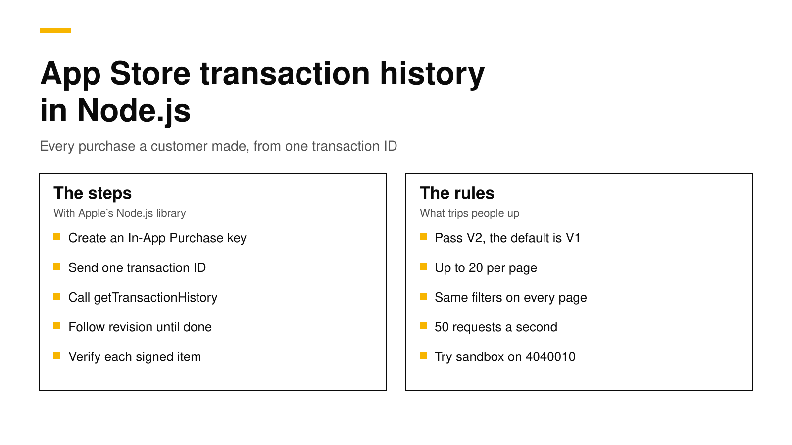

# How to get App Store transaction history in Node.js

To get a customer's App Store purchases on your server, call Apple's Get Transaction History endpoint with any one of that customer's transaction IDs. In Node.js, the simplest way is Apple's own `@apple/app-store-server-library`: create an `AppStoreServerAPIClient` with an In-App Purchase key, call `getTransactionHistory` with `GetTransactionHistoryVersion.V2`, and page through the results until `hasMore` is false. The endpoint returns every product type, including finished consumables, and every state, including refunded and revoked purchases ([Apple](https://developer.apple.com/documentation/appstoreserverapi/get-transaction-history)).

This post covers when you need the history, how to create the key, a complete Node.js example you can run, the filters and paging rules, rate limits, the errors you will meet, and how to keep the data current. Every fact about Apple links its source and was checked on November 9, 2026.



## The short answer

- **Endpoint:** `GET https://api.storekit.apple.com/inApps/v2/history/{transactionId}`, or `api.storekit-sandbox.apple.com` for sandbox. Any transaction ID that belongs to the customer works ([Apple](https://developer.apple.com/documentation/appstoreserverapi/get-transaction-history)).
- **Use V2, not V1.** Apple deprecated V1, which skips finished consumables ([Apple](https://developer.apple.com/documentation/appstoreserverapi/get-transaction-history-v1)). In version 3.1.0 of Apple's Node.js library, `getTransactionHistory` still defaults to V1, so pass `GetTransactionHistoryVersion.V2` yourself.
- **Paging:** each response holds up to 20 transactions, a `revision` token and `hasMore`. Send the same filters with every follow-up request.
- **Rate limit:** 50 requests per second per app in production, enforced over each hour. A `429` response carries a `Retry-After` header ([Apple](https://developer.apple.com/documentation/appstoreserverapi/identifying-rate-limits)).
- **Verify every item.** Each transaction is a signed JWS. Decode it with `SignedDataVerifier` and Apple's root certificate before you trust it.

## When you need the history on your server

StoreKit 2 already gives the app the customer's current entitlements. The server needs its own copy for jobs the device cannot do:

1. **Restoring purchases on a new account or device.** The app sends one transaction ID, and the server finds everything that customer bought.
2. **Answering support tickets.** A customer says they paid, and you want to see every purchase, refund and upgrade in order. Our post on [looking up a purchase by order ID](look-up-purchase-by-order-id.md) covers the case where the customer only has a receipt email.
3. **Backfilling a new backend.** When you move from one system to another, the history rebuilds what each customer owns from Apple's own records.
4. **Reconciling.** A nightly job can compare what Apple says with what your database says, and fix any notification you missed.

If you only need to know whether a subscription is active right now, call Get All Subscription Statuses instead. It returns the latest transaction and renewal info for each subscription group in one request ([Apple](https://developer.apple.com/documentation/appstoreserverapi/get-all-subscription-statuses)).

## Step 1: Create an In-App Purchase key

The App Store Server API accepts only requests signed with a JSON Web Token made from a private key you download from App Store Connect ([Apple](https://developer.apple.com/documentation/appstoreserverapi/creating-api-keys-to-authorize-api-requests)).

1. In App Store Connect, open **Users and Access** and then the **Integrations** tab.
2. Under **Keys** in the sidebar, choose **In-App Purchase**.
3. Click **Generate In-App Purchase Key**, give it a name and download the `.p8` file. Keep the file safe: Apple offers the private key for download only once and does not keep a copy ([Apple](https://developer.apple.com/documentation/appstoreserverapi/creating-api-keys-to-authorize-api-requests)).
4. Write down the **Key ID** and the **Issuer ID** shown on the same page.

Apple says to keep the key out of code repositories and client code, and to revoke it at once if you think it leaked. Store it in your secret manager and load it at runtime.

You also need Apple's root certificate to verify the signed transactions. Download **Apple Root CA - G3** from [Apple's certificate authority page](https://www.apple.com/certificateauthority/) and keep it next to your server code. It is public, so it can live in the repository.

## Step 2: Install the library

```bash
npm install @apple/app-store-server-library
```

The library's README asks for Node 22 or later ([Apple on GitHub](https://github.com/apple/app-store-server-library-node)). It handles the JWT, the HTTP calls, the paging parameters and the JWS verification, so you write very little code.

## Step 3: Fetch and verify the full history

This module fetches every page, verifies each transaction and returns plain objects. We ran it against Apple's sandbox with version 3.1.0 of the library.

```js
// history.mjs
import { readFileSync } from "node:fs";
import {
  AppStoreServerAPIClient, APIException, Environment, GetTransactionHistoryVersion,
  Order, ProductType, SignedDataVerifier,
} from "@apple/app-store-server-library";

const bundleId = "com.example.app";
const appAppleId = 1234567890; // your app's Apple ID, required for production verification

function clientFor(environment) {
  return new AppStoreServerAPIClient(
    process.env.APPLE_IAP_KEY,   // contents of the .p8 file
    process.env.APPLE_KEY_ID,
    process.env.APPLE_ISSUER_ID,
    bundleId,
    environment,
  );
}

const roots = [readFileSync("AppleRootCA-G3.cer")];
const verifierFor = (environment) =>
  new SignedDataVerifier(roots, true, environment, bundleId, environment === Environment.PRODUCTION ? appAppleId : undefined);

export async function getHistory(transactionId, environment = Environment.PRODUCTION) {
  const client = clientFor(environment);
  const verifier = verifierFor(environment);
  const request = { sort: Order.ASCENDING }; // add filters here, and keep them for every page
  const transactions = [];
  let revision = null;
  let page;
  do {
    page = await client.getTransactionHistory(transactionId, revision, request, GetTransactionHistoryVersion.V2);
    for (const signed of page.signedTransactions ?? []) {
      transactions.push(await verifier.verifyAndDecodeTransaction(signed));
    }
    revision = page.revision ?? null;
  } while (page.hasMore);
  return transactions;
}

// Try production first; Apple answers 4040010 (transaction not found) from the wrong environment.
export async function getHistoryAnyEnvironment(transactionId) {
  try {
    return await getHistory(transactionId, Environment.PRODUCTION);
  } catch (e) {
    if (e instanceof APIException && e.apiError === 4040010) return getHistory(transactionId, Environment.SANDBOX);
    throw e;
  }
}
```

Each decoded transaction has the fields you need to rebuild what a customer owns: `transactionId`, `originalTransactionId`, `productId`, `type`, `purchaseDate`, `expiresDate`, `revocationDate`, `price`, `currency`, `appAccountToken` and `environment`. A subscription's renewals share one `originalTransactionId`, so group by it to see each subscription as a single chain.

Where does the first transaction ID come from? A StoreKit 2 app reads `transaction.id` after a purchase and sends it to your server. An older StoreKit 1 app can send its app receipt instead, and the library's `ReceiptUtility.extractTransactionIdFromAppReceipt` pulls a transaction ID out of it without calling Apple.

## Step 4: Filter what you ask for

The request accepts filters, and Apple returns only the transactions that match all of them ([Apple](https://developer.apple.com/documentation/appstoreserverapi/get-transaction-history)).

| Library field | Query parameter | What it does |
|---|---|---|
| `startDate`, `endDate` | `startDate`, `endDate` | Limits by purchase date, in milliseconds since 1970 |
| `productIds` | `productId` | One or more product IDs |
| `productTypes` | `productType` | `AUTO_RENEWABLE`, `NON_RENEWABLE`, `CONSUMABLE` or `NON_CONSUMABLE` |
| `subscriptionGroupIdentifiers` | `subscriptionGroupIdentifier` | One or more subscription groups |
| `inAppOwnershipType` | `inAppOwnershipType` | `PURCHASED` or `FAMILY_SHARED` |
| `revoked` | `revoked` | `true` for only revoked transactions, `false` to leave them out |
| `sort` | `sort` | `ASCENDING` (the default, oldest first) or `DESCENDING` |

Two rules trip people up. First, the filters on every follow-up request must match the first request, or the `revision` token will not line up. Second, Apple sorts by the date a transaction was last modified, not by purchase date. An upgrade or a refund changes that date, so with `ASCENDING` you may see the same transaction twice, the second time with newer data. Store transactions by `transactionId` and let the later copy replace the earlier one.

For a support tool, `sort: Order.DESCENDING` with no other filter shows the newest activity first and is often all you need from the first page.

## Step 5: Respect the rate limit

Apple allows 50 requests per second per app for this endpoint in production and enforces the limit over each hour ([Apple](https://developer.apple.com/documentation/appstoreserverapi/identifying-rate-limits)). A customer with 200 transactions needs 10 requests, so a backfill of 100,000 customers needs at least 100,000 requests, which takes more than half an hour even at the full rate.

For one-off lookups this never matters. For a backfill, run a small fixed number of requests at a time, space them out, and handle `429`. Apple's `RateLimitExceededError` comes with a `Retry-After` header that tells you when to try again, and Apple suggests logging the failure and queuing the job for later. Do not retry in a tight loop, because every retry counts against the same hourly limit.

## Errors you will meet

| Error | What it means | What to do |
|---|---|---|
| `401` | The JWT is wrong: bad key, Key ID, Issuer ID or bundle ID | Check the four values. Our example returns 401 when we run it with a made-up key |
| `4040010` | Transaction ID not found ([Apple](https://developer.apple.com/documentation/appstoreserverapi/transactionidnotfounderror)) | Usually the wrong environment. Try sandbox, as the example does |
| `429` | Rate limit exceeded | Wait for `Retry-After`, then resume from the last `revision` |
| `5xx` | A problem on Apple's side | Retry later. Never treat it as "the customer owns nothing" |

The last row matters most. If your server turns an Apple outage into "no purchases", a paying customer loses access. Treat any error as "unknown" and keep what you already had.

## Keep the data current

The history tells you the past at the moment you ask. To stay current, add App Store Server Notifications V2. Apple sends a notification for each renewal, refund, expiry and billing problem, and your server updates the same records the history created. Our guide to [App Store Server Notifications V2](app-store-server-notifications-v2.md) covers the setup, and our post on [server-side receipt validation](server-side-receipt-validation.md) covers the other App Store Server API calls. On the device, keep a [Transaction.updates listener](storekit-2-transaction-updates.md) running from launch.

A good pattern is to call the history once when you first see a customer, then rely on notifications, and run a nightly job that calls the history again for any customer whose records look wrong.

## Do it with RevenueDot

RevenueDot is an open-source backend for in-app purchases that works with the RevenueCat SDK. It does this work for you on every purchase, and you can read the code.

- **It asks Apple for the full history.** When the SDK posts a purchase, the server calls `GET /inApps/v2/history/{transactionId}` with the app's In-App Purchase key, follows every page, and verifies each transaction ([source](https://github.com/revenuedot/revenuedot/blob/main/apps/server/src/stores/apple/api.ts)). It tries production first and falls back to sandbox when Apple does not know the transaction ([source](https://github.com/revenuedot/revenuedot/blob/main/apps/server/src/stores/apple/index.ts)).
- **It keeps the data current.** RevenueDot processes App Store Server Notifications V2 and updates the same customer. The [App Store guide](../docs/guides/app-store.md) shows where to paste the key and the notification URL.
- **It gives the history back to you.** The REST API lists each subscription's transactions (`GET /v2/projects/{project_id}/subscriptions/{subscription_id}/transactions`, see the [REST reference](../api/rest-v2.md)), and the [full export](../docs/guides/move-projects.md) includes every transaction, so you do not need to call Apple yourself.

To be clear about where this stands: a real App Store sandbox purchase has run end to end against RevenueDot Cloud on a physical iPhone, and RevenueDot processes the live production notifications of one real app. It does not yet have years of production traffic.

New apps install the [RevenueDot SDK](../docs/sdks/README.md). Its code says `import RevenueCat` because it is built from RevenueCat's MIT-licensed SDK, and it needs no RevenueCat account. The [quickstart](../docs/getting-started/quickstart.md) gets a first test purchase working in a few minutes.

**Switching from RevenueCat? Keep your SDK and change one line.** An app that ships the RevenueCat SDK can point its proxy URL at RevenueDot and keep its code, offerings and customers. See the [migration guide](https://revenuedot.app/migrate-from-revenuecat), the [comparison](https://revenuedot.app/compare/revenuedot-vs-revenuecat) and the [RevenueCat fee calculator](https://revenuedot.app/tools/revenuecat-fee-calculator).

[Start for free on RevenueDot Cloud](https://app.revenuedot.app/signup). Building and testing are free, no card needed. Add a card when you go live; Pro costs $0 until your apps make $10,000 a month. See [pricing](https://revenuedot.app/pricing).

## FAQ

### What is the App Store Get Transaction History endpoint?

It is an App Store Server API call that returns a customer's in-app purchase transactions for your app, starting from any one of their transaction IDs. The V2 endpoint returns every product type, including finished consumables, in every state ([Apple](https://developer.apple.com/documentation/appstoreserverapi/get-transaction-history)).

### Should I use Get Transaction History V1 or V2?

Use V2. Apple deprecated V1, which leaves out finished consumable purchases ([Apple](https://developer.apple.com/documentation/appstoreserverapi/get-transaction-history-v1)). In Apple's Node.js library, pass `GetTransactionHistoryVersion.V2`, because the method still defaults to V1.

### How many transactions does each page return?

Up to 20. Each response includes a `revision` token and `hasMore`. Send the token with the same filters to get the next page, and stop when `hasMore` is false ([Apple](https://developer.apple.com/documentation/appstoreserverapi/get-transaction-history)).

### Why does Apple say the transaction ID was not found?

Error `4040010` usually means you called the wrong environment, such as production for a sandbox purchase. Call the other environment, or read the `environment` field of the transaction the app sent you ([Apple](https://developer.apple.com/documentation/appstoreserverapi/transactionidnotfounderror)).

### Does the transaction history include refunds?

Yes. The endpoint returns refunded and revoked transactions, with a `revocationDate` and a reason. Set `revoked` to `false` to leave them out, or to `true` to get only them ([Apple](https://developer.apple.com/documentation/appstoreserverapi/get-transaction-history)).

**About RevenueDot.** RevenueDot is an open-source (AGPL-3.0) backend for in-app purchases and subscriptions on the App Store, Google Play and the web. Start for free on [RevenueDot Cloud](https://app.revenuedot.app/signup): Pro costs $0 until your apps make $10,000 a month, then 0.5% of revenue above $10,000, never more than $999 a month. New apps install the [RevenueDot SDK](../docs/sdks/README.md) and pass their key. Apps that ship the RevenueCat SDK point its proxy URL at RevenueDot and keep their code, offerings and customers. Read the [quickstart](../docs/getting-started/quickstart.md) or the code on [GitHub](https://github.com/revenuedot/revenuedot).
