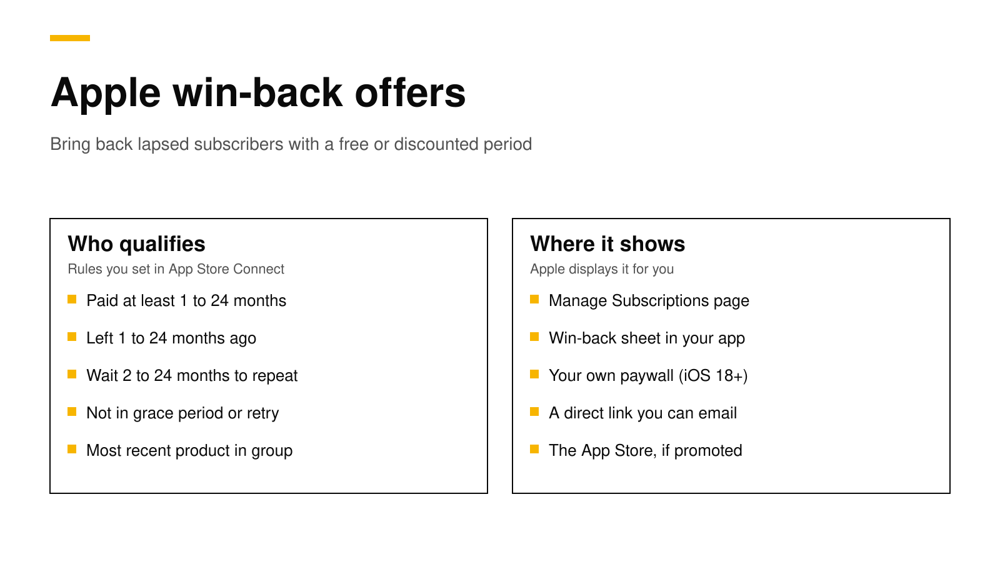

# Apple win-back offers: setup, eligibility and StoreKit code

A win-back offer is a free or discounted period that Apple shows to people whose subscription to your app has ended. You create it in App Store Connect and choose who qualifies: how long they paid, how long ago they left, and how long they must wait between offers ([Apple](https://developer.apple.com/help/app-store-connect/manage-subscriptions/set-up-win-back-offers)). Apple then shows it for you on the Manage Subscriptions page, in a sheet inside your app on iOS 18 and later, and on the App Store if you promote it. Unlike promotional offers, a win-back offer needs no signature from your server.

This post covers the eligibility rules and limits, the setup steps, the StoreKit 2 code for a custom paywall, how to test it, what your server sees, and how Google Play handles the same idea. Every fact about Apple, Google and RevenueCat links its source and was checked on November 2, 2026.



## The short answer

- **Who sees it:** customers whose subscription has an expiration date in the past and is not set to renew ([Apple](https://developer.apple.com/documentation/storekit/supporting-win-back-offers-in-your-app)). A subscription in a billing grace period or billing retry is not eligible ([Apple](https://developer.apple.com/documentation/storekit/product/subscriptioninfo/renewalinfo/eligiblewinbackofferids)).
- **Rules you set:** a minimum paid duration from 1 to 24 months or 3 to 5 years, time since last subscribed from 1 to 24 months, and an optional wait of 2 to 24 months between offers ([Apple](https://developer.apple.com/help/app-store-connect/manage-subscriptions/set-up-win-back-offers)).
- **Where it appears:** the Manage Subscriptions page, the win-back sheet in your app (iOS 18, iPadOS 18, macOS 15 or later), a direct link you can email, and the App Store when you promote it.
- **Code:** with no code, StoreKit shows Apple's sheet at launch. For your own paywall, read `eligibleWinBackOfferIDs` and add `.winBackOffer(offer)` to the purchase.
- **Handle redemptions you did not start.** Most redemptions happen outside your purchase flow, so your app needs a `Transaction.updates` listener and your server needs App Store Server Notifications.

## Why win-back offers matter

Every subscription app loses customers. Some leave on purpose, and some leave because a card expired and they never noticed. Bringing a past subscriber back usually costs less than finding a new one, because they already know the app.

Before iOS 18, you had two tools for this on the App Store. Promotional offers needed a signature from your server and worked only inside your app. Offer codes needed you to reach the customer some other way. Win-back offers fill the gap: Apple decides who is eligible from rules you set, signs nothing on your side, and shows the offer in places your app cannot reach, such as the customer's subscription settings.

## The rules and limits in App Store Connect

You create win-back offers per subscription product, not per subscription group, and only after App Review has approved that subscription ([Apple](https://developer.apple.com/help/app-store-connect/manage-subscriptions/set-up-win-back-offers)). Customers qualify only for their most recently lapsed product in each group.

| Setting | Allowed values |
|---|---|
| Offer type | Pay as you go, pay up front, or free |
| Minimum paid duration | 1 to 24 months, or 3, 4 or 5 years |
| Time since last subscribed | A range between 1 and 24 months, such as 5 to 11 months |
| Wait between offers | Optional, 2 to 24 months |
| Priority | Normal or high, which affects how Apple ranks the offer |
| Dates | Starts at the earliest one day after today, and runs at least 3 days |
| Limits | Up to 350 offers per subscription, and 5 running at once per storefront |

The reference name, offer identifier and price cannot change after you create the offer ([Apple](https://developer.apple.com/help/app-store-connect/manage-subscriptions/set-up-win-back-offers)). The offer identifier appears in transactions and renewal info, so pick a clear one, such as `comeback_50_3m`.

When several offers overlap, Apple chooses one to show based on price, duration and the customer's tenure. To appear on your App Store product page and in Apple's editorial placements, you must promote the offer, which needs an approved subscription image that is not your app icon or a screenshot ([Apple](https://developer.apple.com/help/app-store-connect/manage-subscriptions/set-up-win-back-offers)).

## How to set one up

1. **Pick the product.** Choose the subscription most lapsed customers had, usually your monthly or annual plan.
2. **Decide the offer.** A common start is a discount for one to three months, or one free month for people who paid at least six months.
3. **Create it in App Store Connect.** Open the subscription, add a win-back offer, and fill in the reference name, offer identifier, dates, priority, regions, eligibility and price.
4. **Check Streamlined Purchasing.** It is on by default, which means customers can finish the purchase outside your app and your app receives a completed transaction ([Apple](https://developer.apple.com/documentation/storekit/supporting-win-back-offers-in-your-app)).
5. **Save the direct link.** App Store Connect creates a link in the form `https://apps.apple.com/win-back/<offer Apple ID>`. Apple suggests storing it with the offer identifier on your server.
6. **Make sure your app handles outside purchases.** Start a `Transaction.updates` listener at launch. Our post on [Transaction.updates](storekit-2-transaction-updates.md) shows a complete store class.

## Show the offer in your own paywall

If you do nothing, StoreKit shows Apple's win-back sheet when the app launches for an eligible customer ([Apple](https://developer.apple.com/documentation/storekit/merchandising-win-back-offers-in-your-app)). If you would rather show the offer in your own paywall, suppress that sheet and use the offer data yourself.

To suppress the sheet, read StoreKit messages at launch and skip the one whose reason is `.winBackOffer`:

```swift
import StoreKit
import SwiftUI

struct RootView: View {
    @Environment(\.displayStoreKitMessage) private var displayStoreMessage

    var body: some View {
        ContentView()
            .task {
                for await message in StoreKit.Message.messages {
                    // Show every App Store message except the win-back sheet.
                    if message.reason != .winBackOffer {
                        try? displayStoreMessage(message)
                    }
                }
            }
    }
}
```

To find the best offer for this customer and buy it, compare the renewal info's eligible IDs with the product's offers. Apple sorts `eligibleWinBackOfferIDs` with the best offer first ([Apple](https://developer.apple.com/documentation/storekit/product/subscriptioninfo/renewalinfo/eligiblewinbackofferids)):

```swift
func bestWinBackOffer(for product: Product) async -> Product.SubscriptionOffer? {
    guard let subscription = product.subscription,
          let status = try? await subscription.status.first,
          case .verified(let renewalInfo) = status.renewalInfo else { return nil }

    // Best offer first; empty when the customer is not eligible.
    for id in renewalInfo.eligibleWinBackOfferIDs {
        if let offer = subscription.winBackOffers.first(where: { $0.id == id }) {
            return offer
        }
    }
    return nil
}

func buy(_ product: Product, with offer: Product.SubscriptionOffer) async throws {
    let result = try await product.purchase(options: [.winBackOffer(offer)])
    if case .success(.verified(let transaction)) = result {
        // Grant access, then finish.
        await transaction.finish()
    }
}
```

`winBackOffers` lists every offer you configured, whether or not the customer qualifies, so always filter by `eligibleWinBackOfferIDs` ([Apple](https://developer.apple.com/documentation/storekit/product/subscriptioninfo/winbackoffers)). If you use StoreKit's `SubscriptionStoreView`, it shows eligible win-back offers on its own, and `preferredSubscriptionOffer(_:)` picks one when several apply ([Apple](https://developer.apple.com/documentation/storekit/merchandising-win-back-offers-in-your-app)).

With the RevenueCat SDK, the same steps are `eligibleWinBackOffers(forPackage:)` and a purchase with `PurchaseParams` that includes `winBackOffer`. RevenueCat lists iOS SDK 5.10.0 or later for paywall redemption, and iOS 18 or later on the device ([RevenueCat](https://www.revenuecat.com/docs/subscription-guidance/subscription-offers/ios-subscription-offers)).

## Redemptions outside your app

Customers can redeem a win-back offer from the direct link, the App Store or their subscription settings. With Streamlined Purchasing on, the purchase completes there, and your app gets the transaction through `Transaction.updates` if it is running, or through `Transaction.all` and `currentEntitlements` on the next launch ([Apple](https://developer.apple.com/documentation/storekit/supporting-win-back-offers-in-your-app)).

If you turn Streamlined Purchasing off, StoreKit opens your app and sends a `PurchaseIntent` instead, so you can ask the customer to sign in before you complete the purchase. Your latest approved build must use the `PurchaseIntent` API before you can turn it off, and redemptions from the subscription settings page always behave as if it were on ([Apple](https://developer.apple.com/documentation/storekit/supporting-win-back-offers-in-your-app)).

Before you email the direct link, check that the customer qualifies. Apple's App Store Server API returns `eligibleWinBackOfferIds` in the renewal info from Get All Subscription Statuses, and Apple recommends sending the link only to eligible customers ([Apple](https://developer.apple.com/documentation/storekit/supporting-win-back-offers-in-your-app)).

## What your server sees

A redeemed win-back offer is a new purchase of the same subscription. In the signed transaction, `offerType` is `4` and `offerIdentifier` is the ID you chose ([Apple](https://developer.apple.com/documentation/storekit/supporting-win-back-offers-in-your-app)). App Store Server Notifications report it with the rest of your subscription events. Store the offer ID on each period, so you can later count how many customers each offer brought back and how many stayed after it ended.

## How to test win-back offers

- **In Xcode,** add win-back offers to a StoreKit configuration file. This needs no App Store Connect setup ([Apple](https://developer.apple.com/documentation/storekit/product/purchaseoption/winbackoffer(_:))).
- **In the sandbox,** a test account qualifies once it owned the subscription and the subscription expired; a monthly sandbox subscription expires in 5 minutes by default. Settings, Developer, Sandbox Apple Account has a Win-Back Offer Sheet toggle and a Test Transactions page that redeems an offer outside the app ([Apple](https://developer.apple.com/documentation/storekit/testing-win-back-offers-in-the-sandbox-environment)).
- **In TestFlight,** only your own paywall code can be tested. Apple says the win-back sheet and App Store redemption are not available there.

Our [testing guide](sandbox-testing-in-app-purchases.md) covers sandbox accounts and the other environments.

## Google Play's version

Google Play has no separate win-back offer type. Instead, a subscription offer can use **developer determined** eligibility, where "you solely decide the business logic and determine eligibility in your app," and Google gives win-back offers for lapsed subscribers as an example. Those offers can be bought only inside your app ([Google](https://support.google.com/googleplay/android-developer/answer/12154973?hl=en)). So on Android, your server decides who is a lapsed subscriber, and your paywall shows the offer. Our post on [base plans and offers](google-play-base-plans-and-offers.md) explains how offers attach to a subscription.

## How RevenueDot supports win-back offers

RevenueDot is an open-source backend for in-app purchases that works with the RevenueCat SDK. The SDK does the win-back work on the device, so your app code does not change ([Win-back offers](../docs/guides/win-back-offers.md)).

- **It grants access.** A win-back purchase arrives as a resubscription with the same original transaction ID, and the entitlement is active again.
- **It records the offer.** Each subscription period and transaction stores the offer type (`win_back`) and the offer ID. Webhooks send the ID as `offer_code`, and exports include both.
- **It keeps Apple's eligibility list.** RevenueDot stores `eligibleWinBackOfferIds` each time it reads the renewal info, and `GET /v2/projects/{project_id}/customers/{customer_id}/win_back_offers` returns it, so you email the direct link only to customers who qualify.
- **It sends the emails.** [Win-back campaigns](../docs/guides/win-back-campaigns.md) email customers whose subscription ended, with a button to the Apple subscriptions page where their eligible offers appear.

To be clear about where this stands: the flow is tested with signed test transactions and a mocked App Store, and no real win-back offer has been redeemed against RevenueDot yet ([known limits](../docs/guides/win-back-offers.md#known-limits)).

New apps install the [RevenueDot SDK](../docs/sdks/README.md). Its code says `import RevenueCat` because it is built from RevenueCat's MIT-licensed SDK, and it needs no RevenueCat account. The [quickstart](../docs/getting-started/quickstart.md) gets a first test purchase working in a few minutes.

**Switching from RevenueCat? Keep your SDK and change one line.** An app that ships the RevenueCat SDK can point its proxy URL at RevenueDot and keep its code, offerings and customers, including its win-back offer code. See the [migration guide](https://revenuedot.app/migrate-from-revenuecat), the [comparison](https://revenuedot.app/compare/revenuedot-vs-revenuecat) and the [RevenueCat fee calculator](https://revenuedot.app/tools/revenuecat-fee-calculator).

[Start for free on RevenueDot Cloud](https://app.revenuedot.app/signup). Building and testing are free, no card needed. Add a card when you go live; Pro costs $0 until your apps make $10,000 a month. See [pricing](https://revenuedot.app/pricing).

## FAQ

### What is an Apple win-back offer?

A free or discounted period for an auto-renewable subscription, shown to customers whose subscription has ended and will not renew ([Apple](https://developer.apple.com/documentation/storekit/supporting-win-back-offers-in-your-app)). You set the price, duration and eligibility in App Store Connect, and Apple shows it in the app, on the App Store and in subscription settings.

### Do win-back offers need a server signature?

No. Promotional offers need a signature from your server, but win-back offers do not. StoreKit checks eligibility from Apple's own records, and your app adds the offer with the `winBackOffer` purchase option.

### Which iOS versions support win-back offers?

The in-app sheet and the StoreKit APIs need iOS 18, iPadOS 18 or macOS 15. Customers on iOS 14.3 or later still see eligible offers on the Manage Subscriptions page ([Apple](https://developer.apple.com/help/app-store-connect/manage-subscriptions/set-up-win-back-offers)).

### Who is eligible for a win-back offer?

Customers who meet the paid duration and time-since-lapse rules you set, on their most recently lapsed product in the group, and who have not redeemed the same offer within your wait period. Subscriptions in a billing grace period or billing retry are not eligible ([Apple](https://developer.apple.com/documentation/storekit/product/subscriptioninfo/renewalinfo/eligiblewinbackofferids)).

### How do I offer win-back discounts on Google Play?

Create a subscription offer with developer determined eligibility, decide on your server who is a lapsed subscriber, and show the offer in your app ([Google](https://support.google.com/googleplay/android-developer/answer/12154973?hl=en)). Google Play does not pick eligible customers for you as Apple does.

**About RevenueDot.** RevenueDot is an open-source (AGPL-3.0) backend for in-app purchases and subscriptions on the App Store, Google Play and the web. Start for free on [RevenueDot Cloud](https://app.revenuedot.app/signup): Pro costs $0 until your apps make $10,000 a month, then 0.5% of revenue above $10,000, never more than $999 a month. New apps install the [RevenueDot SDK](../docs/sdks/README.md) and pass their key. Apps that ship the RevenueCat SDK point its proxy URL at RevenueDot and keep their code, offerings and customers. Read the [quickstart](../docs/getting-started/quickstart.md) or the code on [GitHub](https://github.com/revenuedot/revenuedot).
