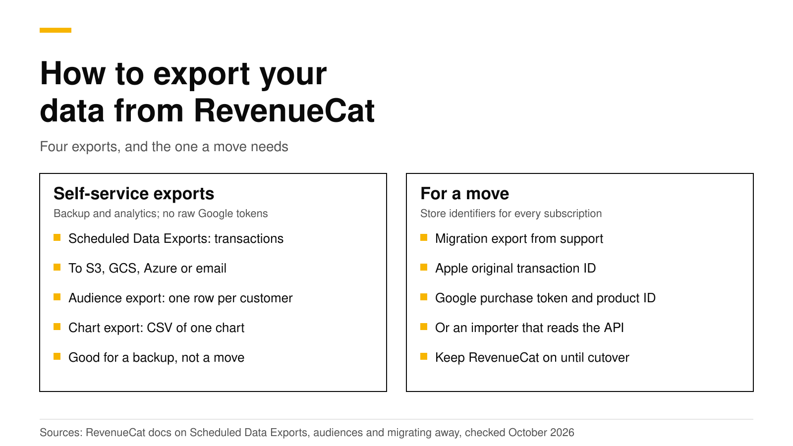

# How to export your data from RevenueCat

RevenueCat gives you three self-service exports and one export that its support team prepares by hand. Scheduled Data Exports send transaction files to your own storage, audience exports give one CSV row per customer, and chart exports give the numbers behind a chart. None of the three self-service exports is enough to move subscribers to another backend, because none contains raw Google Play purchase tokens. For a move you either ask RevenueCat support for a migration file, or you use an importer that reads RevenueCat's API and looks the tokens up with your own Google credentials.

This post explains what each export contains, which one you need for a backup, for analytics and for a move, and the order of steps that keeps every subscriber's access. Every fact about RevenueCat links its documentation and was checked on October 19, 2026.



## The short answer

- **Scheduled Data Exports** send transaction rows (revenue, products, stores, app user IDs, refunds and store transaction IDs) to S3, Google Cloud Storage, Azure or email as CSV or Parquet, once a day by default ([RevenueCat](https://www.revenuecat.com/docs/integrations/scheduled-data-exports)).
- **Audience exports** give one row per customer with about 60 columns, such as status and total spent, as a zipped, semicolon-separated CSV ([RevenueCat](https://www.revenuecat.com/docs/dashboard-and-metrics/audiences)).
- **Chart exports** give the aggregated values behind one chart view as a CSV ([RevenueCat](https://www.revenuecat.com/docs/dashboard-and-metrics/charts)).
- **A migration export** is prepared by RevenueCat support. RevenueCat says that moving to another provider usually needs it, because the self-service exports do not include raw Google Play purchase tokens ([RevenueCat](https://www.revenuecat.com/docs/revenuecat-support/common-tickets/export-data-or-migrate-away)).
- **Do not delete the RevenueCat project early.** RevenueCat warns that deletion cannot be undone, and older app versions may keep calling it for months.

## Why export your data at all?

Three reasons come up again and again on developer forums and in our own conversations with teams that run apps on both stores.

1. **A backup you control.** Your purchase history lives with your vendor. A daily copy in your own bucket protects you if you lose access to the dashboard, if a teammate deletes a project, or if the vendor changes its terms or shuts down.
2. **Analytics in your own warehouse.** Teams that join purchase data with ad spend, product analytics or support tickets need raw rows, not charts.
3. **A move to another backend.** When the monthly bill grows (RevenueCat charges 1% of all tracked revenue once you pass $2,500 a month, per its [pricing page](https://www.revenuecat.com/pricing)), some teams move to a cheaper or self-hosted backend. A move needs the store identifiers that let the new backend ask Apple and Google about each subscription.

Each reason needs a different export, so it helps to know what each one holds.

## What each RevenueCat export contains

| Export | What one row is | Format and delivery | Good for | Enough for a move? |
|---|---|---|---|---|
| Scheduled Data Exports | One transaction | CSV (gzip) or Parquet, to S3, GCS, Azure or email, daily by default | Backup, warehouse | No: no raw Google purchase tokens |
| Audience export | One customer | Zipped CSV with semicolons, link by email for 30 days | Account records, CRM | No: no store identifiers |
| Chart export | One point on a chart | CSV from the chart screen | Board decks, finance | No |
| Migration export | One subscription | Files from support, through an access-controlled link | Moving providers | Yes, if you ask for the right columns |

The sources for this table are RevenueCat's pages on [Scheduled Data Exports](https://www.revenuecat.com/docs/integrations/scheduled-data-exports), [audiences](https://www.revenuecat.com/docs/dashboard-and-metrics/audiences) and [exporting data or migrating away](https://www.revenuecat.com/docs/revenuecat-support/common-tickets/export-data-or-migrate-away).

### Scheduled Data Exports

This is the export to set up first, even if you never plan to leave. RevenueCat delivers transaction files to a storage bucket or an email address on a schedule. Its documentation lists Amazon S3, Google Cloud Storage, Azure Blob Storage and email as destinations, and CSV or Parquet as formats. CSV files are gzip-compressed and come as one file per delivery unless you turn on splitting for exports over about 1 GB. The default schedule is once a day, and Enterprise plans can choose every 4, 6, 8, 12 or 24 hours ([RevenueCat](https://www.revenuecat.com/docs/integrations/scheduled-data-exports)).

The transactions feed has columns such as `rc_original_app_user_id`, `price_in_usd` and `start_time`, with every time in UTC. RevenueCat's guide on leaving says these rows include store transaction identifiers such as Google Play order IDs, but not raw Google Play purchase tokens ([RevenueCat](https://www.revenuecat.com/docs/revenuecat-support/common-tickets/export-data-or-migrate-away)). The same documentation notes one gap: Google subscriptions that expired more than 60 days before an app moved onto RevenueCat have no transaction history in these files.

RevenueCat lists Scheduled Data Exports as available to everyone who signed up after September 2023, and to its legacy Grow, Pro and Enterprise plans ([RevenueCat](https://www.revenuecat.com/docs/integrations/scheduled-data-exports)).

### Audience exports

An audience is a saved customer filter in RevenueCat's dashboard. **Export all** sends you an email with a link to a `.zip` that holds one CSV, one row per customer, with about 60 columns such as `app_user_id`, `latest_product`, `total_spent` and `status`. Two details trip people up. The CSV uses semicolons, not commas, so a spreadsheet may show everything in one column until you change the delimiter. You must also wait 30 minutes between exports, and each link lasts 30 days ([RevenueCat](https://www.revenuecat.com/docs/dashboard-and-metrics/audiences)).

This export is the right place for customer attributes you set from your app, such as an email address. RevenueCat says a support-made migration file does not include reserved or custom attributes on its own, so export them here or through Scheduled Data Exports if your next backend needs them ([RevenueCat](https://www.revenuecat.com/docs/revenuecat-support/common-tickets/export-data-or-migrate-away)).

### Chart exports

Every chart in the dashboard can be downloaded as a CSV of its current view, with the same date range, filters and segments. The same numbers are available from the Charts and Metrics endpoints of RevenueCat's [API v2](https://www.revenuecat.com/docs/api-v2). These files are summaries, so they help finance and reporting but not a move.

### The migration export from support

A move needs identifiers that let the new backend ask the store for the current state of each subscription. RevenueCat's guide lists them per store ([RevenueCat](https://www.revenuecat.com/docs/revenuecat-support/common-tickets/export-data-or-migrate-away)):

- **App Store:** the app user ID and Apple's original transaction ID.
- **Google Play:** the app user ID, the raw purchase token and the product ID.
- **Stripe and others:** the provider's subscription IDs.

RevenueCat asks you to prepare a few things before you open a ticket. You need the destination's import format and column names, a list of every project, app and store, whether you want production only or sandbox too, the date range, and any extra fields such as customer attributes. The project owner has to send or approve the request. Support delivers the files through a link that expires, and RevenueCat asks you to treat receipts, tokens and transaction IDs as sensitive customer data.

## How to move subscribers without losing access

Exports are one part of a move. The order of steps matters more, because the risk in a move is a paying customer who suddenly loses access. RevenueCat's own guide gives the main warnings: keep RevenueCat connected until the new backend has checked the imported subscriptions and your released app uses it, test with a sample from each store first, and remember that older app versions on customers' phones keep calling RevenueCat ([RevenueCat](https://www.revenuecat.com/docs/revenuecat-support/common-tickets/export-data-or-migrate-away)).

A safe order looks like this:

1. **Turn on Scheduled Data Exports now.** Even if the move is months away, a daily copy in your own bucket costs nothing extra and gives you a full archive.
2. **Import into the new backend while RevenueCat keeps running.** Copy the catalog, customers and subscriptions, and keep your public SDK keys if the new backend supports that.
3. **Add your store credentials to the new backend.** RevenueCat cannot export your App Store in-app purchase key or Google Play service account, so you add them again yourself.
4. **Run both side by side.** Send App Store Server Notifications and Google Play notifications to the new backend and forward them to RevenueCat, so both stay current.
5. **Ship an app update** that points the SDK at the new backend. Customers on old versions keep using RevenueCat, which stays correct because notifications are forwarded.
6. **Compare the two systems** until no differences remain and few customers run old versions.
7. **Cut over.** Move your webhooks, stop forwarding, and only then stop RevenueCat. Keep the exports.

## How RevenueDot imports a RevenueCat project

RevenueDot is an open-source backend that works with the RevenueCat SDK, so an app switches by changing the SDK's proxy URL. Its importer does steps 2 and 3 above without a support ticket. You run it with one command and a RevenueCat secret API key:

```bash
npx revenuedot import --from-revenuecat
```

The importer reads RevenueCat's API v2 and copies apps, public SDK keys, products, entitlements, offerings, customers, attributes, subscriptions, one-time purchases and revenue history. It records no events and sends no webhooks, so your backend does not see a second copy of every old purchase ([migration guide](../docs/migrate/README.md)).

**The Google Play token gap.** RevenueCat's API gives Google Play order IDs, not purchase tokens. RevenueDot fills the gap in four ways, and the customer keeps access the whole time ([importer guide](../docs/migrate/importer.md#google-play-purchase-tokens)):

1. With your Google service account, the next import looks the token up from the order ID through Google's API.
2. You pass a CSV with `--google-tokens tokens.csv`, for example the migration file from RevenueCat support. The importer accepts column names such as `purchase_token`, `order_id` and `app_user_id`.
3. Google's next renewal notification carries the token.
4. The app's `syncPurchases()` call after the update sends it.

**What the importer does not copy.** Paywalls, targeting rules, experiments and virtual currency balances stay in RevenueCat, and you rebuild them in RevenueDot. Refunded subscriptions import as expired, because RevenueCat's API v2 subscription object has no refund field. The full list is in [What differs from RevenueCat](../docs/migrate/what-differs.md).

**How it is tested.** The importer runs in tests against a fake RevenueCat API whose responses are checked against RevenueCat's published OpenAPI schemas. A production app has run the side-by-side setup since October 2, 2026, with RevenueDot processing its live store notifications and forwarding each one to RevenueCat. A real App Store sandbox purchase has run end to end on a physical iPhone. No real Google Play purchase has run end to end yet, so test a Play sample before you cut over ([migration guide](../docs/migrate/README.md#what-is-tested)).

The steps for running both systems at once are in [Dual run](../docs/migrate/dual-run.md), and the last checks are in the [cutover checklist](../docs/migrate/cutover-checklist.md). For a page that walks through the whole switch, see [migrate from RevenueCat](https://revenuedot.app/migrate-from-revenuecat).

## Getting your data out of RevenueDot

Ask any new vendor the same question before you move: how do I leave? RevenueDot answers it with one archive. **Project settings, Export and move, Export project** (or `npx revenuedot export`) builds a `.tar` of every table the project owns, one JSON line per row, with a manifest that lists the row count and a checksum for each table ([export guide](../docs/guides/move-projects.md#export-everything)). The same archive can be loaded into a self-hosted RevenueDot server, because the server is open source under AGPL-3.0. RevenueDot also has scheduled data exports of transactions, customers, subscriptions and events to Amazon S3, Cloudflare R2, Google Cloud Storage or Azure Blob Storage ([integrations](../docs/guides/integrations.md#scheduled-data-exports)).

On cost, RevenueCat charges 1% of all monthly tracked revenue once you reach $2,500 ([RevenueCat](https://www.revenuecat.com/pricing)). RevenueDot Cloud's Pro plan costs $0 until your apps make $10,000 a month, then 0.5% of revenue above $10,000, never more than $999 a month. You can check your own numbers in the [RevenueCat fee calculator](https://revenuedot.app/tools/revenuecat-fee-calculator), read the [RevenueDot vs RevenueCat comparison](https://revenuedot.app/compare/revenuedot-vs-revenuecat), which also says where RevenueCat is stronger, or see [pricing](https://revenuedot.app/pricing).

[Start for free on RevenueDot Cloud](https://app.revenuedot.app/signup). Building and testing are free, no card needed. Add a card when you go live; Pro costs $0 until your apps make $10,000 a month.

## FAQ

### Can I export all my subscribers from RevenueCat?

Yes. An audience export with no filters gives one row per customer, and Scheduled Data Exports give every transaction ([RevenueCat](https://www.revenuecat.com/docs/dashboard-and-metrics/audiences)). Neither includes raw Google Play purchase tokens, so for a move you also need a migration file from support or an importer that looks the tokens up.

### Does RevenueCat export Google Play purchase tokens?

Not in its self-service exports. RevenueCat says Scheduled Data Exports include Google Play order IDs but not raw purchase tokens, and that you should ask support for a migration export if you need them ([RevenueCat](https://www.revenuecat.com/docs/revenuecat-support/common-tickets/export-data-or-migrate-away)).

### Will my subscribers lose access if I leave RevenueCat?

Not if you keep both systems running until your new app version is widely installed. Subscriptions live in Apple's and Google's systems, not in RevenueCat, so a new backend can read their state with the right identifiers. The risk comes from turning RevenueCat off while old app versions still call it.

### Should I delete my RevenueCat project after moving?

Wait. RevenueCat warns that deletion cannot be undone and asks you to wait until the new provider has checked the imported data ([RevenueCat](https://www.revenuecat.com/docs/revenuecat-support/common-tickets/export-data-or-migrate-away)). Keep your exports in your own storage either way.

### Can I move back to RevenueCat later?

Yes. RevenueCat can import existing subscriptions from store identifiers ([RevenueCat](https://www.revenuecat.com/docs/migrating-to-revenuecat/migrating-existing-subscriptions)), and RevenueDot's full export gives you every subscription with its store transaction IDs and Google purchase tokens. Your app can also call `syncPurchases()` once after the switch to send each device's purchases to the new backend.

**About RevenueDot.** RevenueDot is an open-source (AGPL-3.0) backend for in-app purchases and subscriptions on the App Store, Google Play and the web. Start for free on [RevenueDot Cloud](https://app.revenuedot.app/signup): Pro costs $0 until your apps make $10,000 a month, then 0.5% of revenue above $10,000, never more than $999 a month. New apps install the [RevenueDot SDK](../docs/sdks/README.md) and pass their key. Apps that ship the RevenueCat SDK point its proxy URL at RevenueDot and keep their code, offerings and customers. Read the [quickstart](../docs/getting-started/quickstart.md) or the code on [GitHub](https://github.com/revenuedot/revenuedot).
