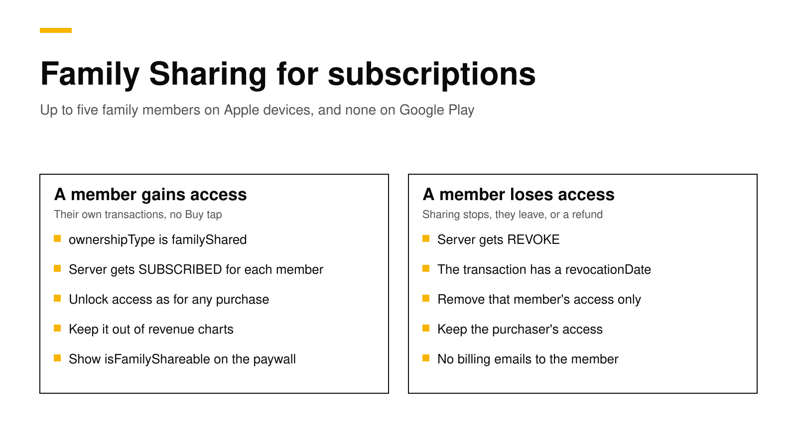

# Family Sharing for in-app subscriptions: iOS setup and Android

Apple Family Sharing lets one customer share an auto-renewable subscription or a non-consumable with up to five family members. You turn it on per product in App Store Connect, and you cannot turn it off again. Each family member then gets their own transaction with the ownership type `familyShared`, so your app unlocks access as it does for any purchase, and your server must also handle the `REVOKE` notification when sharing stops. Google Play has no matching feature for in-app purchases.

This post is for apps that sell subscriptions on the App Store and Google Play, often built with Flutter, React Native or Expo. It covers the decision to turn it on, the StoreKit 2 and server code, what to do on Android, how shared access affects your metrics, and how to test. Every fact about Apple and Google links its source and was checked on November 23, 2026.



## The short answer

- **Up to five family members.** They share the purchaser's subscription on their own Apple devices ([Apple](https://developer.apple.com/documentation/storekit/supporting-family-sharing-in-your-app)).
- **It is one-way.** Once you turn on Family Sharing for a product, you cannot turn it off ([App Store Connect Help](https://developer.apple.com/help/app-store-connect/configure-in-app-purchase-settings/turn-on-family-sharing-for-in-app-purchases)).
- **No special purchase code.** Each member gets their own transactions, so you process them as usual.
- **Handle loss of access.** Your server gets `REVOKE`, and the app sees a transaction with a `revocationDate`.
- **Tell buyers.** Use `isFamilyShareable` to show on the paywall that a plan can be shared.
- **Google Play does not share in-app purchases.** For a family plan on Android, you build it with your own accounts.

## Should you turn it on?

Apple's view is that sharing "can make your content or service more appealing to subscribers, and may encourage conversion to a paid subscription, increase customer engagement, and improve retention" ([Apple](https://developer.apple.com/documentation/storekit/supporting-family-sharing-in-your-app)). The cost is that some people who would have bought their own subscription will use a family member's instead.

Because the switch cannot be undone, many apps do not turn it on for their main plan. They create a separate, more expensive family plan in the same subscription group and turn on sharing only for that product. Apple suggests this pattern: include Family Sharing in the plan's display name, and you can note the price difference on the sign-up screen ([Apple](https://developer.apple.com/app-store/subscriptions/)). The customer then picks "Pro" or "Pro Family", and your existing subscribers keep the plan they bought.

Two more facts help the decision. The purchaser can always turn off sharing in their own subscription settings. And if you also turn on multiseat purchases for a subscription, only the group purchaser can share it with family, while the extra seats are for individual use ([App Store Connect Help](https://developer.apple.com/help/app-store-connect/configure-in-app-purchase-settings/turn-on-family-sharing-for-in-app-purchases)).

## Turn it on in App Store Connect

1. In **Apps**, select your app.
2. In the sidebar, under **Monetization**, click **Subscriptions**, then the subscription group.
3. Select the subscription.
4. Scroll to the **Family Sharing** section and click **Turn On**.
5. Read the terms in the dialog and click **Confirm**.

You need the Account Holder or App Manager role. The steps for non-consumables are the same, under **In-App Purchases** ([App Store Connect Help](https://developer.apple.com/help/app-store-connect/configure-in-app-purchase-settings/turn-on-family-sharing-for-in-app-purchases)).

## What changes in your app

Very little. Apple says that each family member "gets their own unique receipts and transactions", and that you process them "in the same way you already handle purchases" ([Apple](https://developer.apple.com/documentation/storekit/supporting-family-sharing-in-your-app)). For a shared subscription, the family member never taps Buy. The transaction simply appears on their device, so the app must listen for transactions from launch, not only on the paywall.

In StoreKit 2, every transaction has an `ownershipType`, which is `.purchased` for the buyer and `.familyShared` for family members. When sharing stops, the transaction gains a `revocationDate`. Apple says the App Store revokes a transaction when it refunds it, when it removes it from Family Sharing, or when the customer loses access through a group ([Apple](https://developer.apple.com/documentation/storekit/transaction/revocationdate)).

```swift
import StoreKit

// Start at launch, for example in your App's init, so shared purchases that arrive later are seen.
func listenForTransactions() -> Task<Void, Never> {
  Task.detached {
    for await result in Transaction.updates {
      guard case .verified(let transaction) = result else { continue }
      await refreshAccess()
      await transaction.finish()
    }
  }
}

@MainActor
func refreshAccess() async {
  var hasPro = false
  var isShared = false
  for await result in Transaction.currentEntitlements {
    guard case .verified(let t) = result, t.revocationDate == nil else { continue }
    if t.productType == .autoRenewable {
      hasPro = true
      isShared = isShared || t.ownershipType == .familyShared
    }
  }
  AppState.shared.hasPro = hasPro
  AppState.shared.isFamilyMember = isShared   // for example, hide "Manage subscription" for members
}
```

Apple says that refunded or revoked products do not appear in the current entitlements ([Apple](https://developer.apple.com/documentation/storekit/transaction/currententitlements)), so the extra check on `revocationDate` only makes the intent clear. Our posts on [checking subscription status in StoreKit 2](storekit-2-check-subscription-status.md) and [handling `Transaction.updates`](storekit-2-transaction-updates.md) cover the rest of this code.

A family member did not buy the subscription and does not pay for it. So change your "Manage subscription" screen for them, and do not send them billing messages or win-back offers when the purchaser cancels.

## Show it on the paywall

Apple asks apps to say in the UI whether a product can be shared, and to read `isFamilyShareable` at runtime to find out ([Apple](https://developer.apple.com/documentation/storekit/supporting-family-sharing-in-your-app)). A short line under the plan, such as "Share with up to five family members", is enough.

```swift
let products = try await Product.products(for: ["pro_family_yearly", "pro_yearly"])
for product in products where product.isFamilyShareable {
  print("\(product.displayName) can be shared with family")   // add the line under this plan
}
```

## What your server receives

App Store Server Notifications V2 sends one notification for each family member, not only for the buyer ([Apple](https://developer.apple.com/documentation/storekit/testing-family-sharing)). Apple's list of notification types includes these cases ([Apple](https://developer.apple.com/documentation/appstoreservernotifications/notificationtype)):

| Event | Notification type | Subtype |
|---|---|---|
| A family member gains access after the purchaser subscribes for the first time | `SUBSCRIBED` | `INITIAL_BUY` |
| A family member gains access after the purchaser resubscribes | `SUBSCRIBED` | `RESUBSCRIBE` |
| A family member gets a shared non-consumable | `ONE_TIME_CHARGE` | none |
| A family member loses access | `REVOKE` | none |

The signed transaction in each notification has `inAppOwnershipType` set to `PURCHASED` or `FAMILY_SHARED`. Because each member gets their own transactions, store each member's access as its own row, linked to that member's account. That is correct, because each member's access can end on its own.

Treat `REVOKE` like a refund for that member only. Remove the member's access, keep the purchaser's, and do not send the member a cancellation email that talks about billing. Our [REVOKE](../docs/notifications/apple-revoke.md) and [SUBSCRIBED](../docs/notifications/apple-subscribed.md) pages explain each notification, and the post on [App Store Server Notifications V2](app-store-server-notifications-v2.md) shows how to verify and store them.

## What about Google Play?

Google Play has a Family Library for apps, games, books and films, but its help page says: "You can't share in-app purchases and apps downloaded at no charge with your family members" ([Google Play Help](https://support.google.com/googleplay/answer/7007852?hl=en)). There is no Play Billing setting that shares a subscription, and no notification for it.

So for a family plan on Android, or one that works across both stores, you need your own accounts. The usual design is:

1. Sell a family plan as a normal subscription on both stores, and on the web if you sell there.
2. Let the buyer invite family members by email or with a link, and store the members in your database.
3. When a member signs in, your server checks whether the owner's subscription is active and grants the member access.
4. When the owner's subscription ends, every member loses access.

This also lets an iPhone buyer share with a family member on Android, which Apple's Family Sharing cannot do. The cost is that you build the invite flow and keep the member list yourself. Our post on [sharing one subscription across iOS, Android and the web](share-subscription-across-ios-android-web.md) explains the account side, and [syncing subscription status to your backend](sync-subscription-status-to-your-backend.md) shows how your server learns about the owner's subscription.

## Keep shared access out of your revenue numbers

A family member's transaction looks like a subscription, but it brings in no money. If your charts count it as an active subscriber, your active subscriptions go up and your revenue per subscriber goes down. Exclude transactions with `FAMILY_SHARED` ownership from MRR, active subscriptions, trial conversion and churn, and track them as their own number, for example "family members with access". Our post on [subscription app metrics](subscription-app-metrics.md) defines each of these.

## Test Family Sharing in the sandbox

Apple supports this with Sandbox Test Families ([Apple](https://developer.apple.com/documentation/storekit/testing-family-sharing)):

1. Create two or more sandbox accounts and put them in a Sandbox Test Family in App Store Connect.
2. Buy a shareable product with the first account.
3. Open the app on a device signed in with the second account, and check that the app unlocks and the transaction is `familyShared`. With notifications on in the sandbox, your server gets a `SUBSCRIBED` notification for the member.
4. On the device, go to **Settings → Developer**, select the sandbox account, choose **Manage**, then **Family Sharing**, and select **Stop Sharing Purchases** for the member.
5. Check that the app sees a transaction with a `revocationDate`, and that your server gets `REVOKE`.

Changes to product settings can take up to an hour to reach the sandbox, so wait after you turn on sharing. Our guide to [testing in-app purchases](sandbox-testing-in-app-purchases.md) covers sandbox accounts in general.

## Do it with RevenueDot

RevenueDot is an open-source backend for in-app purchases and subscriptions on the App Store, Google Play and the web. Here is how it handles Family Sharing today:

- **Ownership on every purchase.** RevenueDot reads `inAppOwnershipType` from Apple's signed transaction and stores it, so the SDK's entitlement info and the REST API report whether access is `PURCHASED` or `FAMILY_SHARED`. Webhooks carry `is_family_share` ([webhook events](../api/webhook-events.md)).
- **REVOKE ends the member's access.** RevenueDot verifies Apple's signature, applies the signed transaction, and reads its `revocationDate`. The member's purchase is then treated like a refunded one, and a `CANCELLATION` event follows ([REVOKE](../docs/notifications/apple-revoke.md)).
- **Charts leave it out.** The [charts guide](../docs/guides/charts.md) says that granted access and Family Sharing are excluded from every money and subscription number.
- **Imports keep it.** Moving from RevenueCat keeps the family sharing flag on each subscription ([what moves](../docs/migrate/README.md)).

A purchase that RevenueDot has not seen through the app is applied from a notification only when the app's **Track new purchases from server-to-server notifications** setting is on. Family members usually open the app, which sends their transactions, but turn the setting on if you want their access recorded even before they do.

To be clear about where this stands: a real App Store sandbox purchase has run end to end against RevenueDot Cloud on a physical iPhone, but a Family Sharing purchase has not yet been run through a Sandbox Test Family. The handling above is covered by server tests that use Apple-format transactions and notifications.

New apps install the [RevenueDot SDK](../docs/sdks/README.md). Its code says `import RevenueCat` because it is built from RevenueCat's MIT-licensed SDK, and it needs no RevenueCat account. Our [SwiftUI](swiftui-subscriptions-tutorial.md), [Flutter](flutter-in-app-purchases-tutorial.md) and [React Native and Expo](react-native-expo-subscriptions-tutorial.md) tutorials set up the app side.

**Switching from RevenueCat? Keep your SDK and change one line.** An app that ships the RevenueCat SDK points its proxy URL at RevenueDot and keeps its code, offerings and customers. Its family-shared subscriptions are imported with their ownership type. See [migrating without data loss](migrating-from-revenuecat-without-data-loss.md), the [comparison](https://revenuedot.app/compare/revenuedot-vs-revenuecat) and the [fee calculator](https://revenuedot.app/tools/revenuecat-fee-calculator). RevenueCat is free under $2,500 of monthly tracked revenue and then charges 1% of all of it ([RevenueCat](https://www.revenuecat.com/pricing)).

[Start for free on RevenueDot Cloud](https://app.revenuedot.app/signup). Building and testing are free, no card needed. Add a card when you go live; Pro costs $0 until your apps make $10,000 a month. See [pricing](https://revenuedot.app/pricing).

## FAQ

### How many people can share an App Store subscription with Family Sharing?

The purchaser can share with up to five family members, so a family of six can use one subscription on their own Apple devices ([Apple](https://developer.apple.com/documentation/storekit/supporting-family-sharing-in-your-app)).

### Can I turn off Family Sharing after I enable it?

No. Apple says that once you turn on Family Sharing for an in-app purchase, you cannot turn it off ([App Store Connect Help](https://developer.apple.com/help/app-store-connect/configure-in-app-purchase-settings/turn-on-family-sharing-for-in-app-purchases)). To test the idea first, create a separate family plan and enable sharing only on it.

### How do I know if a subscription is family shared in StoreKit 2?

Read the transaction's `ownershipType`. It is `.familyShared` for a family member and `.purchased` for the buyer. On the server, the signed transaction's `inAppOwnershipType` is `FAMILY_SHARED` or `PURCHASED`.

### Does Google Play support Family Sharing for subscriptions?

No. Google Play's Family Library does not share in-app purchases ([Google Play Help](https://support.google.com/googleplay/answer/7007852?hl=en)). To offer a family plan on Android, sell it as a normal subscription and let the buyer add members through your own accounts.

### What does the REVOKE notification mean?

It means a family member lost access to a shared purchase. This happens when the purchaser stops sharing, someone leaves the family, or the purchaser gets a refund. Remove that member's access and keep the purchaser's.

**About RevenueDot.** RevenueDot is an open-source (AGPL-3.0) backend for in-app purchases and subscriptions on the App Store, Google Play and the web. Start for free on [RevenueDot Cloud](https://app.revenuedot.app/signup): Pro costs $0 until your apps make $10,000 a month, then 0.5% of revenue above $10,000, never more than $999 a month. New apps install the [RevenueDot SDK](../docs/sdks/README.md) and pass their key. Apps that ship the RevenueCat SDK point its proxy URL at RevenueDot and keep their code, offerings and customers. Read the [quickstart](../docs/getting-started/quickstart.md) or the code on [GitHub](https://github.com/revenuedot/revenuedot).
