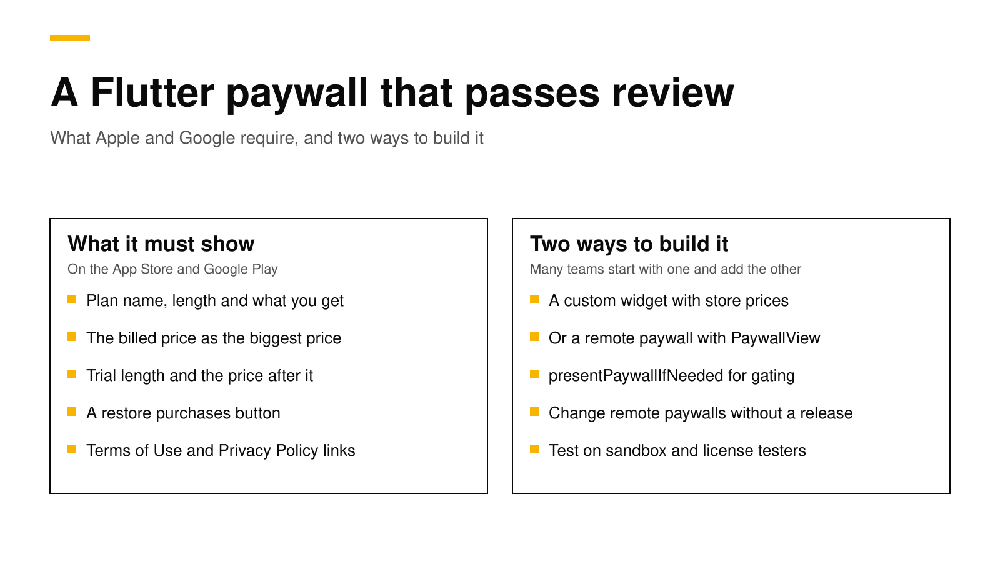

# How to build a paywall in Flutter that passes App Review

To build a paywall in Flutter, load your products from the store, show each plan with its full billed price and length, explain any free trial, and add a restore button and links to your Terms of Use and Privacy Policy. You can draw that screen yourself as a widget, or show a paywall that you design on a server, so you can change it without an app release. Either way, the store rules decide what must be on the screen, and the layout decides how many people buy.

This post is for Flutter apps that sell subscriptions on both the App Store and Google Play. It covers what Apple and Google require, a custom paywall widget, a remote paywall with `PaywallView`, how to choose between them, and how to test. Every fact about Apple, Google and other vendors links its source and was checked on November 23, 2026.



## The short answer

- **Show the billed price first.** On iOS, the amount that is charged must be the most prominent price, and a per-week breakdown must be smaller ([Apple](https://developer.apple.com/app-store/subscriptions/)).
- **Explain the trial in words.** Say how long the trial lasts and what is billed when it ends, on both stores ([Google Play](https://support.google.com/googleplay/android-developer/answer/9900533?hl=en)).
- **Add restore, Terms and Privacy.** Apple requires a way for current subscribers to restore, and links to both documents ([Apple](https://developer.apple.com/app-store/subscriptions/)).
- **Use store prices, never typed prices.** Read `priceString` from the product, so every country sees its own currency.
- **Pick one of two builds.** A custom widget gives full control in code. A remote paywall changes without an app release and can be tested against other designs.
- **Test on real store accounts.** Use a sandbox account on iOS and a license tester on Google Play before you submit.

## What the stores require on a paywall

Most paywall rejections come from missing text, not from bad code. Apple's subscriptions page lists what the sign-up screen must include ([Apple](https://developer.apple.com/app-store/subscriptions/)):

1. The subscription's name and length, and what the customer gets during that time.
2. The full renewal price, shown clearly and in the local currency.
3. A way for current subscribers to sign in or restore their purchases.
4. Links to your Terms of Use and Privacy Policy, in the app and in the App Store listing.

Apple adds two rules that shape the layout. The amount that is billed must be the most prominent price, so a yearly plan shows its yearly total first, and any "per week" figure sits below it in a smaller size. For a free trial, the screen must say how long the trial lasts and what is billed after it. Guideline 3.1.2(c) also asks you to "clearly describe what the user will get for the price" before you ask anyone to subscribe ([App Review Guidelines](https://developer.apple.com/app-store/review/guidelines/#subscriptions)).

Google Play's subscriptions policy asks for the same things in its own words. You must state the offer terms, the price and how often you bill, how a trial turns into a paid plan, and how to cancel, and the customer "should not have to perform any additional action to review the information" ([Google Play](https://support.google.com/googleplay/android-developer/answer/9900533?hl=en)). So do not hide the price behind a "See details" link.

Our post on [submitting your first in-app purchase for App Review](submit-first-in-app-purchase-for-review.md) has the full checklist, and [Apple's free-trial toggle rejection](apple-free-trial-toggle-rejection.md) explains why a switch that adds or removes the trial now gets rejected.

## Option 1: build the paywall as a Flutter widget

A custom widget is the right choice when your design is fixed, or when the paywall is part of a larger onboarding flow you already built. The widget below reads the current offering, shows one card per plan with the billed price first, explains the trial in a full sentence, and includes the restore button and both links. It uses `purchases_flutter`, so the same code runs on iOS and Android.

```dart
import 'package:flutter/material.dart';
import 'package:flutter/services.dart' show PlatformException;
import 'package:purchases_flutter/purchases_flutter.dart';
import 'package:url_launcher/url_launcher.dart';

class Paywall extends StatefulWidget {
  const Paywall({super.key, required this.onUnlocked});
  final VoidCallback onUnlocked;
  @override
  State<Paywall> createState() => _PaywallState();
}

class _PaywallState extends State<Paywall> {
  List<Package> plans = [];
  Package? selected;
  bool busy = false;

  @override
  void initState() {
    super.initState();
    Purchases.getOfferings().then((o) {
      final list = o.current?.availablePackages ?? [];
      setState(() {
        plans = list;
        // Select the yearly plan when there is one.
        selected = list.firstWhere((p) => p.packageType == PackageType.annual, orElse: () => list.first);
      });
    });
  }

  // One full sentence about the trial and the price after it, or null when there is no trial.
  String? trialLine(StoreProduct p) {
    final intro = p.introductoryPrice;
    if (intro == null || intro.price != 0) return null;
    final unit = intro.periodUnit.name.toLowerCase();   // day, week, month or year
    final n = intro.periodNumberOfUnits;
    return 'Free for $n $unit${n == 1 ? '' : 's'}, then ${p.priceString} each ${periodWord(p)}. Cancel at any time.';
  }

  String periodWord(StoreProduct p) => switch (p.subscriptionPeriod) {
        'P1W' => 'week', 'P1M' => 'month', 'P3M' => '3 months', 'P6M' => '6 months', 'P1Y' => 'year', _ => 'period',
      };

  Future<void> buy() async {
    if (selected == null) return;
    setState(() => busy = true);
    try {
      final result = await Purchases.purchase(PurchaseParams.package(selected!));
      if (result.customerInfo.entitlements.active.containsKey('pro')) widget.onUnlocked();
    } on PlatformException catch (e) {
      if (PurchasesErrorHelper.getErrorCode(e) != PurchasesErrorCode.purchaseCancelledError) {
        if (mounted) ScaffoldMessenger.of(context).showSnackBar(SnackBar(content: Text(e.message ?? 'Purchase failed')));
      }
    } finally {
      if (mounted) setState(() => busy = false);
    }
  }

  Future<void> restore() async {
    final info = await Purchases.restorePurchases();
    if (info.entitlements.active.containsKey('pro')) widget.onUnlocked();
  }

  @override
  Widget build(BuildContext context) {
    if (plans.isEmpty) return const Center(child: CircularProgressIndicator());
    final trial = selected == null ? null : trialLine(selected!.storeProduct);
    return SafeArea(
      child: ListView(padding: const EdgeInsets.all(20), children: [
        Text('Get Pro', style: Theme.of(context).textTheme.headlineMedium),
        const Text('Unlimited projects, sync on every device, and no ads.'),
        const SizedBox(height: 16),
        for (final p in plans)
          RadioListTile<Package>(
            value: p,
            groupValue: selected,
            onChanged: (v) => setState(() => selected = v),
            // The billed amount is the big number; a monthly breakdown stays small.
            title: Text('${p.storeProduct.priceString} per ${periodWord(p.storeProduct)}'),
            subtitle: p.storeProduct.pricePerMonthString != null && p.packageType == PackageType.annual
                ? Text('Same as ${p.storeProduct.pricePerMonthString} a month')
                : null,
          ),
        if (trial != null) Text(trial),
        const SizedBox(height: 12),
        FilledButton(onPressed: busy ? null : buy, child: Text(trial != null ? 'Start free trial' : 'Continue')),
        TextButton(onPressed: restore, child: const Text('Restore purchases')),
        Row(mainAxisAlignment: MainAxisAlignment.center, children: [
          TextButton(onPressed: () => launchUrl(Uri.parse('https://example.com/terms')), child: const Text('Terms of Use')),
          TextButton(onPressed: () => launchUrl(Uri.parse('https://example.com/privacy')), child: const Text('Privacy Policy')),
        ]),
      ]),
    );
  }
}
```

Three details in this code matter more than they look.

**The trial line depends on eligibility.** A customer who already used a trial in the same subscription group does not get another one on iOS. On Android, Google only returns the offers a customer can use. Our post on [free trial eligibility](free-trial-eligibility-ios-android.md) shows how to check it, so that you only say "Start free trial" to people who will get one.

**Prices come from the store.** `priceString` is already formatted in the customer's currency. A price typed into your code is wrong in most countries, and it goes stale the day you change the price in App Store Connect or Play Console.

**The button text matches the offer.** When there is no trial, the button says "Continue" rather than "Start free trial". A button that promises something the store will not give is the kind of mismatch that guideline 3.1.2 warns about.

If you use the official `in_app_purchase` package instead of a purchase SDK, the layout is the same, but you load `ProductDetails` yourself, and on Android you must also complete each purchase. Our post on [`in_app_purchase` vs `purchases_flutter`](flutter-in-app-purchase-vs-purchases-flutter.md) compares the two packages.

## Option 2: show a remote paywall with PaywallView

A remote paywall is designed in a dashboard and sent to the app as data. The app draws it with native views. You can change the headline, the plan order or the whole layout without a new release, and you can test two designs against each other. This matters because the paywall is the screen you will change most often after launch.

The `purchases_ui_flutter` package draws these paywalls. It has two calls and one widget. `RevenueCatUI.presentPaywall()` opens the paywall full screen and returns a `PaywallResult`. `RevenueCatUI.presentPaywallIfNeeded('pro')` opens it only when the customer does not already have the `pro` entitlement. `PaywallView` is a widget you place inside your own screen, with callbacks for each step ([pub.dev](https://pub.dev/documentation/purchases_ui_flutter/latest/)).

```dart
import 'package:purchases_ui_flutter/purchases_ui_flutter.dart';

// Show the paywall only to customers without Pro, then react to the result.
Future<void> openPaywall() async {
  final result = await RevenueCatUI.presentPaywallIfNeeded('pro');
  switch (result) {
    case PaywallResult.purchased:
    case PaywallResult.restored:
      unlockPro();
    case PaywallResult.notPresented:   // already Pro
    case PaywallResult.cancelled:
    case PaywallResult.error:
      break;
  }
}

// Or place it inside your own screen, for example as the last onboarding page.
Widget onboardingPaywall() => PaywallView(
      onPurchaseCompleted: (customerInfo, transaction) => unlockPro(),
      onRestoreCompleted: (customerInfo) {
        if (customerInfo.entitlements.active.containsKey('pro')) unlockPro();
      },
      onDismiss: () => goToFreeVersion(),
    );
```

`PaywallView` also has `onPurchaseStarted`, `onPurchaseCancelled`, `onPurchaseError` and `onRestoreError`, so you can log every step for your own analytics. On Android it accepts an `androidPlatformViewMode`, which the package docs show set to hybrid composition ([pub.dev](https://pub.dev/documentation/purchases_ui_flutter/latest/)).

The store rules still apply to a remote paywall. You still need the billed price, the trial sentence, restore, and the Terms and Privacy links in the design. A good paywall editor asks for the links and adds a restore button for you, but check the final screen on a phone before you submit.

## Which option to choose

| | Custom widget | Remote paywall |
|---|---|---|
| Change without an app release | No | Yes |
| A/B test two designs | Only with your own flag system | Yes, from the dashboard |
| Full control of animation and layout | Yes | Within the components the renderer supports |
| Work to build | You write and maintain the widget | You design it in an editor |
| Fits inside a custom onboarding flow | Yes | Yes, with `PaywallView` |
| Store rules | You must add every required element | The editor helps, but you still check |

Many teams use both. They build the first paywall as a widget while the product is young, then move to a remote paywall once they want to run tests. Our [paywall A/B testing guide](paywall-ab-testing-guide.md) explains what to test first and how many customers you need, and [paywall best practices for 2026](paywall-best-practices-2026.md) collects the layouts that measured best.

## Test the paywall before you submit

1. **iOS sandbox.** Sign in with a sandbox account under **Settings → Developer**, buy each plan, and check that the trial sentence and price match the store sheet.
2. **Google Play license testers.** Add your account as a license tester in Play Console and install the app from a test track. For license testers, Google renews test subscriptions much faster than real ones, so you can see a full cycle in minutes ([Android Developers](https://developer.android.com/google/play/billing/test#renewals)).
3. **Every currency you sell in.** Change the sandbox storefront to another country and check that long prices still fit on one line.
4. **Restore on a second device.** Buy on one phone and restore on another signed in to the same store account.
5. **Small screens and dark mode.** The restore button and links must stay visible without scrolling far.

Our guide to [testing in-app purchases](sandbox-testing-in-app-purchases.md) covers each store's test accounts step by step.

## Common mistakes

- **A per-week price in large type above a yearly charge.** Apple wants the billed yearly amount to be the most prominent price.
- **"Start free trial" for customers who are not eligible.** Check eligibility first.
- **No restore button, or a restore button only in Settings.** Put it on the paywall.
- **A paywall that blocks the app with no way out**, when your app promised free features. That is a product choice, but the free path must work if your App Store description says it exists.
- **Showing the paywall before products load.** Show a loading state, and a clear error with a retry if the store returns nothing. [Why in-app products fail to load](in-app-products-not-loading.md) lists the usual causes.

## Do it with RevenueDot

RevenueDot is an open-source backend for in-app purchases and subscriptions on the App Store, Google Play and the web. Both options above work with it:

- **Custom widgets.** The Flutter code in option 1 runs as written with the [RevenueDot SDK for Flutter](../docs/sdks/flutter.md). Offerings, packages and store prices come from RevenueDot.
- **Remote paywalls.** The [paywalls guide](../docs/guides/paywalls.md) describes a gallery of ten templates, a visual editor, AI generation and translations. Templates ask for your app name, accent color, and Terms and Privacy links, and the editor has a Restore purchases button. Publish a paywall to an offering, and the app shows it with `purchases_ui_flutter` from the RevenueDot git dependency.
- **Experiments.** [Experiments](../docs/guides/experiments.md) show each customer one of two to four offerings, each with its own paywall, and compare conversion, revenue and retention.

To be clear about where this stands: RevenueDot paywalls have been rendered by the UI SDK on the iOS simulator, but not yet in a Flutter app on a device. A real App Store sandbox purchase has run end to end against RevenueDot Cloud on a physical iPhone, but no real Google Play purchase has yet. Google Play handling is tested against a copy of Google's API.

New apps install the [RevenueDot SDK](../docs/sdks/README.md). Its code says `import RevenueCat` in Swift and uses the package names `purchases_flutter` and `purchases_ui_flutter` in Flutter, because it is built from RevenueCat's MIT-licensed SDK, and it needs no RevenueCat account. Our [Flutter tutorial](flutter-in-app-purchases-tutorial.md) sets up the stores, the products and the SDK.

**Switching from RevenueCat? Keep your SDK and change one line.** A Flutter app that ships the RevenueCat SDK calls `Purchases.setProxyURL` with RevenueDot's address before `configure`, and keeps its code, offerings and customers. RevenueDot serves paywalls in the component format that the RevenueCat UI SDK draws, but RevenueCat paywalls are not imported, so you rebuild them in the editor. See [leaving RevenueCat with a Flutter or React Native app](leave-revenuecat-flutter-react-native.md), the [comparison](https://revenuedot.app/compare/revenuedot-vs-revenuecat) and the [fee calculator](https://revenuedot.app/tools/revenuecat-fee-calculator). RevenueCat is free under $2,500 of monthly tracked revenue and then charges 1% of all of it ([RevenueCat](https://www.revenuecat.com/pricing)).

[Start for free on RevenueDot Cloud](https://app.revenuedot.app/signup). Building and testing are free, no card needed. Add a card when you go live; Pro costs $0 until your apps make $10,000 a month. See [pricing](https://revenuedot.app/pricing).

## FAQ

### What must a Flutter subscription paywall show to pass App Review?

The plan's name and length, what the customer gets, the full billed price as the most prominent price, the trial length and the price after it, a restore button, and links to your Terms of Use and Privacy Policy ([Apple](https://developer.apple.com/app-store/subscriptions/)). Google Play asks for the price, the billing period, the trial terms and how to cancel.

### Is there a paywall package for Flutter?

Yes. `purchases_ui_flutter` draws remote paywalls with `RevenueCatUI.presentPaywall()`, `presentPaywallIfNeeded()` and the `PaywallView` widget ([pub.dev](https://pub.dev/documentation/purchases_ui_flutter/latest/)). There are also widget packages that only draw the screen, such as `in_app_purchases_paywall_ui` ([pub.dev](https://pub.dev/packages/in_app_purchases_paywall_ui)), which leave the purchase logic to you.

### Can I change my Flutter paywall without an app update?

Yes, with a remote paywall. The design lives on a server, the app downloads it with the offering, and a change reaches customers the next time the app fetches offerings. A custom widget needs a new release for every change.

### How do I show the price per month for a yearly plan?

Read `pricePerMonthString` from the store product and show it below the yearly price in a smaller size. Apple requires the billed amount, here the yearly total, to stay the most prominent price ([Apple](https://developer.apple.com/app-store/subscriptions/)).

**About RevenueDot.** RevenueDot is an open-source (AGPL-3.0) backend for in-app purchases and subscriptions on the App Store, Google Play and the web. Start for free on [RevenueDot Cloud](https://app.revenuedot.app/signup): Pro costs $0 until your apps make $10,000 a month, then 0.5% of revenue above $10,000, never more than $999 a month. New apps install the [RevenueDot SDK](../docs/sdks/README.md) and pass their key. Apps that ship the RevenueCat SDK point its proxy URL at RevenueDot and keep their code, offerings and customers. Read the [quickstart](../docs/getting-started/quickstart.md) or the code on [GitHub](https://github.com/revenuedot/revenuedot).
