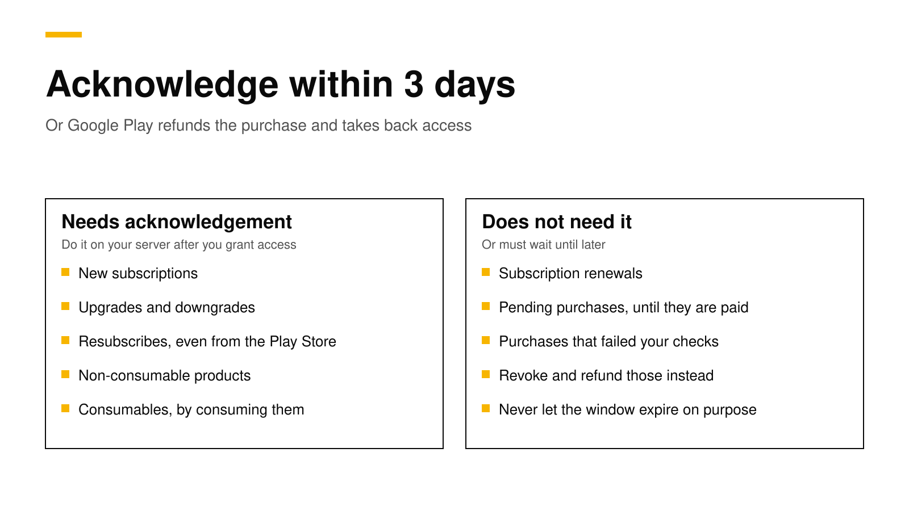

# Google Play refunds after 3 days: how to acknowledge purchases

Google Play refunds a purchase and takes back access when your app does not acknowledge it within three days. To stop it, acknowledge every new subscription and every non-consumable after you grant access, and consume every consumable. The safest place to do this is your server, with the Google Play Developer API, because the server can still do it when the app crashes, loses its network or is never opened again.

This post is for Flutter, React Native, Expo and native Android apps that sell on Google Play, often next to the App Store. It explains which purchases need acknowledgement, the cases that catch teams out, the server code, and how to find purchases that slipped through. Every fact about Google and RevenueCat links its source and was checked on November 23, 2026.



## The short answer

- **The window is three days.** Google refunds the purchase and revokes access when it is not acknowledged in time ([Android Developers](https://developer.android.com/google/play/billing/integrate#process)).
- **Acknowledge only purchases in the PURCHASED state.** For a pending purchase, the three days start when it changes from PENDING to PURCHASED.
- **Subscriptions need it once per purchase.** New subscriptions, upgrades, downgrades and resubscribes need it, but renewals do not ([Android Developers](https://developer.android.com/google/play/billing/lifecycle/subscriptions)).
- **Consuming counts.** For a consumable, a consume call also acknowledges it.
- **Do it on the server.** Use `purchases.subscriptions.acknowledge` or `purchases.products.acknowledge` after you verify the purchase.
- **Never use the timeout to reject a purchase.** Revoke and refund it with the API instead.

## What "acknowledge" means on Google Play

When a customer buys on Google Play, Google takes the money, but it does not yet know whether your app delivered what was sold. The acknowledgement is your answer: it tells Google that the customer now has access. Google's integration guide lists it as the last step of every purchase, after you verify the purchase on your server and grant access ([Android Developers](https://developer.android.com/google/play/billing/integrate#process)).

Google uses the three days as a safety net for customers. If an app took money and then crashed before unlocking anything, the customer gets the money back without asking. That is fair to the customer, but it is a quiet failure for you: the order shows as refunded, the customer loses access, and nothing in your logs says why. The App Store has no rule like this, so teams that build for iOS first often miss it on Android.

## Which purchases need it

| Purchase | Needs acknowledgement? | How |
|---|---|---|
| New subscription | Yes | `acknowledge` on the subscription token |
| Subscription renewal | No | Nothing to do |
| Upgrade, downgrade or resubscribe in the app | Yes, because it is a new purchase with a new token | `acknowledge` on the new token |
| Resubscribe from the Play Store after expiry | Yes, and the app may never be opened | Acknowledge from the server after the notification |
| Prepaid plan or top-up | Yes, with a shorter window for plans under one week | `acknowledge` on the token |
| Non-consumable one-time product | Yes | `acknowledge` on the product token |
| Consumable one-time product | Yes, by consuming it | `consume` acknowledges too |

Three rows need a closer look.

**Plan changes and resubscribes.** Google says that an upgrade, downgrade or resubscribe is a new purchase that you must acknowledge. Google also blocks a plan change while the current subscription is still waiting for acknowledgement ([Android Developers](https://developer.android.com/google/play/billing/lifecycle/subscriptions#upgrades-downgrades)). So an app that forgot to acknowledge the first purchase also breaks its upgrade button.

**Resubscribes from the Play Store.** A customer can buy an expired subscription again inside the Play Store app. Google sends your server a `SUBSCRIPTION_PURCHASED` notification with a brand-new purchase token, and you must acknowledge it on the server. Google's page says this lets you acknowledge "even if the user doesn't open your app" ([Android Developers](https://developer.android.com/google/play/billing/lifecycle/subscriptions#resubscribe)). An app that only acknowledges on the device can never handle this case.

**Prepaid plans.** Plans of one week or longer have three days. Plans shorter than a week must be acknowledged within half of their length, so a three-day plan has a day and a half. If a top-up is not acknowledged in time, Google refunds it and also revokes and cancels the rest of the plan ([Android Developers](https://developer.android.com/google/play/billing/lifecycle/subscriptions#prepaid)).

## Pending purchases start the clock later

Some payment methods, such as cash at a store, leave a purchase in the PENDING state for hours or days. Do not grant access and do not acknowledge while a purchase is pending. Google's note is clear: the three-day window "begins only when the purchase state transitions from 'PENDING' to 'PURCHASED'" ([Android Developers](https://developer.android.com/google/play/billing/integrate#pending)). Our post on [Google Play pending purchases](google-play-pending-purchases.md) shows how to handle that state in the app.

## Acknowledge on the server

Google recommends the server for this work. Its security guide gives the order: send the purchase token to your backend, check that you have not seen it before, verify it with `purchases.subscriptionsv2.get` or `purchases.products.get`, grant access, and then acknowledge "immediately after granting entitlement" ([Android Developers](https://developer.android.com/google/play/billing/security#verify)). The same page explains why the device is not enough. If a customer loses their network during the check and does not open the app again within three days, the purchase is refunded.

This Node.js function uses Google's `googleapis` package with a service account that has access to your app in Play Console.

```ts
import { google } from "googleapis";

const auth = new google.auth.GoogleAuth({
  keyFile: "play-service-account.json",
  scopes: ["https://www.googleapis.com/auth/androidpublisher"],
});
const play = google.androidpublisher({ version: "v3", auth });

// Call this after you have stored the purchase and granted access.
export async function acknowledgeSubscription(packageName: string, token: string) {
  const { data } = await play.purchases.subscriptionsv2.get({ packageName, token });

  // Pending purchases are not acknowledged; the window starts when they are paid.
  if (data.subscriptionState === "SUBSCRIPTION_STATE_PENDING") return "pending";
  if (data.acknowledgementState !== "ACKNOWLEDGEMENT_STATE_PENDING") return "already acknowledged";

  const subscriptionId = data.lineItems?.[0]?.productId;
  if (!subscriptionId) throw new Error("No product on this purchase token");

  await play.purchases.subscriptions.acknowledge({ packageName, subscriptionId, token, requestBody: {} });
  return "acknowledged";
}

export async function acknowledgeProduct(packageName: string, productId: string, token: string, consumable: boolean) {
  const { data } = await play.purchases.products.get({ packageName, productId, token });
  if (data.purchaseState !== 0) return "not purchased";        // 0 purchased, 1 canceled, 2 pending
  if (consumable) {
    if (data.consumptionState === 1) return "already consumed";
    await play.purchases.products.consume({ packageName, productId, token });   // consuming also acknowledges
    return "consumed";
  }
  if (data.acknowledgementState === 1) return "already acknowledged";
  await play.purchases.products.acknowledge({ packageName, productId, token, requestBody: {} });
  return "acknowledged";
}
```

Run the same function from two places. The first is the endpoint the app calls after a purchase. The second is your handler for Google's real-time developer notifications, which covers resubscribes from the Play Store and purchases whose app call never arrived. If the acknowledge call fails, answer the notification with an error, so that Pub/Sub delivers it again and you get another try.

## Acknowledge in the app

When you have no backend, acknowledge on the device. With the Play Billing Library, check `purchase.isAcknowledged()` and call `acknowledgePurchase()` for subscriptions and non-consumables, or `consumeAsync()` for consumables ([Android Developers](https://developer.android.com/google/play/billing/integrate#process)).

In Flutter, the official `in_app_purchase` package does this when you call `completePurchase`. Its README warns that not calling it and getting a successful response "within 3 days of the purchase will result in a refund on Android" ([pub.dev](https://pub.dev/packages/in_app_purchase)).

```dart
// Flutter, in_app_purchase 3.x: listen to the stream as early as possible, for example in initState.
InAppPurchase.instance.purchaseStream.listen((purchases) async {
  for (final p in purchases) {
    if (p.status == PurchaseStatus.purchased || p.status == PurchaseStatus.restored) {
      final ok = await verifyOnServer(p.verificationData.serverVerificationData);
      if (ok) await grantAccess(p.productID);
    }
    if (p.pendingCompletePurchase) {
      await InAppPurchase.instance.completePurchase(p);   // acknowledges on Android
    }
  }
});
```

The weak spot of the device-only approach is the gap between paying and acknowledging. If the app is killed in that gap, the purchase waits until the next launch. That is why the listener must start at launch and not only on the paywall screen.

## Purchase SDKs that do it for you

A purchase SDK such as RevenueCat's finishes purchases for you by default. RevenueCat's docs describe a setting that hands this job back to your app, and say that with it "your app will complete the purchases itself" ([RevenueCat](https://www.revenuecat.com/docs/migrating-to-revenuecat/sdk-or-not/finishing-transactions)). So if you set `purchasesAreCompletedBy` to your app, for example to keep your own billing code, your code must acknowledge and consume on Android. A team that turns that setting on and forgets this step will see refunds three days later.

## Never use the timeout to reject a purchase

It is tempting to leave a suspicious purchase unacknowledged and let Google refund it. Google asks you not to. An expired window "is ambiguous to Google Play", because it can also come from a bug or a timeout. If a purchase fails your checks, do not grant access and do not acknowledge it. Revoke it with a full refund: `purchases.subscriptionsv2.revoke` for subscriptions, or `orders.refund` with `revoke` set to `true` for one-time products ([Android Developers](https://developer.android.com/google/play/billing/security#verify)).

## How to find purchases you did not acknowledge

These signs show that some purchases are slipping through:

1. **Refunds you did not issue.** In Play Console, **Order management** lists refunded orders. A group of refunds about three days after purchase, with no request from the customer, points to missing acknowledgements.
2. **A warning in Play Console.** Developers report a Play Console message that says "We've detected that your app is not acknowledging all in-app purchases" ([Unity forum](https://discussions.unity.com/t/weve-detected-that-your-app-is-not-acknowledging-all-in-app-purchases-android-iap-acknowledgment/824352)).
3. **Voided purchases.** Google's Voided Purchases API lists purchases that were cancelled, and the list includes "unacknowledged auto-canceled purchases" ([Android Developers](https://developer.android.com/google/play/billing/security#voided)).
4. **Upgrades that fail.** A plan change that Google blocks often means the current subscription was never acknowledged.
5. **Your own database.** Run a daily job that lists purchases from the last three days and calls `get` on each one. Acknowledge any token whose `acknowledgementState` still says pending.

Developers on other stacks report the same thing. A question about a .NET Android app describes in-app purchases that were "always refunded after 3 days" ([Microsoft Q&A](https://learn.microsoft.com/en-us/answers/questions/1664499/google-play-in-apps-are-always-refunded-after-3-da)). The fix is almost always the same: add the acknowledge call, ideally on the server.

## Do it with RevenueDot

RevenueDot is an open-source backend for in-app purchases and subscriptions on the App Store, Google Play and the web. It acknowledges Google Play purchases on the server, in the two places this post recommends:

- **When the app posts a purchase.** After the SDK sends the purchase token, RevenueDot checks it with `purchases.subscriptionsv2.get` or `purchases.products.get` and acknowledges any subscription or non-consumable that still needs it. A pending purchase is answered with a temporary error, so the SDK sends it again later. The code is in [stores/google/index.ts](https://github.com/revenuedot/revenuedot/blob/main/apps/server/src/stores/google/index.ts).
- **When Google sends a notification.** For subscription and one-time product notifications, RevenueDot reads the purchase from Google, updates the customer it belongs to, and acknowledges it. If the acknowledge call fails, it answers with a 5xx so that Pub/Sub delivers the message again. This covers resubscribes from the Play Store when the app is never opened. The code is in [stores/google/sync.ts](https://github.com/revenuedot/revenuedot/blob/main/apps/server/src/stores/google/sync.ts).
- **Consumables stay with the device.** RevenueDot does not consume them; its answer to the SDK tells it to consume, and the SDK does so.

To be clear about where this stands: Google Play handling is tested against a copy of Google's API, and no real Google Play purchase has yet run end to end against RevenueDot. A real App Store sandbox purchase has. The [Google Play setup guide](../docs/guides/google-play.md) explains the service account and the notification topic, and the [ONE_TIME_PRODUCT_PURCHASED](../docs/notifications/google-one-time-product-purchased.md) page describes one of the notifications.

New apps install the [RevenueDot SDK](../docs/sdks/README.md). Its code says `import RevenueCat` because it is built from RevenueCat's MIT-licensed SDK, and it needs no RevenueCat account. Our [Android](android-google-play-billing-subscriptions.md), [Flutter](flutter-in-app-purchases-tutorial.md) and [React Native and Expo](react-native-expo-subscriptions-tutorial.md) tutorials set up the app side.

**Switching from RevenueCat? Keep your SDK and change one line.** An app that ships the RevenueCat SDK points its proxy URL at RevenueDot and keeps its code, offerings and customers. Acknowledgement keeps working the same way, because the SDK still finishes purchases and RevenueDot acknowledges on the server. See [migrating without data loss](migrating-from-revenuecat-without-data-loss.md), the [comparison](https://revenuedot.app/compare/revenuedot-vs-revenuecat) and the [fee calculator](https://revenuedot.app/tools/revenuecat-fee-calculator). RevenueCat is free under $2,500 of monthly tracked revenue and then charges 1% of all of it ([RevenueCat](https://www.revenuecat.com/pricing)).

[Start for free on RevenueDot Cloud](https://app.revenuedot.app/signup). Building and testing are free, no card needed. Add a card when you go live; Pro costs $0 until your apps make $10,000 a month. See [pricing](https://revenuedot.app/pricing).

## FAQ

### Why are my Google Play in-app purchases refunded after 3 days?

Your app or server did not acknowledge them. Google refunds every purchase that is not acknowledged or consumed within three days of reaching the PURCHASED state, and takes back access ([Android Developers](https://developer.android.com/google/play/billing/integrate#process)). Add the acknowledge call after you grant access, ideally on your server.

### Do subscription renewals need to be acknowledged?

No. Google says that renewals do not need acknowledgement. The first purchase does, and so does every upgrade, downgrade and resubscribe, because each of those is a new purchase with a new token ([Android Developers](https://developer.android.com/google/play/billing/lifecycle/subscriptions)).

### Should I acknowledge on the device or on the server?

Use the server when you have one. Google recommends it because the server can acknowledge even when the app loses its network or is never opened again, for example after a resubscribe in the Play Store ([Android Developers](https://developer.android.com/google/play/billing/security#verify)).

### Does consuming a purchase also acknowledge it?

Yes. For consumables, `consumeAsync()` in the app or `purchases.products.consume` on the server meets the acknowledgement rule and lets the customer buy the item again ([Android Developers](https://developer.android.com/google/play/billing/integrate#process)).

### Can I acknowledge a pending purchase?

No. Wait until the purchase is in the PURCHASED state. The three-day window only starts at that moment, so a slow payment method does not shorten your time.

**About RevenueDot.** RevenueDot is an open-source (AGPL-3.0) backend for in-app purchases and subscriptions on the App Store, Google Play and the web. Start for free on [RevenueDot Cloud](https://app.revenuedot.app/signup): Pro costs $0 until your apps make $10,000 a month, then 0.5% of revenue above $10,000, never more than $999 a month. New apps install the [RevenueDot SDK](../docs/sdks/README.md) and pass their key. Apps that ship the RevenueCat SDK point its proxy URL at RevenueDot and keep their code, offerings and customers. Read the [quickstart](../docs/getting-started/quickstart.md) or the code on [GitHub](https://github.com/revenuedot/revenuedot).
