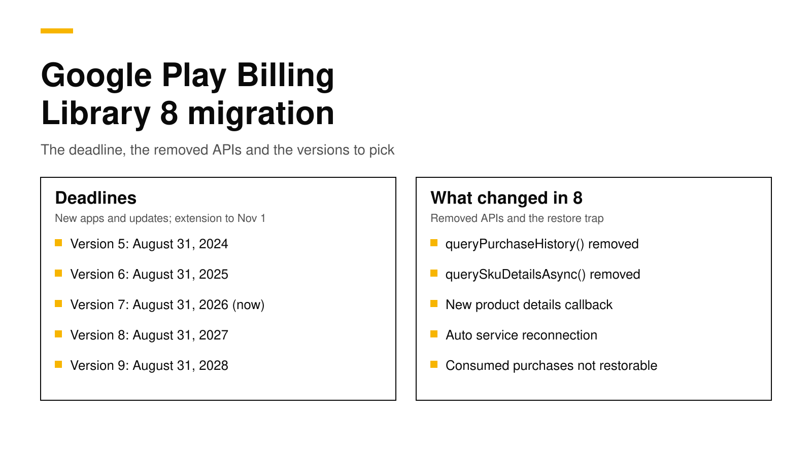

# Google Play Billing Library 8: deadline and migration

Since August 31, 2026, Google Play only accepts new apps and app updates that use Play Billing Library 8 or later. Teams that asked Google for an extension can keep shipping on version 7 until November 1, 2026. The apps already on people's phones keep working, so the deadline blocks your next release, not your current purchases. If your app uses the RevenueCat SDK, version 9.0.0 of the Android, React Native and Flutter SDKs moved to Billing Library 8. If you use Flutter's `in_app_purchase`, version 0.5.0 of its Android package made the same move.

This post covers the dates, the APIs that version 8 removed, the code to change, the version to pick for Flutter, React Native and Expo apps, and the one change that can quietly break restores. Every fact about Google and RevenueCat links its source and was checked on October 26, 2026.



## The short answer

- **The deadline:** new apps and updates must use Billing Library 8 or later since August 31, 2026. An extension, which you request in Play Console, runs to November 1, 2026 ([Google](https://developer.android.com/google/play/billing/deprecation-faq)).
- **Existing installs keep working.** Google says unmaintained APKs do not need updates; only new apps and updates must use a supported version ([Google](https://developer.android.com/google/play/billing/deprecation-faq)).
- **Removed in 8.0.0:** `queryPurchaseHistory()`, `querySkuDetailsAsync()`, the no-argument `enablePendingPurchases()` and the string version of `queryPurchasesAsync()`. The product details callback also has a new signature ([Google](https://developer.android.com/google/play/billing/release-notes)).
- **Package versions:** RevenueCat's purchases-android, react-native-purchases and purchases-flutter use Billing Library 8 from 9.0.0 ([RevenueCat](https://www.revenuecat.com/docs/known-store-issues/play-billing-library/restore-consumable-purchases-bc8)). Flutter's `in_app_purchase_android` uses it from 0.5.0 ([pub.dev](https://pub.dev/packages/in_app_purchase_android/changelog)).
- **The trap:** version 8 can no longer read consumed one-time purchases, so an app without logins cannot restore them from the device. Plan an order ID restore for support cases.

## The dates Google set

Google publishes one deadline per library version on its [deprecation FAQ](https://developer.android.com/google/play/billing/deprecation-faq), updated on October 23, 2026. Each version stops being accepted on August 31, one year after the version before it, with an extension to November 1 of the same year.

| Billing Library version | New apps and updates must move off it by | Extension until |
|---|---|---|
| 5 | August 31, 2024 | November 1, 2024 |
| 6 | August 31, 2025 | November 1, 2025 |
| 7 | August 31, 2026 | November 1, 2026 |
| 8 | August 31, 2027 | November 1, 2027 |
| 9 | August 31, 2028 | November 1, 2028 |

The table also tells you which version to pick. Any 8.x release satisfies today's rule, but version 8 reaches its own deadline in August 2027. Moving straight to version 9 gives your Android code a year longer before the next forced upgrade.

## What happens if you miss it

The deadline is a publishing gate. When your app uses an unsupported version, Play Console shows a warning, and Google says you open the extension form from that warning's details page under **Policy status** ([Google](https://developer.android.com/google/play/billing/deprecation-faq)). Without an extension, Play Console will not accept the update.

Nothing changes for customers who already installed your app. Their purchases and renewals keep working, because Google bills subscriptions on its own schedule whatever library version the app was built with. The risk is a different one: a crash fix or an urgent release that Play Console refuses because the billing code is out of date. Upgrade before you need a hotfix.

## What changed in Billing Library 8

Version 8.0.0 shipped on June 30, 2025. Google's [release notes](https://developer.android.com/google/play/billing/release-notes) and [migration guide](https://developer.android.com/google/play/billing/migrate-gpblv8) list four removed APIs and one changed callback.

| Removed or changed | Replacement |
|---|---|
| `queryPurchaseHistory()` | No device replacement for consumed purchases; see [query purchase history](https://developer.android.com/google/play/billing/query-purchase-history) |
| `querySkuDetailsAsync()` | `queryProductDetailsAsync()` |
| `enablePendingPurchases()` with no arguments | `enablePendingPurchases(PendingPurchasesParams.newBuilder().enableOneTimeProducts().build())` |
| `queryPurchasesAsync(String skuType, listener)` | `queryPurchasesAsync(QueryPurchasesParams, listener)` |
| `onProductDetailsResponse(BillingResult, List<ProductDetails>)` | `onProductDetailsResponse(BillingResult, QueryProductDetailsResult)` |

Version 8 also added three useful things. `enableAutoServiceReconnection()` reconnects to Google Play by itself when you call an API while the service is disconnected. `queryProductDetailsAsync()` now reports products it could not fetch instead of dropping them silently. And `launchBillingFlow()` can return sub-response codes such as `PAYMENT_DECLINED_DUE_TO_INSUFFICIENT_FUNDS` and `USER_INELIGIBLE`, which help you show a better error message.

### The code to change

If you call the library yourself in Kotlin, the client setup and the product query are the two places that usually break the build. Here is the setup Google shows in its [integration guide](https://developer.android.com/google/play/billing/integrate), with automatic reconnection turned on:

```kotlin
val billingClient = BillingClient.newBuilder(context)
    .setListener(purchasesUpdatedListener)
    .enablePendingPurchases(
        PendingPurchasesParams.newBuilder().enableOneTimeProducts().build()
    )
    .enableAutoServiceReconnection()
    .build()
```

Google asks you not to call `startConnection()` again from `onBillingServiceDisconnected()` once automatic reconnection is on. Leave that method empty, or use it only to log the disconnection.

The product query now hands you a result object with two lists:

```kotlin
billingClient.queryProductDetailsAsync(params) { billingResult, result ->
    if (billingResult.responseCode != BillingClient.BillingResponseCode.OK) return@queryProductDetailsAsync

    for (details in result.productDetailsList) {
        // Show this product on the paywall.
    }
    for (missing in result.unfetchedProductList) {
        // Log it: the product id is wrong, inactive, or has no offer for this user.
    }
}
```

Log the unfetched products. A paywall that shows two plans instead of three is a common bug after a Play Console change, and this list now tells you which product went missing.

### Later releases you should know about

Three later releases change what you can support. Version 8.1.0 raised `minSdkVersion` to 23 and added `Purchase.isSuspended()` for subscriptions that are suspended, which Google says should not get access. Version 9.0.0 raised `targetSdkVersion` to 35 and now returns `BILLING_UNAVAILABLE` instead of `ERROR` when the system blocks the Play Store, for example in a kids mode. Version 9.1.0 added APIs for Google's billing choice programs ([Google](https://developer.android.com/google/play/billing/release-notes)).

## Which package version to use

Most cross-platform apps never call the Billing Library directly. The library comes inside a package, so the upgrade is a package upgrade.

| What your app uses | First version on Billing Library 8 | Source |
|---|---|---|
| RevenueCat purchases-android | 9.0.0 | [RevenueCat](https://www.revenuecat.com/docs/known-store-issues/play-billing-library/restore-consumable-purchases-bc8) |
| react-native-purchases (React Native and Expo) | 9.0.0 | [RevenueCat](https://www.revenuecat.com/docs/known-store-issues/play-billing-library/restore-consumable-purchases-bc8) |
| purchases_flutter | 9.0.0 | [RevenueCat](https://www.revenuecat.com/docs/known-store-issues/play-billing-library/restore-consumable-purchases-bc8) |
| purchases-capacitor, purchases-unity, purchases-kmp | 11.0.0, 8.0.0, 2.0.0 | [RevenueCat](https://www.revenuecat.com/docs/known-store-issues/play-billing-library/restore-consumable-purchases-bc8) |
| Flutter `in_app_purchase_android` | 0.5.0 (0.5.5 moved to 9.1.0) | [pub.dev](https://pub.dev/packages/in_app_purchase_android/changelog) |

A major version of the RevenueCat SDK can include other breaking changes, so read the release notes for your platform before you bump it. The Android 9.0.0 release, for example, also removed `copy` functions from public data classes ([GitHub](https://github.com/RevenueCat/purchases-android/releases/tag/9.0.0)). Today RevenueCat's purchases-android builds against Billing Library 8.3.0 and needs Android 6.0 (API 23) or later ([GitHub](https://github.com/RevenueCat/purchases-android/blob/main/gradle/libs.versions.toml)).

For Expo apps the upgrade happens in a development build, not in Expo Go. Bump the package, run a new native build, and upload it to an internal testing track to check the Play Console warning has cleared.

## The restore problem with consumables

This is the change that can hurt customers. Starting with Billing Library 8, Google removed the ability to read consumed one-time purchases from the device. RevenueCat's documentation says its SDKs on this version therefore cannot restore those purchases ([RevenueCat](https://www.revenuecat.com/docs/known-store-issues/play-billing-library/restore-consumable-purchases-bc8)). Subscriptions and non-consumables still restore normally, because `queryPurchasesAsync()` returns everything the customer still owns.

The problem only matters if two things are true. Your app sells or once sold consumables, such as credits or coins, and it has no login, so a customer who reinstalls or changes phones gets a new anonymous ID. That customer's past credit purchases no longer come back with a tap on **Restore**.

You have three ways to handle it:

1. **Add accounts.** A customer who logs in keeps the same app user ID on every device, so the backend already knows their purchases.
2. **Back up the anonymous ID.** Android Auto Backup can restore the SDK's stored app user ID on a new phone. RevenueCat notes this does not cover every device.
3. **Restore by order ID.** Every Google Play receipt email has an order ID that starts with `GPA.`. Support can use it to find the purchase on the server and move it to the customer's new ID.

RevenueDot supports the third path for Google Play and the App Store. One call to the REST API finds the purchase with Google's Orders API and gives it to the customer under your project's transfer behavior ([API reference](../api/rest-v2.md#restore-a-purchase-by-its-store-order-id)):

```bash
curl -s -X POST "https://api.revenuedot.app/v2/projects/$PROJECT_ID/customers/$APP_USER_ID/actions/restore_purchase_by_order_id" \
  -H "Authorization: Bearer $SECRET_KEY" \
  -H "Content-Type: application/json" \
  -d '{"order_id":"GPA.3372-4157-7914-56870"}'
```

The Play service account needs the "View financial data" permission for this lookup. Our post on [looking up a purchase by order ID](look-up-purchase-by-order-id.md) explains the support flow for both stores.

## A checklist for the upgrade

1. **Find your version.** Open Play Console, **Policy status**, and read the warning, or check the package version in your `build.gradle`, `pubspec.lock` or `package-lock.json`.
2. **Request the extension now** if you cannot ship a new build before November 1, 2026.
3. **Upgrade the package** to a release on Billing Library 8 or, better, 9. Read its release notes for other breaking changes.
4. **Check `minSdkVersion`.** Billing Library 8.1.0 and later need Android 6.0 (API 23).
5. **Test a purchase, a renewal and a restore** with a license tester on an internal testing track. Our [testing guide](sandbox-testing-in-app-purchases.md) shows the setup.
6. **Test consumables on a fresh install.** If restore no longer brings them back, decide between accounts, backup and order ID restores before you release.
7. **Upload to Play Console** and confirm the warning disappears from **Policy status**.

## How RevenueDot fits in

RevenueDot is an open-source backend for in-app purchases that works with the RevenueCat SDK. New apps install the [RevenueDot SDK](../docs/sdks/README.md), which is built from RevenueCat's MIT-licensed SDKs, so its code says `import RevenueCat` even though it needs no RevenueCat account. Its current releases are past 9.0.0 on every platform: 10.23.3 for [Android](../docs/sdks/android.md), 10.13.2 for [Flutter](../docs/sdks/flutter.md) and 10.10.2 for [React Native and Expo](../docs/sdks/react-native.md). They use Billing Library 8 or later, so they meet the deadline.

The server checks Google Play purchases with the Play Developer API, receives real-time developer notifications, and scans for voided purchases every day ([Google Play setup](../docs/guides/google-play.md)). RevenueDot has run next to RevenueCat in a production app since October 2, 2026, and a real App Store sandbox purchase has run end to end on a physical iPhone. A real Google Play purchase has not yet run end to end, so test a Play purchase with your own license tester before you rely on it.

**Switching from RevenueCat? Keep your SDK and change one line.** The RevenueCat SDK accepts a proxy URL, so an app on RevenueCat can point it at RevenueDot and keep its code, offerings and customers. RevenueCat charges 1% of all tracked revenue once you pass $2,500 a month ([RevenueCat](https://www.revenuecat.com/pricing)). Compare your own numbers with the [RevenueCat fee calculator](https://revenuedot.app/tools/revenuecat-fee-calculator), read the [RevenueDot vs RevenueCat comparison](https://revenuedot.app/compare/revenuedot-vs-revenuecat), or see [pricing](https://revenuedot.app/pricing).

[Start for free on RevenueDot Cloud](https://app.revenuedot.app/signup). Building and testing are free, no card needed. Add a card when you go live; Pro costs $0 until your apps make $10,000 a month.

## FAQ

### What is the Google Play Billing Library deadline in 2026?

Since August 31, 2026, new apps and updates must use Billing Library 8 or later. Apps that requested an extension in Play Console can ship on version 7 until November 1, 2026 ([Google](https://developer.android.com/google/play/billing/deprecation-faq)).

### Will my app stop selling if I do not update the Billing Library?

No. Google says existing apps keep working and only new apps and updates must use a supported version ([Google](https://developer.android.com/google/play/billing/deprecation-faq)). You will not be able to publish an update until you upgrade, which is a problem the day you need a fix.

### Should I upgrade to Billing Library 8 or 9?

Either meets the current rule. Version 8 must itself be replaced by August 31, 2027, while version 9 is accepted until August 31, 2028, so version 9 gives you a year more. Check that your package supports it first.

### Which RevenueCat SDK version uses Billing Library 8?

Version 9.0.0 and later of purchases-android, react-native-purchases and purchases-flutter. Capacitor uses it from 11.0.0, Unity from 8.0.0 and Kotlin Multiplatform from 2.0.0 ([RevenueCat](https://www.revenuecat.com/docs/known-store-issues/play-billing-library/restore-consumable-purchases-bc8)).

### Why can't my app restore consumable purchases after the upgrade?

Billing Library 8 removed the way to read consumed one-time purchases from the device. Apps with logins keep them on the server. Apps without logins need app backups or a support flow that restores a purchase from the order ID on the receipt email.

**About RevenueDot.** RevenueDot is an open-source (AGPL-3.0) backend for in-app purchases and subscriptions on the App Store, Google Play and the web. Start for free on [RevenueDot Cloud](https://app.revenuedot.app/signup): Pro costs $0 until your apps make $10,000 a month, then 0.5% of revenue above $10,000, never more than $999 a month. New apps install the [RevenueDot SDK](../docs/sdks/README.md) and pass their key. Apps that ship the RevenueCat SDK point its proxy URL at RevenueDot and keep their code, offerings and customers. Read the [quickstart](../docs/getting-started/quickstart.md) or the code on [GitHub](https://github.com/revenuedot/revenuedot).
