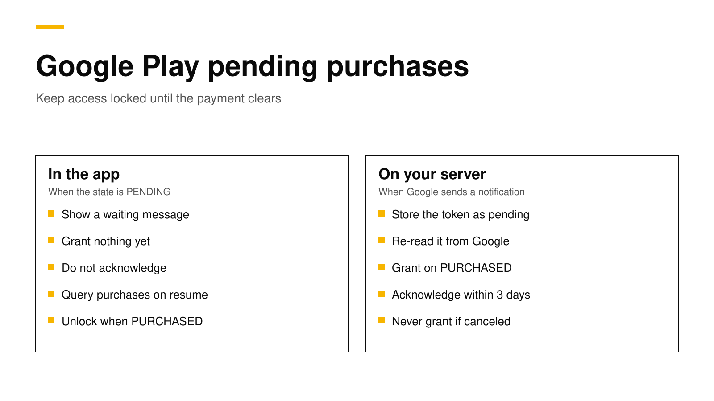

# Google Play pending purchases: how to handle them

A pending purchase on Google Play is a purchase the customer has started but not yet paid for. It happens when someone chooses to pay with cash at a store, with a bank transfer, or with another payment method that takes time to clear. Google says your app must not grant access until the purchase moves from `PENDING` to `PURCHASED`, and must not acknowledge it before then ([Google](https://developer.android.com/google/play/billing/integrate#pending)). If you treat a pending purchase like a finished one, you give away the product for free, and if you treat it like a failure, the customer pays and gets nothing.

This post shows how to enable pending purchases, the Kotlin code for the purchase listener, how to catch payments that clear while your app is closed, what your server should do, and how to test the whole flow without real money. Every fact about Google and RevenueCat links its source and was checked on November 9, 2026.



## The short answer

- **Enable them when you build the client.** Google Play Billing Library 8 requires `enablePendingPurchases(PendingPurchasesParams.newBuilder().enableOneTimeProducts().build())`, and prepaid subscription plans need `enablePrepaidPlans()` as well ([Google](https://developer.android.com/reference/com/android/billingclient/api/PendingPurchasesParams.Builder)).
- **Check the state of every purchase.** Call `getPurchaseState()` and grant access only when it returns `PURCHASED` ([Google](https://developer.android.com/google/play/billing/integrate#pending)).
- **Do not acknowledge a pending purchase.** The three-day acknowledgement window starts only when the purchase becomes `PURCHASED`.
- **Expect the payment to clear later.** Call `queryPurchasesAsync()` when the app starts and in `onResume()`, and let your server listen for real-time developer notifications.
- **Handle the cancel case.** If the customer never pays, Google sends `ONE_TIME_PRODUCT_CANCELED` or `SUBSCRIPTION_PENDING_PURCHASE_CANCELED`, and the customer should never have had access.

## What a pending purchase is

Most Google Play purchases finish in seconds. The customer taps buy, the card is charged, and your `PurchasesUpdatedListener` receives a purchase in the `PURCHASED` state. A pending purchase takes a different path. Google's example is a customer who chooses to pay in cash at a physical store: Google gives them a code, they show the code to a cashier, and only then does Google tell you and the customer that the payment arrived ([Google](https://developer.android.com/google/play/billing/integrate#pending)).

Two other cases look similar. A family member can approve a purchase on another device, and a pre-order stays `PENDING` until its release date and then becomes `PURCHASED` without any action from the customer ([Google](https://developer.android.com/google/play/billing/integrate#granting-entitlement)).

Pending purchases apply to one-time products, such as credit packs or a lifetime unlock. For subscriptions, they apply only to prepaid plans, which do not renew on their own. Google says pending transactions for subscriptions exist only for prepaid plans on Billing Library 7.0 and later, and you must enable them explicitly ([Google](https://developer.android.com/google/play/billing/subscriptions#pending)). A normal auto-renewing subscription never reaches your app as a pending purchase.

## The states you will see

| Where you look | Pending | Paid | Never paid |
|---|---|---|---|
| `Purchase.getPurchaseState()` in the app | `PENDING` | `PURCHASED` | The purchase disappears |
| `purchases.products.get` on your server | `purchaseState` 2 | `purchaseState` 0 | `purchaseState` 1 |
| `purchases.subscriptionsv2.get` on your server | `SUBSCRIPTION_STATE_PENDING` | `SUBSCRIPTION_STATE_ACTIVE` | `SUBSCRIPTION_STATE_PENDING_PURCHASE_CANCELED` |
| Real-time developer notification | None | `ONE_TIME_PRODUCT_PURCHASED` or `SUBSCRIPTION_PURCHASED` | `ONE_TIME_PRODUCT_CANCELED` or `SUBSCRIPTION_PENDING_PURCHASE_CANCELED` |

The product values come from Google's reference for `purchases.products`, which lists 0 as purchased, 1 as canceled and 2 as pending ([Google](https://developers.google.com/android-publisher/api-ref/rest/v3/purchases.products)). The subscription states come from `purchases.subscriptionsv2` ([Google](https://developers.google.com/android-publisher/api-ref/rest/v3/purchases.subscriptionsv2)), and the notification types come from the [real-time developer notifications reference](https://developer.android.com/google/play/billing/rtdn-reference).

## Step 1: Enable pending purchases

You turn pending purchases on when you build the `BillingClient`. Since Billing Library 8, the version without arguments is gone, so every app passes a `PendingPurchasesParams` object ([Google](https://developer.android.com/google/play/billing/release-notes)). Our [Billing Library 8 migration guide](google-play-billing-library-8-migration.md) covers the other changes in that release.

```kotlin
val billingClient = BillingClient.newBuilder(context)
    .setListener(purchasesListener)
    .enablePendingPurchases(
        PendingPurchasesParams.newBuilder()
            .enableOneTimeProducts()   // required
            .enablePrepaidPlans()      // only if you sell prepaid subscription plans
            .build()
    )
    .enableAutoServiceReconnection()
    .build()
```

Google calls `enableOneTimeProducts()` mandatory. By calling it, you tell Google that your app will not grant access before the payment clears ([Google](https://developer.android.com/reference/com/android/billingclient/api/PendingPurchasesParams.Builder)).

## Step 2: Branch on the purchase state

Your listener receives pending and finished purchases through the same callback, so the first thing to read is the state. The code below sends every purchase to your server, shows a waiting message for pending ones, and leaves acknowledgement to the paid path.

```kotlin
private val purchasesListener = PurchasesUpdatedListener { result, purchases ->
    if (result.responseCode != BillingClient.BillingResponseCode.OK || purchases == null) return@PurchasesUpdatedListener
    purchases.forEach { handlePurchase(it) }
}

private fun handlePurchase(purchase: Purchase) {
    when (purchase.purchaseState) {
        Purchase.PurchaseState.PURCHASED -> {
            // Your server verifies the token, grants access and acknowledges (or consumes).
            scope.launch { api.recordPurchase(purchase.purchaseToken, purchase.products) }
        }
        Purchase.PurchaseState.PENDING -> {
            // Save the token so you can match it later, but do not unlock anything.
            scope.launch { api.recordPending(purchase.purchaseToken, purchase.products) }
            showMessage("Your purchase is waiting for payment. We will unlock it as soon as Google confirms it.")
        }
        else -> Unit // UNSPECIFIED_STATE: ignore
    }
}
```

The waiting message matters more than it seems. A customer who sees nothing happen is likely to tap buy again or write to support, so tell them what is happening and close the paywall. Google gives the same advice: if the state is pending, tell the customer what they still need to do before access is granted ([Google](https://developer.android.com/google/play/billing/integrate#granting-entitlement)).

For prepaid plans there is one more case. When a customer starts a pending top-up, upgrade or downgrade, your app receives the old subscription's `Purchase` with a `PendingPurchaseUpdate` object that holds the new product IDs and purchase token. The customer keeps the old plan until the payment clears, and only then should you replace the old token with the new one ([Google](https://developer.android.com/google/play/billing/subscriptions#pending)).

## Step 3: Catch payments that clear while the app is closed

A customer may pay at the store hours later, when your app is not running. Google gives you two ways to find out, and you should use both.

1. **Query purchases when the app connects and resumes.** Google recommends calling `queryPurchasesAsync()` after the billing connection succeeds and in `onResume()`, so purchases that moved to `PURCHASED` while the app was closed are processed ([Google](https://developer.android.com/google/play/billing/integrate#process)).
2. **Listen for real-time developer notifications on your server.** When the purchase completes, Google sends `ONE_TIME_PRODUCT_PURCHASED` or `SUBSCRIPTION_PURCHASED`. When it is canceled, Google sends `ONE_TIME_PRODUCT_CANCELED` or `SUBSCRIPTION_PENDING_PURCHASE_CANCELED` ([Google](https://developer.android.com/google/play/billing/integrate#pending)).

```kotlin
override fun onResume() {
    super.onResume()
    billingClient.queryPurchasesAsync(
        QueryPurchasesParams.newBuilder().setProductType(BillingClient.ProductType.INAPP).build()
    ) { result, purchases ->
        if (result.responseCode == BillingClient.BillingResponseCode.OK) purchases.forEach { handlePurchase(it) }
    }
}
```

The server notification is the one you can rely on. The customer may not open the app for days, and the notification arrives anyway. If you also email or push a message when the payment clears, the customer knows to come back.

## Step 4: Verify and acknowledge on your server

Your server should treat the purchase token as a claim and ask Google for the truth. For a one-time product, call `purchases.products.get`. For a subscription, call `purchases.subscriptionsv2.get`. Grant access only when the state says paid. This Node.js example uses Google's `googleapis` package and a service account with access to your Play Console app.

```js
import { google } from "googleapis";

const auth = new google.auth.GoogleAuth({
  keyFile: "service-account.json",
  scopes: ["https://www.googleapis.com/auth/androidpublisher"],
});
const play = google.androidpublisher({ version: "v3", auth });

export async function checkOneTimePurchase(packageName, productId, token) {
  const { data } = await play.purchases.products.get({ packageName, productId, token });
  if (data.purchaseState === 2) return { status: "pending" };   // keep access locked
  if (data.purchaseState === 1) return { status: "canceled" };  // never grant
  // purchaseState 0: paid. Grant access, then acknowledge (or let the app consume a consumable).
  if (data.acknowledgementState === 0) {
    await play.purchases.products.acknowledge({ packageName, productId, token });
  }
  return { status: "paid", orderId: data.orderId };
}
```

Google's rule on acknowledgement is easy to get wrong with pending purchases. You must acknowledge a paid purchase within three days, or Google refunds it and revokes it. For a pending purchase, the three days start only when the state becomes `PURCHASED`, so acknowledging early is both wrong and unnecessary ([Google](https://developer.android.com/google/play/billing/integrate#pending)). Consumables, such as credit packs, are acknowledged when the app consumes them. Our post on [selling credits](sell-credits-in-app-purchases.md) shows a ledger that adds credits only once.

Store the token with a `pending` status as soon as the app reports it. When the notification arrives, you look up the same token, check it with Google, and switch it to `paid` or `canceled`. Because the notification only tells you that something changed, always call the API again rather than trusting the message alone. Our guide to [server-side receipt validation](server-side-receipt-validation.md) covers the setup of the service account and the API calls in more detail.

## Step 5: Test it without real money

Google gives license testers two extra payment methods for this case. **Slow test card, approves after a few minutes** completes the purchase after a short wait, and **Slow test card, declines after a few minutes** cancels it ([Google](https://developer.android.com/google/play/billing/test#pending-purchases)). Run both:

1. Buy with the approving card, close the app at once, wait a few minutes, and open it again. The product should unlock on resume, and your server should have received `ONE_TIME_PRODUCT_PURCHASED`.
2. Buy with the declining card and wait. The product must never unlock, and your server should receive the cancel notification.
3. Buy with the approving card and keep the app open. The listener should fire a second time with `PURCHASED`, and the waiting message should give way to the unlocked content.

Our guide to [testing in-app purchases](sandbox-testing-in-app-purchases.md) covers license testers, testing tracks and the App Store side.

## The iOS equivalent

Apple has a similar case. With Ask to Buy, a child's purchase waits for a parent's approval, and StoreKit 2 returns `.pending` from `purchase()`. The approved transaction later arrives through `Transaction.updates`, which is why every iOS app needs that listener running from launch ([Apple](https://developer.apple.com/documentation/storekit/product/purchaseresult/pending)). Our post on [Transaction.updates](storekit-2-transaction-updates.md) shows the full store class.

## If you use the RevenueCat SDK or RevenueDot

The purchases SDK handles most of this for you. When a purchase is pending, it raises `paymentPendingError` (code 20) instead of returning a successful result. That error is not a failure: show a waiting message and close the paywall, and do not start the purchase again ([paymentPendingError](../docs/errors/sdk-payment-pending-error.md)). RevenueCat's own engineering post on Google Play edge cases describes the same rule of granting nothing until the state is purchased ([RevenueCat](https://www.revenuecat.com/blog/engineering/google-play-edge-cases)).

RevenueDot is an open-source backend for in-app purchases that works with the RevenueCat SDK. Its server follows Google's rules for pending purchases, and you can read the code:

- **It never grants a pending purchase.** When the SDK posts a pending Google Play purchase to `POST /v1/receipts`, the server answers with HTTP 503, so the SDK keeps the purchase and retries later instead of dropping it ([source](https://github.com/revenuedot/revenuedot/blob/main/apps/server/src/stores/google/index.ts)). Our page on [4xx and 5xx receipt errors](../docs/help/receipt-errors-4xx-vs-5xx.md) explains why a temporary problem must never return a 4xx.
- **It does not acknowledge too early.** The server acknowledges a subscription only when it has left the pending states, and it leaves consumables for the app to consume.
- **It processes the notifications.** For each subscription notification it reads the purchase again from Google; a pending state changes nothing, and the purchased notification that follows grants access. A [canceled pending purchase](../docs/notifications/google-subscription-pending-purchase-canceled.md) never grants access ([source](https://github.com/revenuedot/revenuedot/blob/main/apps/server/src/stores/google/sync.ts)).

To be clear about where this stands: RevenueDot's Google Play handling is tested against a copy of Google's API, and no real Google Play purchase has run end to end against RevenueDot yet.

New apps install the [RevenueDot SDK](../docs/sdks/README.md). Its code says `import RevenueCat` because it is built from RevenueCat's MIT-licensed SDK, and it needs no RevenueCat account. The [Google Play guide](../docs/guides/google-play.md) shows how to connect the service account and real-time developer notifications.

**Switching from RevenueCat? Keep your SDK and change one line.** An app that ships the RevenueCat SDK can point its proxy URL at RevenueDot and keep its code, offerings and customers. See the [migration guide](https://revenuedot.app/migrate-from-revenuecat), the [comparison](https://revenuedot.app/compare/revenuedot-vs-revenuecat) and the [RevenueCat fee calculator](https://revenuedot.app/tools/revenuecat-fee-calculator).

[Start for free on RevenueDot Cloud](https://app.revenuedot.app/signup). Building and testing are free, no card needed. Add a card when you go live; Pro costs $0 until your apps make $10,000 a month. See [pricing](https://revenuedot.app/pricing).

## FAQ

### What does a pending purchase mean on Google Play?

It means the customer started the purchase but the payment has not cleared yet, for example because they chose to pay in cash at a store. Your app should show a waiting message and grant nothing until the state becomes `PURCHASED` ([Google](https://developer.android.com/google/play/billing/integrate#pending)).

### Should I acknowledge a pending purchase?

No. Acknowledge only after the state is `PURCHASED`. The three-day acknowledgement window starts when the purchase moves from `PENDING` to `PURCHASED`, so there is no deadline to miss while it waits ([Google](https://developer.android.com/google/play/billing/integrate#pending)).

### How long can a Google Play purchase stay pending?

Google does not publish one fixed limit in its integration guide. If the customer does not pay within the time the payment method allows, Google cancels the purchase and sends `ONE_TIME_PRODUCT_CANCELED` or `SUBSCRIPTION_PENDING_PURCHASE_CANCELED` to your server ([Google](https://developer.android.com/google/play/billing/integrate#pending)).

### Can subscriptions be pending on Google Play?

Only prepaid plans, and only if you call `enablePrepaidPlans()` on Billing Library 7.0 or later. Auto-renewing subscriptions do not reach your app as pending purchases ([Google](https://developer.android.com/google/play/billing/subscriptions#pending)).

### How do I test pending purchases?

Add a license tester in the Play Console and buy with **Slow test card, approves after a few minutes** or **Slow test card, declines after a few minutes**. The first completes the purchase after a short wait, and the second cancels it ([Google](https://developer.android.com/google/play/billing/test#pending-purchases)).

**About RevenueDot.** RevenueDot is an open-source (AGPL-3.0) backend for in-app purchases and subscriptions on the App Store, Google Play and the web. Start for free on [RevenueDot Cloud](https://app.revenuedot.app/signup): Pro costs $0 until your apps make $10,000 a month, then 0.5% of revenue above $10,000, never more than $999 a month. New apps install the [RevenueDot SDK](../docs/sdks/README.md) and pass their key. Apps that ship the RevenueCat SDK point its proxy URL at RevenueDot and keep their code, offerings and customers. Read the [quickstart](../docs/getting-started/quickstart.md) or the code on [GitHub](https://github.com/revenuedot/revenuedot).
