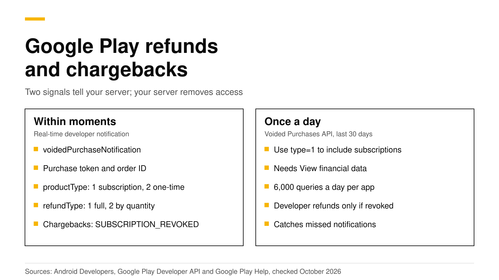

# How to handle Google Play refunds and chargebacks

Google Play tells your backend about a refund, a chargeback or a revoked purchase in two ways. A real-time developer notification with a `voidedPurchaseNotification` arrives within moments, and the Voided Purchases API lists every voided order of the last 30 days. Use the notification to remove access right away, and run a daily job against the API to catch anything you missed. A refund you issue yourself in Play Console or through the API shows up in both places only if you choose to revoke access, so decide that before you click.

This post explains who can refund a Google Play purchase, what each signal contains, the difference between cancel and revoke, and code for both the notification and the daily check. Every Google fact links Google's documentation and was checked on October 19, 2026.



## The short answer

- **Customers can ask Google within 48 hours.** After 48 hours, Google tells them to contact the developer ([Google Play Help](https://support.google.com/googleplay/answer/15574908?hl=en)).
- **You learn about it from a notification.** A `voidedPurchaseNotification` carries the purchase token, the order ID, the product type and the refund type ([Android Developers](https://developer.android.com/google/play/billing/rtdn-reference)).
- **The Voided Purchases API is the backup.** It lists refunds, chargebacks and cancellations from the last 30 days only ([Google](https://developers.google.com/android-publisher/voided-purchases)).
- **Your own refunds appear only if you revoke.** Google says only revoked orders show in the Voided Purchases API ([Google](https://developers.google.com/android-publisher/voided-purchases)).
- **Cancel and revoke are not the same.** A cancel stops renewal and keeps access to the end of the period; a revoke stops renewal and removes access at once ([Android Developers](https://developer.android.com/google/play/billing/subscriptions)).
- **A chargeback revokes a subscription.** Google sends `SUBSCRIPTION_REVOKED` and says to remove access immediately ([Android Developers](https://developer.android.com/google/play/billing/lifecycle/subscriptions)).

## Who can refund a Google Play purchase?

Three parties can void a purchase, and your backend has to handle all of them the same way.

1. **The customer, through Google.** Google's refund policy says that within 48 hours of a purchase the customer may get a refund depending on its details, and that after 48 hours they should contact the developer ([Google Play Help](https://support.google.com/googleplay/answer/15574908?hl=en)).
2. **You, the developer.** In Play Console's order management you can refund an order, and choose **Refund and revoke** to remove the item as well. Google's help page says that refunding the most recent order of a subscription removes the subscription at once and cancels future renewals, while refunding an older order leaves the subscription active ([Play Console Help](https://support.google.com/googleplay/android-developer/answer/2741495?hl=en)).
3. **The bank or Google.** A chargeback from the customer's card issuer, or a cancellation by Google, voids the purchase too ([Google](https://developers.google.com/android-publisher/voided-purchases)).

Unlike Apple, Google does not ask you for consumption data before it decides a refund. If you also sell on iOS, our post on [Apple refund requests](apple-refund-requests-consumption-info.md) covers Apple's side.

## Cancel, revoke and refund are three different things

Developers mix these up more than anything else in Play Billing, and the mix-up costs either money or customers.

| Action | Stops renewal | Removes access | Gives money back | Notification |
|---|---|---|---|---|
| Cancel | Yes | No, access lasts to `expiryTime` | No | `SUBSCRIPTION_CANCELED` |
| Revoke | Yes | Yes, at once | Depends on the refund type | `SUBSCRIPTION_REVOKED` |

Both rows come from Google's subscription guides ([Android Developers](https://developer.android.com/google/play/billing/subscriptions), [lifecycle](https://developer.android.com/google/play/billing/lifecycle/subscriptions)). Google warns that removing access while a customer is still entitled, for example after a plain cancel, breaks its subscriptions policy. A refund is a third thing: it gives money back, and a developer refund shows up in the Voided Purchases API only when you also chose to revoke ([Google](https://developers.google.com/android-publisher/voided-purchases)).

From a server, `purchases.subscriptionsv2.revoke` takes a `revocationContext` that says how to refund: the full amount of the latest charge, a prorated amount for the time left, or one item of a subscription with add-ons ([Google](https://developers.google.com/android-publisher/api-ref/rest/v3/purchases.subscriptionsv2/revoke)). For a single order, `orders.refund` takes a `revoke` flag ([Google](https://developers.google.com/android-publisher/api-ref/rest/v3/orders/refund)).

## Signal 1: the voided purchase notification

If you have [real-time developer notifications](android-google-play-billing-subscriptions.md) set up, Google publishes a Pub/Sub message for each voided purchase. It looks like this ([Android Developers](https://developer.android.com/google/play/billing/rtdn-reference)):

```json
{
  "version": "1.0",
  "packageName": "com.example.app",
  "eventTimeMillis": "1760860800000",
  "voidedPurchaseNotification": {
    "purchaseToken": "PURCHASE_TOKEN",
    "orderId": "GPA.1234-5678-9012-34567",
    "productType": 1,
    "refundType": 1
  }
}
```

- **`productType`** is 1 for a subscription and 2 for a one-time product.
- **`refundType`** is 1 for a full refund and 2 for a partial refund by quantity, which only applies to purchases of more than one unit. When the last units of such a purchase are refunded, the type becomes 1.
- **`orderId`** names the exact order. For a subscription, each renewal has its own order ID, so a refund of an old renewal and a refund of the current period look different.

Google says the notification alone is enough to find the purchase and order for an access change ([Android Developers](https://developer.android.com/google/play/billing/rtdn-reference)). For a subscription, read it again from `purchases.subscriptionsv2` anyway, because the state you need (expired, or still active after an old order was refunded) lives there.

Here is a minimal handler in Node.js. It assumes you already decode the Pub/Sub push body and have a `db` and a Play Developer API client.

```js
export async function handleVoided(n, { db, play, packageName }) {
  const { purchaseToken, orderId, productType, refundType } = n.voidedPurchaseNotification;

  if (productType === 1) {
    // Subscription: read the current state; a refund of an old renewal leaves it active.
    const sub = await play.purchases.subscriptionsv2.get({ packageName, token: purchaseToken });
    const active = sub.data.subscriptionState === "SUBSCRIPTION_STATE_ACTIVE";
    await db.markRefunded({ purchaseToken, orderId });
    if (!active) await db.revokeAccess({ purchaseToken });
    return;
  }

  if (refundType === 2) {
    // Partial refund of a multi-quantity purchase: reduce the balance by the refunded units.
    return db.reduceQuantity({ purchaseToken, orderId });
  }
  await db.markRefunded({ purchaseToken, orderId });
  await db.revokeAccess({ purchaseToken });
}
```

Answer Pub/Sub with a 2xx status only after the change is saved. Google redelivers messages that are not acknowledged, and its reference suggests checking each `messageId` so a redelivered message is not processed twice ([Android Developers](https://developer.android.com/google/play/billing/rtdn-reference)).

## Signal 2: the Voided Purchases API

Notifications can be lost: a Pub/Sub subscription misconfigured for a day, a deploy that returned errors, or a backend that was down. The [Voided Purchases API](https://developers.google.com/android-publisher/voided-purchases) is the safety net. What matters about it:

- **It reaches back 30 days.** Run it at least once a day, from the last time you ran it.
- **Ask for subscriptions too.** The default `type=0` returns only one-time products; `type=1` returns both. Google asks you to match by `orderId` when you use `type=1`, because subscription renewals share a purchase token.
- **It needs financial access.** The service account needs the **View financial data** permission in Play Console.
- **It has quotas.** Each app can make 6,000 queries a day and 30 in any 30 seconds, with up to 1,000 results per page.
- **It has rules.** Google's API terms say this data may be used only to revoke access to refunded or charged-back purchases and to fight fraud ([Google](https://developers.google.com/android-publisher/terms)).

```js
// Once a day: everything voided since the last run, at most 30 days back.
const res = await play.purchases.voidedpurchases.list({
  packageName,
  startTime: String(lastRunMs),
  type: 1,
  maxResults: 1000,
});
for (const v of res.data.voidedPurchases ?? []) {
  // Skip orders you already recorded from a notification, then handle the rest
  // exactly like a voidedPurchaseNotification.
}
```

## What about repeat refunders?

Some customers buy, use the product and ask for a refund, again and again. Google's guidance on the Voided Purchases API asks you to apply any policy uniformly, to start with a warning inside the app, to tell customers before you change a policy and when you revoke access, and to let them dispute a decision ([Google](https://developers.google.com/android-publisher/voided-purchases)). Keep a refund count per customer from both signals, and look at it before you take any step beyond removing the refunded item.

## How RevenueDot handles Google Play refunds

RevenueDot is an open-source backend for in-app purchases that works with the RevenueCat SDK and its forks, the RevenueDot SDKs. You add a Google Play service account and a Pub/Sub topic once, and it does the work above for you ([Google Play setup](../docs/guides/google-play.md)):

- **Voided purchase notifications** are stored once by message ID, and the purchase is read again from the Play Developer API before anything changes.
- **A daily check of the Voided Purchases API** covers the last 30 days as a backup for missed notifications. This needs the service account's financial permission.
- **Access ends at the refund time.** A refunded subscription or one-time product drops out of the customer's entitlements, so the SDK's `customerInfo` shows it inactive on the next fetch.
- **A refund of an old renewal is left alone**, so the customer keeps their current paid period, which matches what Google does.
- **Your backend gets a webhook.** A refund arrives as a `CANCELLATION` event with `cancel_reason: CUSTOMER_SUPPORT` and a negative price ([webhook reference](../docs/webhooks/webhook-cancellation.md)).
- **You can refund from your server.** `POST /v2/projects/{project_id}/subscriptions/{subscription_id}/actions/refund` refunds and revokes a subscription order, and the purchases route does the same for one-time products.

Be aware of the limits. No real Google Play purchase has run end to end against RevenueDot yet; Play handling is tested against a copy of Google's API, so test refunds with a license tester before you rely on them. Partial refunds by quantity of one-time products are not recorded yet.

**Switching from RevenueCat?** Keep your SDK and change one line: point its proxy URL at RevenueDot. The [migration guide](../docs/migrate/README.md) covers importing customers, the [RevenueCat comparison](https://revenuedot.app/compare/revenuedot-vs-revenuecat) shows where each one is stronger, and the [fee calculator](https://revenuedot.app/tools/revenuecat-fee-calculator) shows the cost at your revenue. See [pricing](https://revenuedot.app/pricing) for RevenueDot's plans.

[Start for free on RevenueDot Cloud](https://app.revenuedot.app/signup). Building and testing are free, no card needed. Add a card when you go live; Pro costs $0 until your apps make $10,000 a month.

## FAQ

### How do I know if a Google Play purchase was refunded?

Turn on real-time developer notifications with voided purchases included, and handle each `voidedPurchaseNotification` ([Android Developers](https://developer.android.com/google/play/billing/rtdn-reference)). Once a day, also call the Voided Purchases API for anything you missed in the last 30 days ([Google](https://developers.google.com/android-publisher/voided-purchases)).

### Does Google remove access after a refund automatically?

Your backend decides what your app unlocks, so it must remove access when the voided purchase arrives. For a revoked subscription, Google sets `subscriptionState` to `SUBSCRIPTION_STATE_EXPIRED` and says to remove access immediately ([Android Developers](https://developer.android.com/google/play/billing/lifecycle/subscriptions)).

### Why is my refund missing from the Voided Purchases API?

Either it is older than 30 days, you queried with the default `type=0`, which leaves subscriptions out, or it was a developer refund without revoke. Google lists developer refunds only when the revoke option was set ([Google](https://developers.google.com/android-publisher/voided-purchases)).

### Should I revoke access when a customer cancels?

No. A cancel stops renewal but the customer keeps access until `expiryTime`, and Google says removing access while the customer is still entitled breaks its subscriptions policy ([Android Developers](https://developer.android.com/google/play/billing/lifecycle/subscriptions)).

### Can a customer get a refund after 48 hours?

Not from Google directly. Google's policy sends customers to the developer after 48 hours ([Google Play Help](https://support.google.com/googleplay/answer/15574908?hl=en)), and you can refund any order in Play Console or through `orders.refund`.

**About RevenueDot.** RevenueDot is an open-source (AGPL-3.0) backend for in-app purchases and subscriptions on the App Store, Google Play and the web. Start for free on [RevenueDot Cloud](https://app.revenuedot.app/signup): Pro costs $0 until your apps make $10,000 a month, then 0.5% of revenue above $10,000, never more than $999 a month. New apps install the [RevenueDot SDK](../docs/sdks/README.md) and pass their key. Apps that ship the RevenueCat SDK point its proxy URL at RevenueDot and keep their code, offerings and customers. Read the [quickstart](../docs/getting-started/quickstart.md) or the code on [GitHub](https://github.com/revenuedot/revenuedot).
