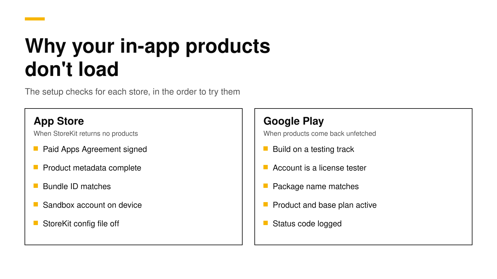

# Why in-app products don't load on iOS and Android

When your paywall shows no prices, the store almost never says why. On iOS, StoreKit's `Product.products(for:)` silently leaves out every product ID it cannot find and returns an empty array ([Apple](https://developer.apple.com/documentation/storekit/product/products(for:))). On Android, Google Play Billing returns the missing IDs in an `unfetchedProductList` with a status code ([Google](https://developer.android.com/google/play/billing/integrate)). The cause is nearly always setup, not code: an unsigned agreement, a product that is not ready, a bundle ID or package name that does not match, or a test device that is not signed in as a tester.

This post lists the causes on each store in the order worth checking, shows a few lines of Swift and Kotlin that tell you which product failed, and explains what "empty offerings" means when you use a backend such as RevenueDot or RevenueCat. Every fact about Apple, Google and RevenueCat links its source and was checked on November 2, 2026.



## The short answer

- **Find out which IDs failed first.** Print the IDs you asked for next to the IDs that came back. On Android, print each unfetched product's status code.
- **iOS, most common causes:** the Paid Apps Agreement is not signed ([Apple](https://developer.apple.com/help/app-store-connect/manage-agreements/sign-and-update-agreements)), the product is missing metadata, the bundle ID does not match, or the device is not using a sandbox account.
- **Android, most common causes:** the app was never uploaded to a testing track, the Google account is not a license tester, the package name does not match, or the product is not active ([Google](https://developer.android.com/google/play/billing/test)).
- **New products take time.** Apple says metadata changes can take up to one hour to reach the sandbox ([Apple](https://developer.apple.com/documentation/storekit/testing-win-back-offers-in-the-sandbox-environment)), and Google lists a product that is "just created but not fully propagated yet" as a cause of `PRODUCT_NOT_FOUND` ([Google](https://developer.android.com/reference/com/android/billingclient/api/UnfetchedProduct.StatusCode)).
- **"Empty offerings" is a different problem.** Your backend sent a list of product IDs and the store could not load them, or your backend sent no list at all. Check both.

## Step 1: find out which product failed

Before you change any settings, log exactly what the store returned. This turns "nothing loads" into one or two product IDs with a reason.

On iOS with StoreKit 2:

```swift
import StoreKit

let wanted: Set<String> = ["pro_monthly", "pro_annual", "credits_100"]

func checkProducts() async {
    do {
        let products = try await Product.products(for: wanted)
        let found = Set(products.map(\.id))
        print("Found:", found.sorted())
        print("Missing:", wanted.subtracting(found).sorted())
    } catch {
        // A thrown error is a system problem (network, StoreKit), not a missing product.
        print("StoreKit error:", error)
    }
}
```

An empty "Missing" list with no paywall means your UI code has the bug. A full "Missing" list means the store cannot see any of your products, which points to an account-level cause such as the agreement or the bundle ID. A partial list points to those products' own setup.

On Android with Google Play Billing Library 8:

```kotlin
val params = QueryProductDetailsParams.newBuilder()
    .setProductList(listOf(
        QueryProductDetailsParams.Product.newBuilder()
            .setProductId("pro")
            .setProductType(BillingClient.ProductType.SUBS)
            .build()
    ))
    .build()

billingClient.queryProductDetailsAsync(params) { billingResult, result ->
    Log.d("IAP", "response=${billingResult.responseCode}")
    result.productDetailsList.forEach { Log.d("IAP", "found ${it.productId}") }
    result.unfetchedProductList.forEach {
        // 2 = INVALID_PRODUCT_ID_FORMAT, 3 = PRODUCT_NOT_FOUND, 4 = NO_ELIGIBLE_OFFER
        Log.d("IAP", "missing ${it.productId} status=${it.statusCode}")
    }
}
```

Google documents four status codes ([Google](https://developer.android.com/reference/com/android/billingclient/api/UnfetchedProduct.StatusCode)):

| Status code | Meaning | What to check |
|---|---|---|
| `INVALID_PRODUCT_ID_FORMAT` (2) | The ID breaks Play's format rules | IDs must start with a number or lowercase letter ([Google](https://support.google.com/googleplay/android-developer/answer/1153481?hl=en)) |
| `PRODUCT_NOT_FOUND` (3) | No product with this ID and type | Typos, the wrong product type (`SUBS` against `INAPP`), a deleted product, or a product created minutes ago |
| `NO_ELIGIBLE_OFFER` (4) | The product exists but has nothing to buy | A subscription with no active base plan, or a one-time product with no purchase option |
| `UNKNOWN` (0) | Anything else | Retry, then check the Play Store app and the tester account |

If your app is older and still on Billing Library 7 or earlier, our [Billing Library 8 migration post](google-play-billing-library-8-migration.md) covers the change to `queryProductDetailsAsync` and the deadline.

## iOS: the causes, in the order to check

Work down this table. The first rows block every product at once, so check them first when nothing loads.

| Check | Why it matters | Where to look |
|---|---|---|
| The Paid Apps Agreement is signed and active | Apple says the Account Holder must sign it "to sell your apps on the App Store or offer In-App Purchases" ([Apple](https://developer.apple.com/help/app-store-connect/manage-agreements/sign-and-update-agreements)) | App Store Connect, Business |
| Tax and banking are complete | An update to tax or banking information can create a new agreement to accept ([Apple](https://developer.apple.com/help/app-store-connect/manage-agreements/sign-and-update-agreements)) | App Store Connect, Business |
| The bundle ID in Xcode matches the app in App Store Connect | Products belong to one app record | Xcode target, Signing & Capabilities |
| The product ID matches exactly | IDs are case sensitive, and StoreKit drops IDs it cannot find without an error ([Apple](https://developer.apple.com/documentation/storekit/product/products(for:))) | App Store Connect, the product page |
| The product has all its metadata | A product missing its display name, price or review screenshot is not ready | App Store Connect, the product's status |
| The device uses a sandbox account | Development builds buy with a Sandbox Apple Account, set under Settings, Developer ([Apple](https://developer.apple.com/documentation/storekit/testing-win-back-offers-in-the-sandbox-environment)) | The test device |
| The Xcode scheme does not point at a StoreKit configuration file when you mean to test the sandbox | When the configuration file is active, StoreKit uses its local data instead of App Store Connect ([Apple](https://developer.apple.com/documentation/xcode/setting-up-storekit-testing-in-xcode)) | Xcode, Edit Scheme, Run, Options |
| You waited after a change | Metadata changes can take up to one hour to appear in the sandbox ([Apple](https://developer.apple.com/documentation/storekit/testing-win-back-offers-in-the-sandbox-environment)) | A clock |

Two more rules catch people at release time, not during testing:

- **The first in-app purchase of each type ships with an app version.** Apple says the first consumable, non-consumable, auto-renewable subscription and non-renewing subscription "must be submitted with a new app version" ([Apple](https://developer.apple.com/help/app-store-connect/manage-submissions-to-app-review/submit-an-in-app-purchase)). If you submit the app without its subscription attached, the live app will find no products.
- **Simulators and StoreKit testing.** The simulator can load products from a StoreKit configuration file, which is the fastest way to build a paywall. To test against App Store Connect, use a real device with a sandbox account, or TestFlight. Our [testing guide](sandbox-testing-in-app-purchases.md) walks through each environment.

## Android: the causes, in the order to check

Google Play blocks the billing library for apps that are not signed and uploaded to Play, unless the Google account on the device is a license tester ([Google](https://developer.android.com/google/play/billing/test)). That one rule explains most "nothing loads" reports on Android.

| Check | Why it matters | Where to look |
|---|---|---|
| A build has been uploaded to a testing track | Products need an app on Play; after you publish to a test track "it can take a few hours for the app to be available for testers" ([Google](https://developer.android.com/google/play/billing/test)) | Play Console, Testing |
| The Google account on the device is a license tester | License testers can run debug and sideloaded builds and buy with test cards ([Google](https://developer.android.com/google/play/billing/test)) | Play Console, Settings, License testing |
| The tester opted in to the test | Testers on a track must accept the opt-in link ([Google](https://developer.android.com/google/play/billing/test)) | The test's opt-in URL |
| The package name matches | Google says the package name "must match that of the app that is configured for Google Play" ([Google](https://developer.android.com/google/play/billing/test)) | `applicationId` in Gradle |
| The app declares the billing permission | Play requires `com.android.vending.BILLING` in the manifest ([Google](https://support.google.com/googleplay/android-developer/answer/1153481?hl=en)) | The merged manifest (the billing library adds it) |
| The product is active, and a subscription has an active base plan | Inactive products cannot be bought, and a subscription without a base plan returns `NO_ELIGIBLE_OFFER` | Play Console, Monetize |
| The device has the current Play Store app and the right account | If several accounts are on the device, the purchase uses the one that downloaded the app ([Google](https://developer.android.com/google/play/billing/test)) | The test device |

An emulator works if it has the Play Store app and a signed-in tester account. An emulator image without Google Play cannot load products at all.

## When the store works but offerings are empty

Most apps do not hard-code product IDs. They ask a backend which products to show, then ask the store for prices. With the RevenueCat SDK, that backend is RevenueCat or a compatible server such as RevenueDot, and the call is `getOfferings()`. An empty result can fail at either step:

1. **The backend sent no products.** No offering is marked current, or the current offering's packages hold products for a different app. The store is never asked.
2. **The store could not load the products the backend named.** Every cause in the two tables above applies. RevenueCat's SDK then logs that none of the products registered in its dashboard could be fetched from the store, and its guide lists the same store-side causes ([RevenueCat](https://www.revenuecat.com/docs/offerings/troubleshooting-offerings)).

To tell the two apart, turn on the SDK's debug logs and look at the offerings response before the store request. If the response has packages with `platform_product_identifier` values, the backend did its part, and the problem is in App Store Connect or Play Console. If the response has no current offering, fix the backend first.

Two more backend mistakes look like store problems:

- **The wrong API key for the platform.** Each app (iOS, Android, web) has its own public key. An Android build with the iOS key asks for the iOS products.
- **Google Play IDs in the wrong form.** A Play subscription is a product with base plans. Backends usually store it as `subscription_id:base_plan_id`, such as `pro:monthly`, and a bare `pro` may not match the package you meant.

## How RevenueDot helps you find the cause

RevenueDot is an open-source backend for in-app purchases that works with the RevenueCat SDK. Three parts of it shorten this hunt.

- **The offerings response is easy to inspect.** `GET /v1/subscribers/{app_user_id}/offerings` returns only the packages whose products belong to the calling app, so you can see exactly what the SDK will ask the store for ([Offerings and packages](../docs/concepts/offerings-and-packages.md)). The [troubleshooting page](../docs/help/troubleshooting.md#sdk) lists "Offerings are empty" with its two causes and fixes.
- **The Test Store needs no store account.** A Test Store app with a `test_` key loads products from RevenueDot and buys them through the SDK's test dialog, so you can build and test the paywall before the agreement, the products or the testing track are ready ([Test Store](../docs/guides/test-store.md)).
- **Import products from the stores.** **Import products** reads your products from App Store Connect and Google Play with the app's credentials, so the IDs in your offerings are the store's own, with no typing ([Import products](../docs/guides/import-products.md)).

New apps install the [RevenueDot SDK](../docs/sdks/README.md). Its code says `import RevenueCat` because it is built from RevenueCat's MIT-licensed SDK, and it needs no RevenueCat account. The [quickstart](../docs/getting-started/quickstart.md) gets a first test purchase working in a few minutes.

**Switching from RevenueCat? Keep your SDK and change one line.** An app that ships the RevenueCat SDK can point its proxy URL at RevenueDot and keep its code, offerings and customers. See the [migration guide](https://revenuedot.app/migrate-from-revenuecat), the [RevenueDot vs RevenueCat comparison](https://revenuedot.app/compare/revenuedot-vs-revenuecat) and the [RevenueCat fee calculator](https://revenuedot.app/tools/revenuecat-fee-calculator).

[Start for free on RevenueDot Cloud](https://app.revenuedot.app/signup). Building and testing are free, no card needed. Add a card when you go live; Pro costs $0 until your apps make $10,000 a month. See [pricing](https://revenuedot.app/pricing).

## FAQ

### Why does StoreKit return an empty products array?

StoreKit leaves out every product ID the App Store cannot find, and only throws for system errors ([Apple](https://developer.apple.com/documentation/storekit/product/products(for:))). When every ID is missing, check the Paid Apps Agreement, the bundle ID and the sandbox account first. When only some are missing, check those products' IDs and metadata.

### Why are my products not found on Google Play?

Usually because the app has not been uploaded to a testing track, or the account on the device is not a license tester ([Google](https://developer.android.com/google/play/billing/test)). Log each unfetched product's status code: `PRODUCT_NOT_FOUND` points to the ID, type or a brand-new product, and `NO_ELIGIBLE_OFFER` points to a missing base plan.

### Do I need to sign the Paid Apps Agreement to test in the sandbox?

Apple says the Account Holder must sign the Paid Apps Agreement to offer in-app purchases ([Apple](https://developer.apple.com/help/app-store-connect/manage-agreements/sign-and-update-agreements)). Sign it before you test against App Store Connect. A StoreKit configuration file in Xcode, or RevenueDot's Test Store, lets you build the paywall before then.

### How long do new in-app products take to appear?

Apple says metadata changes can take up to one hour to reach the sandbox ([Apple](https://developer.apple.com/documentation/storekit/testing-win-back-offers-in-the-sandbox-environment)). Google says a newly created product may not be fully propagated yet, and a new testing track can take a few hours to reach testers ([Google](https://developer.android.com/google/play/billing/test)).

### Why are my RevenueCat offerings empty?

Either the backend has no current offering with products for this app, or the store could not load the products the backend named. Debug logs show which. RevenueCat's own guide lists the store-side causes ([RevenueCat](https://www.revenuecat.com/docs/offerings/troubleshooting-offerings)), and they match the tables above.

**About RevenueDot.** RevenueDot is an open-source (AGPL-3.0) backend for in-app purchases and subscriptions on the App Store, Google Play and the web. Start for free on [RevenueDot Cloud](https://app.revenuedot.app/signup): Pro costs $0 until your apps make $10,000 a month, then 0.5% of revenue above $10,000, never more than $999 a month. New apps install the [RevenueDot SDK](../docs/sdks/README.md) and pass their key. Apps that ship the RevenueCat SDK point its proxy URL at RevenueDot and keep their code, offerings and customers. Read the [quickstart](../docs/getting-started/quickstart.md) or the code on [GitHub](https://github.com/revenuedot/revenuedot).
