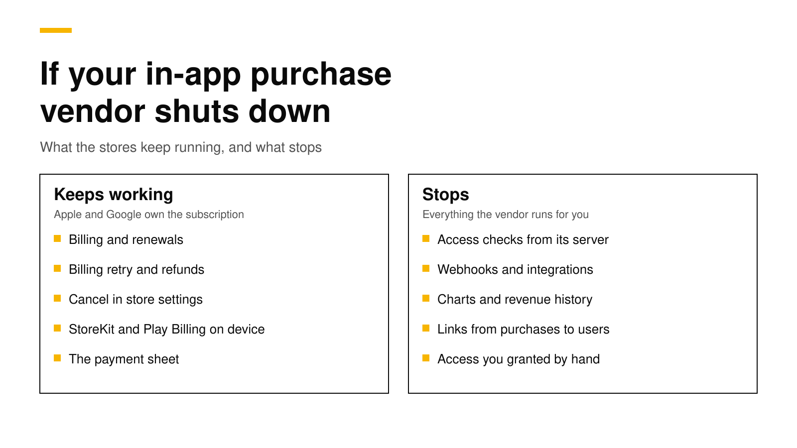

# What happens if your in-app purchase vendor shuts down

If the company behind your in-app purchase backend shuts down, your subscribers keep paying. Apple and Google bill them, renew them and let them cancel, whatever happens to the vendor. What stops is everything the vendor runs for you: the server your app asks "does this customer have Pro?", the webhooks to your own server, your charts, your integrations and, most important, the records that link each store purchase to one of your users. A team that keeps its own store credentials, a daily export and control of its store notifications can move in days. A team that keeps none of them can lose the link between paying customers and their accounts.

This post explains what keeps working, what breaks, what happened when Glassfy closed, and six steps that protect you whichever vendor you use. Every fact about Apple, Google and other vendors links its source and was checked on October 26, 2026.

## The short answer

- **Billing keeps running.** Apple says auto-renewable subscriptions renew at the end of each period until the customer cancels ([Apple](https://developer.apple.com/app-store/subscriptions/)). Google Play works the same way. Your revenue does not stop.
- **Access checks stop.** An app that asks the vendor's server for entitlements gets errors once that server is gone. SDK caches and offline modes help for a while, not for good.
- **Your user links are the asset.** Moving to a new backend needs, for each customer, your app user ID plus the Apple original transaction ID or the Google purchase token. If those live only with the vendor, you need them out before it closes.
- **It has happened before.** Adapty's migration guide, published August 1, 2024, said Glassfy's services would end in December 2024 ([Adapty](https://adapty.io/blog/migrate-from-glassfy-to-adapty/)).
- **Six steps cut the risk:** own your store credentials, export daily, control your store notification URLs, record purchases on your own server, make the SDK host changeable, and practice a restore.

## Why vendor risk is real

An in-app purchase backend sits between your app and two stores. It is a small, critical piece of software, and the market has many young companies in it. For an app that makes $30,000 or more a month on both stores, the vendor's fee is a cost you can plan for, but a vendor that disappears would be a crisis.

Glassfy is the example people remember. It was a hosted subscription backend with its own SDK. In August 2024, Adapty published a guide for Glassfy customers that said Glassfy's services would end in December 2024, and described the move: replace the SDK, ask Glassfy support for a data export, and import it ([Adapty](https://adapty.io/blog/migrate-from-glassfy-to-adapty/)). That guide also notes that the export needed to include iOS receipts and Apple original transaction IDs. When we checked on October 26, 2026, the address of Glassfy's own shutdown announcement redirected to an unrelated website, so the notice itself is gone.

Customers who exported in time had about five months. Customers who did not had nothing to export from.

## What keeps working

The stores own the subscription. Apple and Google hold the payment method, run each renewal, handle billing retries and refunds, and let the customer cancel in their account settings ([Apple](https://developer.apple.com/app-store/subscriptions/)). None of that depends on your vendor.

Your app's own store code also keeps working. On iOS, StoreKit 2 can still list the customer's current entitlements on the device, and on Android, `queryPurchasesAsync()` still returns active subscriptions. A purchase still goes through, because the payment sheet belongs to the store.

## What breaks

| Part | What happens when the vendor's server is gone |
|---|---|
| Access checks | The SDK cannot fetch the customer's status. A cached answer works for a while; new installs and new devices get errors |
| New purchases | The store charges the customer, but the vendor never records the purchase or unlocks it on its server |
| Paywall content | Products, prices and paywall designs that the app downloads from the vendor may not load |
| Webhooks | Your server stops hearing about renewals, cancellations and refunds |
| Integrations | Attribution, analytics and messaging tools stop receiving purchase events |
| History and charts | Revenue history, cohorts and refunds are gone unless you exported them |
| User links | The mapping from store purchases to your app user IDs is gone unless you kept it |
| Granted access | Promotional access you gave by hand exists only in the vendor's database |

Offline modes soften the first two rows but do not remove them. RevenueCat's SDK, for example, turns on its Offline Entitlements when its servers cannot respond, but RevenueCat documents that it only applies to purchases made while the servers are down, does not cover one-time purchases, and does not recognize purchases across platforms ([RevenueCat](https://www.revenuecat.com/docs/customers/customer-info)). Those rules are built for an outage of minutes or hours, not for a company that has closed.

## The data you need to move

A new backend can rebuild almost everything from the stores, as long as it knows which purchase belongs to which of your users. For each paying customer you need ([RevenueCat](https://www.revenuecat.com/docs/revenuecat-support/common-tickets/export-data-or-migrate-away)):

- **App Store:** your app user ID and Apple's original transaction ID.
- **Google Play:** your app user ID, the purchase token and the product ID.
- **Stripe or other web billing:** your app user ID and the provider's subscription ID.

Apple is forgiving here. With any one transaction ID, the App Store Server API returns the customer's full history and subscription status. Google is not. Google's APIs look up a subscription by its purchase token, so without the token you depend on the customer's device, the next renewal notification, or an order ID from their receipt email. Our post on [looking up a purchase by order ID](look-up-purchase-by-order-id.md) shows that last route.

## Six steps to take now

None of these steps needs you to change vendors. They make a change possible on your own schedule.

1. **Own your store credentials.** Keep your App Store In-App Purchase key and your Google Play service account in your own secrets store, not only in the vendor's dashboard. No vendor can export them for you.
2. **Export every day.** Send transaction and customer data to your own storage bucket on a schedule. Our guide to [exporting data from RevenueCat](export-data-from-revenuecat.md) shows what each RevenueCat export holds.
3. **Control your notification URLs.** App Store Connect has one production and one sandbox URL for App Store Server Notifications ([Apple](https://developer.apple.com/help/app-store-connect/configure-in-app-purchase-settings/enter-server-urls-for-app-store-server-notifications)). Point it at an endpoint you control that forwards each notification to the vendor. For Google Play, a Pub/Sub topic can have more than one subscription ([Google Cloud](https://docs.cloud.google.com/pubsub/docs/subscription-overview)), so you can add your own next to the vendor's.
4. **Record purchases on your own server.** Store your app user ID with the Apple original transaction ID or Google purchase token whenever a webhook or your app reports a purchase. This small table is what makes a move safe.
5. **Make the SDK host changeable.** Several SDKs let you set a proxy URL before `configure`. If your app reads that URL from remote config, you can move backends without waiting for every customer to update.
6. **Practice a restore.** Once a quarter, take one test customer and rebuild their access in a second system from your own data alone. A plan you never tested is a hope.

## Questions to ask any vendor

Before you sign up, or before you renew, ask five questions. Write the answers down.

- **Can I get all my data out without a support ticket, and in what format?**
- **Does the export include Google purchase tokens and Apple original transaction IDs?**
- **Is the server open source, and under which license, so the code outlives the company?**
- **Can I run the same server myself if I have to?**
- **How long has it run in production, and for whom?** Maturity matters. A vendor with years of traffic, audits and a large customer base has proven things a young vendor has not.

## Where RevenueDot stands

RevenueDot is an open-source backend for in-app purchases that works with the RevenueCat SDK. It is also a young company: it launched in 2026, has no SOC 2 report yet, and has run next to RevenueCat in one production app since October 2, 2026. We think a young vendor should answer the shutdown question before anyone asks, so here are our answers.

- **The server is open source** under AGPL-3.0 on [GitHub](https://github.com/revenuedot/revenuedot), and the SDKs are MIT-licensed forks of RevenueCat's. If RevenueDot the company disappeared, the code would not.
- **One command exports everything.** `npx revenuedot export`, or **Project settings, Export and move** in the dashboard, builds an archive of every table the project owns, one JSON line per row, with a row count and checksum for each table ([export guide](../docs/guides/move-projects.md#export-everything)). It includes Apple transaction IDs and Google purchase tokens.
- **The same archive runs on your own server.** You can load it into a [self-hosted](https://revenuedot.app/self-host) RevenueDot with Docker and Postgres. Enterprise features on your own servers need an Enterprise license.
- **Scheduled exports** send transactions, customers, subscriptions and events to Amazon S3, Cloudflare R2, Google Cloud Storage or Azure Blob Storage ([integrations](../docs/guides/integrations.md#scheduled-data-exports)).
- **Forwarding is built in.** Each app can forward every store notification to RevenueCat or to your own server, so you keep a second copy of the event stream ([dual run guide](../docs/migrate/dual-run.md)).
- **You can go back.** RevenueCat imports existing subscriptions from store identifiers ([RevenueCat](https://www.revenuecat.com/docs/migrating-to-revenuecat/migrating-existing-subscriptions)), and RevenueDot's export has them.

**Switching from RevenueCat? Keep your SDK and change one line.** An app that ships the RevenueCat SDK can point its proxy URL at RevenueDot and keep its code, offerings and customers. RevenueCat charges 1% of all tracked revenue once you pass $2,500 a month ([RevenueCat](https://www.revenuecat.com/pricing)). See the [RevenueDot vs RevenueCat comparison](https://revenuedot.app/compare/revenuedot-vs-revenuecat), which also lists where RevenueCat is stronger, the [migration guide](https://revenuedot.app/migrate-from-revenuecat), the [RevenueCat fee calculator](https://revenuedot.app/tools/revenuecat-fee-calculator) and [pricing](https://revenuedot.app/pricing).

[Start for free on RevenueDot Cloud](https://app.revenuedot.app/signup). Building and testing are free, no card needed. Add a card when you go live; Pro costs $0 until your apps make $10,000 a month.

## FAQ

### Do subscribers keep getting charged if my subscription vendor shuts down?

Yes. Apple and Google bill the customer and renew the subscription until the customer cancels in their store account ([Apple](https://developer.apple.com/app-store/subscriptions/)). The vendor never holds the payment, so its closing does not stop renewals.

### Will my users lose access if RevenueCat or Adapty goes down?

During a short outage, SDK caches and offline modes keep most current subscribers unlocked; RevenueCat documents the limits of its Offline Entitlements ([RevenueCat](https://www.revenuecat.com/docs/customers/customer-info)). After a permanent shutdown, new installs and new devices cannot get their status until the app points at another backend.

### What data do I need to move to another backend?

For each customer, your app user ID with the Apple original transaction ID, or with the Google purchase token and product ID. A new backend can ask the stores for everything else.

### What happened to Glassfy customers?

Glassfy announced that its services would end in December 2024. Other vendors, such as Adapty, published migration guides that asked customers to request a data export from Glassfy support and replace the SDK ([Adapty](https://adapty.io/blog/migrate-from-glassfy-to-adapty/)).

### Is an open-source backend safer?

It removes one risk: the code survives the company, and you can run it yourself. It does not remove the others, such as bugs or a project that stops getting updates. Check the license, the export format and how long it has run in production.

**About RevenueDot.** RevenueDot is an open-source (AGPL-3.0) backend for in-app purchases and subscriptions on the App Store, Google Play and the web. Start for free on [RevenueDot Cloud](https://app.revenuedot.app/signup): Pro costs $0 until your apps make $10,000 a month, then 0.5% of revenue above $10,000, never more than $999 a month. New apps install the [RevenueDot SDK](../docs/sdks/README.md) and pass their key. Apps that ship the RevenueCat SDK point its proxy URL at RevenueDot and keep their code, offerings and customers. Read the [quickstart](../docs/getting-started/quickstart.md) or the code on [GitHub](https://github.com/revenuedot/revenuedot).
