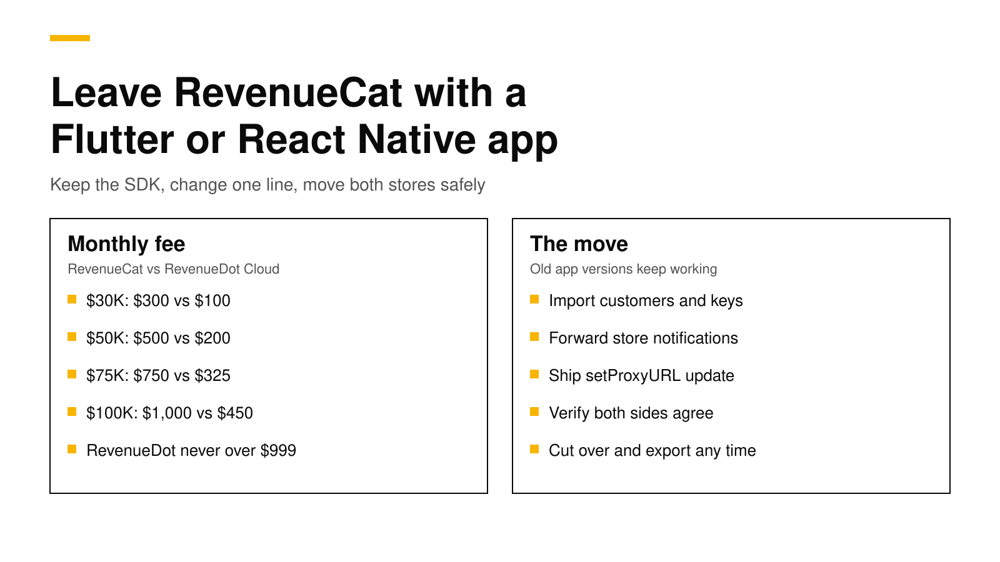

# Leave RevenueCat with a Flutter or React Native app

A Flutter, React Native or Expo app that sells on both the App Store and Google Play can leave RevenueCat without rewriting its purchase code. The RevenueCat SDK has a proxy URL setting, so the app keeps `purchases_flutter` or `react-native-purchases` and points it at another backend that speaks the same protocol, such as RevenueDot. The real work is outside the code: importing customers, sending both stores' notifications to the new backend while old app versions still talk to RevenueCat, and cutting over once the two agree.

This post is for teams that make $30,000 or more a month on two stores. It shows what RevenueCat costs at that size, the exact code change for Flutter and React Native, the steps for each store, what does not move, and where the risks are. Every fact about RevenueCat, Apple and Google links its source and was checked on November 9, 2026.



## The short answer

- **Cost at your size:** RevenueCat charges 1% of all tracked revenue once you reach $2,500 a month, so $30,000 costs $300 a month and $100,000 costs $1,000 ([RevenueCat](https://www.revenuecat.com/pricing)). RevenueDot Cloud costs $100 and $450 at the same levels.
- **Code change:** one call before `configure`. Flutter and React Native both use `await Purchases.setProxyURL(...)`, plus one `syncPurchases()` call on first launch after the update ([SDK changes](../docs/migrate/sdk-changes.md)).
- **Two stores, two notification paths:** App Store Connect takes one notification URL per environment, so RevenueDot receives Apple's notifications and forwards them to RevenueCat. Google Play can send one topic to two push subscriptions.
- **Old app versions keep working.** Customers who never update keep talking to RevenueCat, which stays correct because it still receives every notification.
- **What does not move:** store credentials, paywalls, experiments and virtual currency balances. You enter or rebuild them in the new backend.

## What RevenueCat costs a two-store app at $30K to $100K

RevenueCat's Pro plan is free until monthly tracked revenue reaches $2,500, and then costs 1% of what you track ([RevenueCat](https://www.revenuecat.com/pricing)). A RevenueCat staff member confirmed that the 1% applies to all of it, not only the part above $2,500 ([RevenueCat community](https://community.revenuecat.com/general-questions-7/questions-about-pro-plan-payments-3618)). The fee is on everything RevenueCat tracks for you, so an app that makes $20,000 on iOS and $10,000 on Android pays 1% of $30,000.

| Monthly revenue, both stores | RevenueCat a month | RevenueCat a year | RevenueDot Cloud a month | RevenueDot Cloud a year |
|---|---|---|---|---|
| $30,000 | $300 | $3,600 | $100 | $1,200 |
| $50,000 | $500 | $6,000 | $200 | $2,400 |
| $75,000 | $750 | $9,000 | $325 | $3,900 |
| $100,000 | $1,000 | $12,000 | $450 | $5,400 |

RevenueDot Cloud's Pro plan costs $0 until your apps make $10,000 a month, then 0.5% of revenue above $10,000, and never more than $999 a month ([pricing](https://revenuedot.app/pricing)). The [RevenueCat fee calculator](https://revenuedot.app/tools/revenuecat-fee-calculator) runs the same numbers for your revenue, and [the comparison](https://revenuedot.app/compare/revenuedot-vs-revenuecat) lists the feature differences. Our post on [RevenueCat pricing](revenuecat-pricing-explained.md) explains how the 1% compares with the store's own cut.

At $100,000 a month the gap is $6,600 a year. That is real money, but it is not enough by itself to justify a risky move. The rest of this post is about making the move safe.

## What RevenueCat is still better at

You should know what you give up before you decide. RevenueCat has a SOC 2 Type II report, audited each year by an independent firm ([RevenueCat](https://www.revenuecat.com/security-and-compliance)), and many years of production traffic. RevenueDot has no SOC 2 report, no published uptime history, and has not yet run a real Google Play purchase end to end. If your company needs a SOC 2 report from every vendor, RevenueCat is the safer choice today.

## The code change in a Flutter app

Flutter apps keep the `purchases_flutter` package from pub.dev. Add the proxy URL before `configure`, and call `syncPurchases()` once after the update, so purchases made while the app talked to RevenueCat reach the new backend ([SDK changes](../docs/migrate/sdk-changes.md#flutter)).

```dart
import 'dart:io' show Platform;
import 'package:purchases_flutter/purchases_flutter.dart';

Future<void> initPurchases() async {
  // RevenueDot Cloud's address. Await it before configure.
  await Purchases.setProxyURL('https://api.revenuedot.app');
  await Purchases.configure(PurchasesConfiguration(Platform.isIOS ? 'appl_...' : 'goog_...'));
  // Once, on the first launch after this update.
  await Purchases.syncPurchases();
}
```

Your public SDK keys stay the same, because the importer copies them. One limit matters for Flutter teams: RevenueCat's web plugin for Flutter ignores `setProxyURL`, so a Flutter web build would still call RevenueCat. iOS and Android builds work with the stock package. If you ship Flutter web, use the [RevenueDot SDK for Flutter](../docs/sdks/flutter.md), which fixes this.

## The code change in a React Native or Expo app

React Native and Expo apps keep `react-native-purchases`. The change is the same shape ([SDK changes](../docs/migrate/sdk-changes.md#react-native-and-expo)).

```ts
import { Platform } from "react-native";
import Purchases from "react-native-purchases";

export async function initPurchases() {
  // RevenueDot Cloud's address. Await it before configure.
  await Purchases.setProxyURL("https://api.revenuedot.app");
  Purchases.configure({ apiKey: Platform.OS === "ios" ? "appl_..." : "goog_..." });
  // Once, on the first launch after this update.
  await Purchases.syncPurchasesForResult();
}
```

The proxy URL works on iOS, Android, Expo Go and the web with the stock package ([SDKs](../docs/sdks/README.md)). If you set `entitlementVerificationMode` to `INFORMATIONAL` or `ENFORCED`, set it back to the default, because RevenueDot signs responses with its own key rather than RevenueCat's.

Because the change is in JavaScript, Expo teams sometimes ask whether an over-the-air update is enough. Treat this as a normal store release. It changes where purchases are sent, and you want a build you have tested end to end in TestFlight and a Play testing track before customers get it.

## The steps for two stores

The move has four phases, and the [migration guide](../docs/migrate/README.md) covers each in detail.

1. **Import.** Run `npx revenuedot import --from-revenuecat`. It copies your products, entitlements, offerings, customers, subscriptions, purchases and public SDK keys ([importer](../docs/migrate/importer.md)). Then enter each app's App Store In-App Purchase key and Google Play service account, because RevenueCat's API does not return store credentials. Run the importer again so it can confirm Apple transaction IDs and look up Google purchase tokens.
2. **Dual run.** App Store Connect accepts one production and one sandbox notification URL per app ([Apple](https://developer.apple.com/documentation/appstoreservernotifications/enabling-app-store-server-notifications)), so point it at RevenueDot and let RevenueDot forward the exact body to RevenueCat. Google Play publishes to one Pub/Sub topic ([Google](https://developer.android.com/google/play/billing/getting-ready#configure-rtdn)), and a topic can have several push subscriptions ([Google Cloud](https://cloud.google.com/pubsub/docs/subscriber)), so add a second push subscription for RevenueDot and leave RevenueCat's in place ([dual run](../docs/migrate/dual-run.md)).
3. **App update.** Ship the code change above to both stores. Customers who update talk to RevenueDot. Customers who do not update keep talking to RevenueCat, and both systems see every renewal, refund and cancellation.
4. **Cutover.** When `npx revenuedot import verify` shows no differences and few customers run old versions, create your webhooks in RevenueDot, turn off RevenueCat's, remove the forwarding, and close the RevenueCat project ([cutover checklist](../docs/migrate/cutover-checklist.md)).

RevenueCat's own export guide gives the same warnings from its side. It says to keep RevenueCat connected until the new provider can validate imported subscriptions, and notes that removing RevenueCat from a new release does not change the versions already on customers' devices ([RevenueCat](https://www.revenuecat.com/docs/revenuecat-support/common-tickets/export-data-or-migrate-away)).

## Google Play needs the most care

Apple identifies each subscription by its original transaction ID, and the importer brings those over directly. Google Play is harder. RevenueCat's self-service exports do not include raw Google Play purchase tokens ([RevenueCat](https://www.revenuecat.com/docs/revenuecat-support/common-tickets/export-data-or-migrate-away)), and its API gives only order IDs. Without a token, a new backend cannot ask Google about a subscription.

RevenueDot fills the gap in four ways: it looks the tokens up with your service account, reads them from a CSV you pass, takes them from Google's next renewal notification, or receives them when the updated app calls `syncPurchases()` ([Google Play purchase tokens](../docs/migrate/importer.md#google-play-purchase-tokens)). Customers keep access in the meantime, because the imported subscription is already active. If you can get a store migration file from RevenueCat support that includes the tokens, pass it in and the gap closes at once.

## What does not move

- **Paywalls, targeting rules and experiments.** RevenueDot has [paywalls](../docs/guides/paywalls.md) with a visual editor and [targeting and experiments](../docs/guides/targeting-and-experiments.md), but the importer does not copy RevenueCat's. If you use RevenueCat Paywalls, rebuild them before the app update.
- **Virtual currency balances.** RevenueDot has virtual currencies, but the importer does not copy RevenueCat's balances, so plan how you will carry them over.
- **Integrations other than webhooks.** Recreate them, and create webhooks at cutover.
- **Refunded subscriptions.** RevenueCat's API v2 subscription object does not show refunds, so a refunded subscription imports as expired.
- **RevenueCat Billing renewals.** If you sell on the web through RevenueCat Billing, those subscriptions keep renewing there.

The full list is in [What differs from RevenueCat](../docs/migrate/what-differs.md).

## The risks, and how the plan handles them

**A purchase bug that drops sales.** The RevenueCat SDK treats a 4xx answer to a posted purchase as final and stops retrying it, while a 5xx makes it keep the purchase and try again. RevenueDot answers any temporary problem with a 5xx, so a bad moment on the server delays a purchase instead of losing it ([receipt errors](../docs/help/receipt-errors-4xx-vs-5xx.md)).

**Losing subscribers during the move.** The dual run keeps both systems current, so neither one has a gap. You can stop at any point before cutover and RevenueCat still has every event.

**A young vendor disappearing.** The server is open source under AGPL-3.0, and a full export moves every table to another RevenueDot server, including one you run yourself with Docker and Postgres ([move projects](../docs/guides/move-projects.md)). Our post on [vendor shutdowns](in-app-purchase-vendor-shutdown.md) explains what the stores keep running in any case.

**Where RevenueDot stands today.** A real App Store sandbox purchase has run end to end against RevenueDot Cloud on a physical iPhone, and RevenueDot processes the live production notifications of one real app in a dual run with RevenueCat. No real Google Play purchase has run end to end yet; Play handling is tested against a copy of Google's API. For a two-store app, that means you should run the dual run long enough to see Google renewals match on both sides before you cut over.

## Do it with RevenueDot

RevenueDot is an open-source backend for in-app purchases that works with the RevenueCat SDK. The importer, the dual run and the `import verify` check exist to make this move dull and safe. The [switching guide](https://revenuedot.app/migrate-from-revenuecat) shows the whole path on one page.

New apps that have never used RevenueCat install the [RevenueDot SDK](../docs/sdks/README.md). Its code says `import RevenueCat` because it is built from RevenueCat's MIT-licensed SDK, and it needs no RevenueCat account. Our [Flutter tutorial](flutter-in-app-purchases-tutorial.md) and [React Native and Expo tutorial](react-native-expo-subscriptions-tutorial.md) start from zero.

[Start for free on RevenueDot Cloud](https://app.revenuedot.app/signup). Building and testing are free, no card needed. Add a card when you go live; Pro costs $0 until your apps make $10,000 a month. See [pricing](https://revenuedot.app/pricing).

## FAQ

### Do I have to rewrite my Flutter or React Native purchase code to leave RevenueCat?

No. You keep `purchases_flutter` or `react-native-purchases`, add `setProxyURL` before `configure`, and call `syncPurchases()` once after the update. Your offerings, entitlements and SDK keys come over with the importer ([SDK changes](../docs/migrate/sdk-changes.md)).

### How much does RevenueCat cost at $50,000 a month?

$500 a month, or $6,000 a year, because RevenueCat charges 1% of all tracked revenue once you pass $2,500 a month ([RevenueCat](https://www.revenuecat.com/pricing)). RevenueDot Cloud costs $200 a month at the same revenue.

### What happens to customers on old app versions?

They keep talking to RevenueCat. During the dual run, RevenueCat still receives every App Store and Google Play notification, so their access stays correct until they update or until you cut over ([dual run](../docs/migrate/dual-run.md)).

### Can I export Google Play purchase tokens from RevenueCat?

Not from the self-service exports, which leave raw purchase tokens out. RevenueCat support can prepare a store migration file with store identifiers on request ([RevenueCat](https://www.revenuecat.com/docs/revenuecat-support/common-tickets/export-data-or-migrate-away)). RevenueDot can also look the tokens up with your service account.

### Does the proxy URL work in Expo Go?

Yes. With the stock `react-native-purchases` package, `setProxyURL` works on iOS, Android, Expo Go and the web ([SDKs](../docs/sdks/README.md)). Test the release itself in a development build on TestFlight and a Play testing track before you ship it.

**About RevenueDot.** RevenueDot is an open-source (AGPL-3.0) backend for in-app purchases and subscriptions on the App Store, Google Play and the web. Start for free on [RevenueDot Cloud](https://app.revenuedot.app/signup): Pro costs $0 until your apps make $10,000 a month, then 0.5% of revenue above $10,000, never more than $999 a month. New apps install the [RevenueDot SDK](../docs/sdks/README.md) and pass their key. Apps that ship the RevenueCat SDK point its proxy URL at RevenueDot and keep their code, offerings and customers. Read the [quickstart](../docs/getting-started/quickstart.md) or the code on [GitHub](https://github.com/revenuedot/revenuedot).
