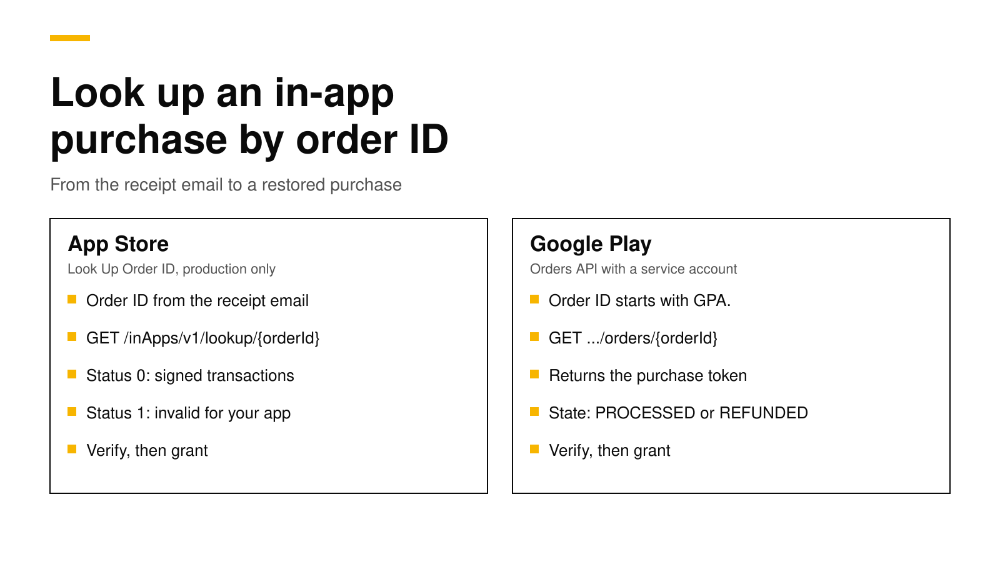

# How to look up an in-app purchase by order ID

When a customer says "I paid but the app does not unlock," the fastest proof is the order ID on their receipt email. Apple's App Store Server API has a **Look Up Order ID** endpoint that turns an App Store order ID into the signed transactions on that order. Google's Play Developer API has an **Orders API** that turns a `GPA.` order ID into the order's purchase token, state and price. With either answer, your server can confirm the purchase and give it to the customer's current account.

This post shows where customers find each order ID, how to call both APIs with working Node.js code, how to give the purchase back to the right account, and what RevenueDot does in one call. Every fact about Apple, Google and RevenueCat links its source and was checked on October 26, 2026.



## The short answer

- **App Store:** call `GET https://api.storekit.apple.com/inApps/v1/lookup/{orderId}` with your In-App Purchase key. A `status` of `0` comes with the order's signed transactions; `1` means the ID is invalid or holds no purchase for your app ([Apple](https://developer.apple.com/documentation/appstoreserverapi/look-up-order-id)).
- **The App Store lookup does not work in the sandbox.** Apple says this one endpoint is production only ([Apple](https://developer.apple.com/documentation/appstoreserverapi)).
- **Google Play:** call `GET .../applications/{packageName}/orders/{orderId}` with a service account. The order holds the purchase token, the state (such as `PROCESSED` or `REFUNDED`) and the line items ([Google](https://developers.google.com/android-publisher/api-ref/rest/v3/orders)).
- **Then verify and grant.** Check the transaction or token the way you check any purchase, and attach it to the customer's current app user ID.
- **Why it matters more now:** Google Play Billing Library 8 can no longer read consumed purchases from the device, so a restore from the order ID is often the only way back for an app without logins.

## When support needs an order ID

Most purchase problems fix themselves with a **Restore** button. The order ID matters in the cases where restore cannot help:

- The customer bought on one Apple ID or Google account and now uses the app signed in to another.
- The app has no login, the customer reinstalled, and the new install got a new anonymous ID.
- The purchase was a consumable, such as credits, which Google Play Billing Library 8 no longer returns from the device ([RevenueCat](https://www.revenuecat.com/docs/known-store-issues/play-billing-library/restore-consumable-purchases-bc8)). Our [Billing Library 8 post](google-play-billing-library-8-migration.md) explains that change.
- The customer wants a refund or says they were charged twice, and you need to see what they actually bought.
- A store notification was lost during an outage, and your database never recorded the purchase.

In each case the receipt email is the one thing the customer reliably has.

## Where customers find the order ID

| Store | What it looks like | Where the customer finds it |
|---|---|---|
| App Store | Letters and digits, such as `MK5TTTVWJH` | The receipt email Apple sends for every in-app purchase, and their purchase history ([Apple](https://developer.apple.com/documentation/appstoreserverapi/orderid)) |
| Google Play | `GPA.` and four groups of digits, such as `GPA.3333-4137-0319-36762` | The confirmation email, and **Payments & subscriptions**, **Budget & history** in the Play Store ([Google](https://support.google.com/googleplay/answer/2850369?hl=en)) |

On an iPhone, the purchase history is under the account button in the App Store, then **Apps & Purchase History** ([Apple Support](https://support.apple.com/en-us/118212)). Put both paths in your support macro, because customers rarely know which store they paid through until they see the email.

## Look up an App Store order

Apple's endpoint takes the order ID and returns an `OrderLookupResponse`. Apple documents two status values: `0` means the order ID is valid and contains at least one in-app purchase for your app, and `1` means it is invalid or contains none ([Apple](https://developer.apple.com/documentation/appstoreserverapi/orderlookupstatus)). Only a `0` answer carries the `signedTransactions` array.

The request needs a JSON Web Token signed with an In-App Purchase key from App Store Connect, the same key every other App Store Server API call uses. Apple's official Node.js library builds the token and checks the signatures for you:

```js
// npm install @apple/app-store-server-library
import { readFileSync } from "node:fs";
import {
  AppStoreServerAPIClient, Environment, SignedDataVerifier,
} from "@apple/app-store-server-library";

const key = readFileSync("SubscriptionKey_ABCDEFGHIJ.p8", "utf8");
const client = new AppStoreServerAPIClient(
  key, "ABCDEFGHIJ", "your-issuer-id", "com.example.app", Environment.PRODUCTION,
);
const rootCerts = [readFileSync("AppleRootCA-G3.cer")];
const verifier = new SignedDataVerifier(
  rootCerts, true, Environment.PRODUCTION, "com.example.app", 1234567890, // your app's Apple ID
);

export async function lookUpAppStoreOrder(orderId) {
  const res = await client.lookUpOrderId(orderId);
  if (res.status !== 0) return []; // invalid, or no purchase for this app
  const out = [];
  for (const jws of res.signedTransactions ?? []) {
    out.push(await verifier.verifyAndDecodeTransaction(jws));
  }
  return out; // productId, originalTransactionId, purchaseDate, revocationDate…
}
```

Apple suggests using `productId` and `purchaseDate` from the decoded transaction to help the customer ([Apple](https://developer.apple.com/documentation/appstoreserverapi/look-up-order-id)). For a subscription, take `originalTransactionId` and call **Get All Subscription Statuses** to see whether it is active, in a grace period or expired ([Apple](https://developer.apple.com/documentation/appstoreserverapi/get-all-subscription-statuses)). A refunded purchase still comes back from the lookup; its decoded transaction has a `revocationDate`. To see every refund the customer has had, call **Get Refund History** with any of their transaction IDs ([Apple](https://developer.apple.com/documentation/appstoreserverapi/get-refund-history)).

Three details catch people out:

- **No sandbox.** You cannot test this endpoint with a sandbox purchase. Test it with a real purchase from your own Apple ID in production, then refund it.
- **The new host.** Apple's documentation now gives `api.storekit.apple.com` as the production host and `api.storekit-sandbox.apple.com` for the sandbox ([Apple](https://developer.apple.com/documentation/appstoreserverapi)). Older code uses `api.storekit.itunes.apple.com`; check your library version.
- **Installs do not matter.** Apple says the API answers from the customer's purchase history whether or not they removed or reinstalled the app.

## Look up a Google Play order

Google's Orders API returns an `Order` with the `purchaseToken`, a `state` (`PENDING`, `PROCESSED`, `CANCELED`, `PENDING_REFUND`, `PARTIALLY_REFUNDED` or `REFUNDED`), the line items, the total, the tax and an order history of refunds and cancellations ([Google](https://developers.google.com/android-publisher/api-ref/rest/v3/orders)). The request uses a service account with the `androidpublisher` scope:

```js
// npm install google-auth-library
import { GoogleAuth } from "google-auth-library";

const auth = new GoogleAuth({
  keyFile: "play-service-account.json",
  scopes: ["https://www.googleapis.com/auth/androidpublisher"],
});

export async function lookUpPlayOrder(packageName, orderId) {
  const client = await auth.getClient();
  const url = `https://androidpublisher.googleapis.com/androidpublisher/v3/applications/` +
    `${encodeURIComponent(packageName)}/orders/${encodeURIComponent(orderId)}`;
  const { data: order } = await client.request({ url });
  return order; // order.purchaseToken, order.state, order.lineItems, order.total
}
```

The `purchaseToken` is the key to everything else. For a subscription, pass it to `purchases.subscriptionsv2.get` for the current state and expiry ([Google](https://developer.android.com/google/play/billing/subscriptions)). For a one-time product, check the purchase with the token, then grant it. To check many orders at once, `orders:batchGet` takes 1 to 1,000 distinct order IDs, and the whole request fails if any one of them is not found ([Google](https://developers.google.com/android-publisher/api-ref/rest/v3/orders/batchget)).

The service account needs access to financial data in Play Console. If the call returns 403, open **Users and permissions** and check that the account can view financial data for the app.

## Give the purchase to the right account

Finding the purchase is half the job. The other half is deciding who owns it, because the same purchase may already belong to another account in your database.

1. **Match it to your app.** Check the bundle ID or package name and the product ID against your catalog. An order ID from a different app should not unlock anything.
2. **Check the state.** Do not grant a refunded, revoked or expired purchase. On Google Play, also skip orders that are `PENDING` or `CANCELED`.
3. **Decide on ownership.** If another account already owns the purchase, either move it (and remove access from the old account) or refuse and tell the customer which account has it. Pick one rule and apply it everywhere, including normal restores.
4. **Record it once.** Store the transaction ID or purchase token so a later store notification for the same purchase updates the record instead of creating a second one.
5. **Tell the customer.** Ask them to reopen the app, so it fetches its new status from your server.

## How RevenueDot does it in one call

RevenueDot is an open-source backend for in-app purchases that works with the RevenueCat SDK. It does all five steps above in one REST call. Send the customer's current app user ID and the order ID:

```bash
curl -s -X POST "https://api.revenuedot.app/v2/projects/$PROJECT_ID/customers/$APP_USER_ID/actions/restore_purchase_by_order_id" \
  -H "Authorization: Bearer $SECRET_KEY" \
  -H "Content-Type: application/json" \
  -d '{"order_id":"MK5TTTVWJH"}'
```

A `GPA.` ID goes to Google's `orders.batchGet` on each Play app in the project, and the purchase token it returns is checked and acknowledged like any receipt. Any other ID goes to Apple's Look Up Order ID on each App Store app, production first and then the sandbox, and only that order's own subscriptions and purchases are restored. The purchase then moves under the project's transfer behavior, and a move records a `TRANSFER` event that your webhooks receive ([API reference](../api/rest-v2.md#restore-a-purchase-by-its-store-order-id)). The answer is 404 when no store knows the order, 422 when no app has the credentials the lookup needs, and 409 when the transfer behavior keeps the purchase with another customer.

The setup is the same credentials RevenueDot already uses: the In-App Purchase key for the [App Store](../docs/guides/app-store.md) and a service account with the "View financial data" permission for [Google Play](../docs/guides/google-play.md).

**Switching from RevenueCat? Keep your SDK and change one line.** RevenueCat's API v2 has the same operation, which it documents for Google Play order IDs that start with `GPA` ([RevenueCat](https://www.revenuecat.com/docs/known-store-issues/play-billing-library/restore-consumable-purchases-bc8)). RevenueDot accepts App Store order IDs too. An app on RevenueCat can point the SDK's proxy URL at RevenueDot and keep its code, offerings and customers; see [migrate from RevenueCat](https://revenuedot.app/migrate-from-revenuecat) and the [RevenueDot vs RevenueCat comparison](https://revenuedot.app/compare/revenuedot-vs-revenuecat), which also says where RevenueCat is stronger.

On cost, RevenueCat charges 1% of all tracked revenue once you pass $2,500 a month ([RevenueCat](https://www.revenuecat.com/pricing)). RevenueDot Cloud's Pro plan costs $0 until your apps make $10,000 a month, then 0.5% of revenue above $10,000, never more than $999 a month. Check your numbers with the [RevenueCat fee calculator](https://revenuedot.app/tools/revenuecat-fee-calculator) or see [pricing](https://revenuedot.app/pricing).

[Start for free on RevenueDot Cloud](https://app.revenuedot.app/signup). Building and testing are free, no card needed. Add a card when you go live; Pro costs $0 until your apps make $10,000 a month.

## FAQ

### Where do I find an App Store order ID?

On the receipt email Apple sends after each in-app purchase, and in the customer's App Store purchase history ([Apple](https://developer.apple.com/documentation/appstoreserverapi/orderid)). On an iPhone, the purchase history is under the account button, **Apps & Purchase History**, and on the web it is at reportaproblem.apple.com ([Apple Support](https://support.apple.com/en-us/118212)).

### Can I test Look Up Order ID in the sandbox?

No. Apple says every App Store Server API endpoint works in the sandbox except Look Up Order ID ([Apple](https://developer.apple.com/documentation/appstoreserverapi)). Test it with a real purchase in production and refund it afterwards.

### What does status 1 mean in Apple's order lookup?

It means the order ID is invalid, or the order has no in-app purchase for your app ([Apple](https://developer.apple.com/documentation/appstoreserverapi/orderlookupstatus)). A common cause is an order for a different app on the same Apple ID. Ask for the receipt email that names your app.

### How do I get a purchase token from a Google Play order ID?

Call the Orders API: `orders.get` with your package name and the `GPA.` order ID. The `Order` it returns includes the `purchaseToken`, which you then use with the subscription or product purchase APIs ([Google](https://developers.google.com/android-publisher/api-ref/rest/v3/orders)).

### Does a refunded purchase still show up?

Yes. Apple's lookup still returns the transaction, with a `revocationDate` when it was refunded. Google's order shows a `state` of `REFUNDED` or `PARTIALLY_REFUNDED` and lists the refund in its order history. Do not grant access for either.

**About RevenueDot.** RevenueDot is an open-source (AGPL-3.0) backend for in-app purchases and subscriptions on the App Store, Google Play and the web. Start for free on [RevenueDot Cloud](https://app.revenuedot.app/signup): Pro costs $0 until your apps make $10,000 a month, then 0.5% of revenue above $10,000, never more than $999 a month. New apps install the [RevenueDot SDK](../docs/sdks/README.md) and pass their key. Apps that ship the RevenueCat SDK point its proxy URL at RevenueDot and keep their code, offerings and customers. Read the [quickstart](../docs/getting-started/quickstart.md) or the code on [GitHub](https://github.com/revenuedot/revenuedot).
