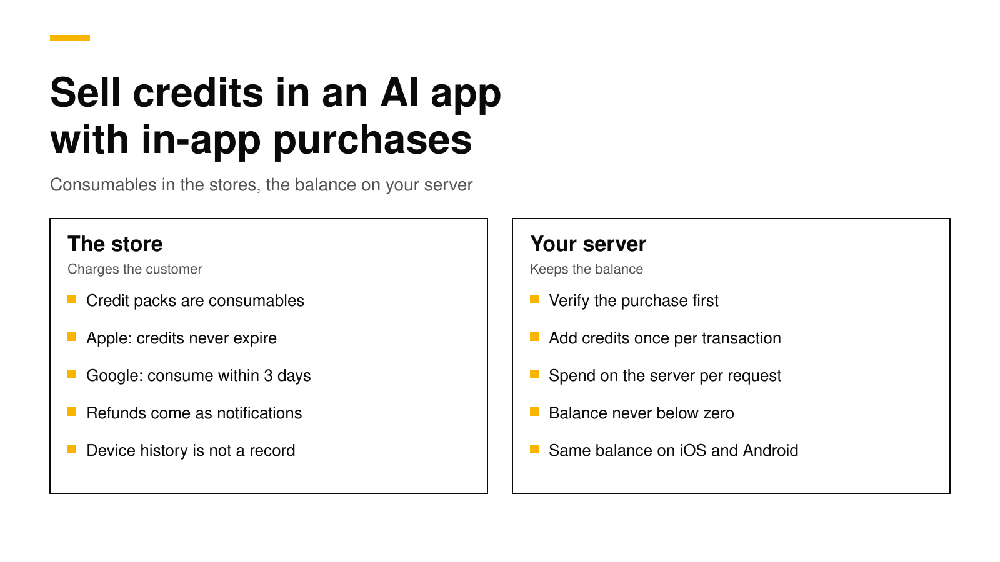

# How to sell credits in an AI app with in-app purchases

To sell credits in an AI app, create each credit pack as a **consumable** in-app purchase on the App Store and Google Play, and keep the balance on your own server, not on the device. The store charges the customer and gives you a transaction. Your server checks that transaction, adds the credits once, and subtracts credits each time the app makes an AI request. Apple requires that credits bought with in-app purchase never expire ([Apple](https://developer.apple.com/app-store/review/guidelines/)), and Google refunds a purchase that is not consumed or acknowledged within three days ([Google](https://developer.android.com/google/play/billing/integrate)).

This post explains the store rules, the ledger your server needs, the order of steps that avoids double credits and lost credits, how to handle refunds, and how RevenueDot does each step for you. Every fact about Apple, Google and RevenueCat links its source and was checked on November 2, 2026.



## The short answer

- **Use consumables for credit packs.** A pack of 100 or 500 credits is a consumable product on both stores. Customers can buy it again and again.
- **Credits may not expire.** Apple's guideline 3.1.1 says "any credits or in-game currencies purchased via in-app purchase may not expire" ([Apple](https://developer.apple.com/app-store/review/guidelines/)).
- **Consume on Android within three days.** Google refunds and revokes a purchase that is not acknowledged within three days; consuming it counts as acknowledging it ([Google](https://developer.android.com/google/play/billing/integrate)).
- **The device is not your record.** After a consumable is finished, StoreKit leaves it out of the transaction history by default ([Apple](https://developer.apple.com/documentation/storekit/transaction/all)). Keep the balance in a server ledger tied to the user's account.
- **Grant once per transaction ID, and spend on the server.** The store's transaction ID is the key that stops a retry from adding credits twice. The server, not the app, subtracts credits when it runs the AI request.

## Why AI apps sell credits

An AI request has a real cost per call. A flat subscription works when usage is predictable, but a few heavy users can cost more than they pay. Credits tie the price to the work. Most apps pick one of three models:

| Model | What the customer buys | Store product | Good for |
|---|---|---|---|
| Credit packs | 100, 500 or 2,000 credits, bought when needed | Consumable | Occasional use, such as image or video generation |
| Subscription with credits | A monthly plan that adds credits each renewal | Auto-renewable subscription | Regular use with a predictable bill |
| Both | A subscription, plus packs to top up | Subscription and consumables | Apps with a few heavy users |

You can change models later. Start with the simplest one your usage fits, and keep the balance logic on the server so a change does not need an app update.

## What Apple and Google require

**Apple.** Credits sold through in-app purchase must not expire, and you should offer a restore mechanism for restorable purchases ([Apple](https://developer.apple.com/app-store/review/guidelines/)). Consumables are not restorable in the store's sense, so "restore" for credits means the balance comes back when the customer signs in on a new device. That only works if the balance lives on your server.

StoreKit 2 also changes what the device can tell you. `Transaction.currentEntitlements` never includes consumables ([Apple](https://developer.apple.com/documentation/storekit/transaction/currententitlements)). `Transaction.all` includes unfinished consumables and refunded ones, but leaves out finished consumables unless you set the `SKIncludeConsumableInAppPurchaseHistory` key in your Info.plist ([Apple](https://developer.apple.com/documentation/storekit/transaction/all)). Call `finish()` only after you have delivered the credits ([Apple](https://developer.apple.com/documentation/storekit/transaction/finish())), and treat your server as the place that remembers them.

**Google.** The purchase must be acknowledged within three days, or Google refunds it and revokes it ([Google](https://developer.android.com/google/play/billing/integrate)). For consumables, Google recommends consuming from your backend with `purchases.products.consume`, after checking `consumptionState`, and using `consumeAsync()` in the app only when there is no backend. Consuming both acknowledges the purchase and lets the customer buy the same pack again. Google also warns that consumption can fail, so your server must check that each purchase token has not been used before it grants anything ([Google](https://developer.android.com/google/play/billing/integrate)).

Since Google Play Billing Library 8, the device can no longer list consumed purchases, which makes a server record even more important. Our [Billing Library 8 post](google-play-billing-library-8-migration.md) explains that change.

## The ledger your server needs

Store every change to a balance as one row, and compute the balance from the rows. A ledger is easy to audit, and it makes refunds and support questions simple to answer.

```sql
create table credit_ledger (
  id          bigserial primary key,
  user_id     text not null,
  amount      integer not null,          -- +100 for a pack, -3 for a request
  source      text not null,             -- 'purchase', 'spend', 'refund', 'support'
  source_key  text,                      -- store transaction ID, or your request ID
  created_at  timestamptz not null default now(),
  unique (source, source_key)            -- the same purchase or request applies once
);

create view credit_balance as
  select user_id, sum(amount) as balance from credit_ledger group by user_id;
```

The unique key is the important part. Apple can send the same notification more than once, the app can retry a request, and a customer can tap a button twice. Each of those inserts the same `source_key`, and the database ignores the copy.

Spending needs the same care. Subtract credits in the same transaction that checks the balance, so two requests at once cannot both spend the last credit:

```js
// Node.js with pg. Spend `cost` credits for one AI request, once per requestId.
export async function spend(db, userId, requestId, cost) {
  await db.query("begin");
  try {
    await db.query("select pg_advisory_xact_lock(hashtext($1))", [userId]);
    const { rows } = await db.query(
      "select coalesce(sum(amount), 0) as balance from credit_ledger where user_id = $1", [userId]);
    if (Number(rows[0].balance) < cost) { await db.query("rollback"); return { ok: false, reason: "not_enough_credits" }; }
    await db.query(
      "insert into credit_ledger (user_id, amount, source, source_key) values ($1, $2, 'spend', $3) on conflict do nothing",
      [userId, -cost, requestId]);
    await db.query("commit");
    return { ok: true };
  } catch (e) { await db.query("rollback"); throw e; }
}
```

## The purchase flow, step by step

1. **The customer taps a pack.** The app starts the purchase with StoreKit or Google Play Billing. On Android, pass your account ID as `obfuscatedAccountId` so the purchase carries it ([Google](https://developer.android.com/google/play/billing/integrate)). On iOS, pass a UUID for the account as the `appAccountToken` purchase option ([Apple](https://developer.apple.com/documentation/storekit/product/purchaseoption/appaccounttoken(_:))).
2. **The app sends the result to your server.** Send Apple's signed transaction, or Google's purchase token and product ID.
3. **The server verifies it with the store.** Check Apple's signature or call the App Store Server API, and call Google's Play Developer API for the token. Our [server-side validation post](server-side-receipt-validation.md) shows both.
4. **The server adds the credits.** Insert one ledger row with the transaction ID or purchase token as `source_key`.
5. **The server finishes the purchase.** Consume the Google purchase from the backend. Tell the app to call `finish()` on the Apple transaction.
6. **The app shows the new balance.** Read it from your server, not from a number the app keeps.

Do steps 3 and 4 before step 5. If you finish or consume first and your server then fails, the customer has paid and has nothing, and the store will not send the purchase to the app again.

Also listen to the stores directly. Purchases can complete when the app is closed, for example after a slow payment method on Android or an interrupted purchase on iOS. App Store Server Notifications and Google's real-time developer notifications let your server grant those too.

## Refunds and disputes

Customers can ask Apple or Google for a refund after they spend the credits. Decide your rule before launch: remove the refunded credits, let the balance go negative, or block new purchases until the balance is positive.

- **Apple** sends a `REFUND` notification, and for consumables it may first send a `CONSUMPTION_REQUEST` that asks how much of the purchase the customer used. A prompt, honest answer helps Apple decide. Our post on [Apple refund requests](apple-refund-requests-consumption-info.md) covers the fields and the deadline.
- **Google** reports refunds and chargebacks through voided purchase notifications and the Voided Purchases API. Our post on [Google Play refunds](google-play-refunds-and-chargebacks.md) shows both signals in Node.js.

A ledger makes both easy, because you can see exactly how many of the refunded credits the customer spent.

## How RevenueDot handles credits

RevenueDot is an open-source backend for in-app purchases that works with the RevenueCat SDK. It has in-app currencies built in, so you do not have to build the ledger above.

- **Product grants.** Create a currency, such as `CRD`, and say how many credits each product adds. RevenueDot adds them when it records the purchase, renewal or trial start, using the store transaction ID as the ledger's idempotency key, so a replayed notification never adds credits twice ([source](https://github.com/revenuedot/revenuedot/blob/main/apps/server/src/services/virtual-currencies.ts)).
- **Spend from your server.** Your backend calls `POST /v2/projects/{project_id}/customers/{customer_id}/virtual_currencies/transactions` with `{"adjustments": {"CRD": -3}}` and an `Idempotency-Key` header. Nothing is applied if a balance would go below zero ([API reference](../api/rest-v2.md#credit-or-spend-in-app-currency)).
- **Read the balance in the app.** The SDK reads balances with the RevenueCat SDK's virtual currency calls, such as `Purchases.shared.virtualCurrencies()` on iOS (SDK 5.32.0 and later) ([RevenueCat](https://www.revenuecat.com/docs/offerings/virtual-currency)).
- **Android consumption is handled.** RevenueDot tells the Android SDK to consume consumables once it has recorded them, so customers can buy the pack again ([Products and entitlements](../docs/concepts/products-and-entitlements.md)).
- **Apple consumption requests use the ledger.** When Apple asks about a consumable that grants credits, RevenueDot reports how much of that purchase's grant was spent, oldest credits first ([source](https://github.com/revenuedot/revenuedot/blob/main/apps/server/src/services/refunds.ts)). It records the refund but does not remove credits by itself, so your refund rule stays yours.
- **Webhooks and setup.** Each purchase grant sends a `VIRTUAL_CURRENCY_TRANSACTION` webhook event, and you create currencies and their product grants under **Product catalog > Virtual currencies** in the dashboard.
- **Rewarded ads can add credits too.** An ad reward can grant a fixed amount of a currency per view ([Ads](../docs/guides/ads.md)).

New apps install the [RevenueDot SDK](../docs/sdks/README.md). Its code says `import RevenueCat` because it is built from RevenueCat's MIT-licensed SDK, and it needs no RevenueCat account. Start with the [quickstart](../docs/getting-started/quickstart.md), and test credit packs with the [Test Store](../docs/guides/test-store.md) before your store products are ready.

**Switching from RevenueCat? Keep your SDK and change one line.** An app that ships the RevenueCat SDK can point its proxy URL at RevenueDot and keep its code, offerings and customers. RevenueDot's importer does not copy virtual currency balances yet, so plan to load balances through the API ([what differs](../docs/migrate/what-differs.md#migration)). See the [migration guide](https://revenuedot.app/migrate-from-revenuecat), the [comparison](https://revenuedot.app/compare/revenuedot-vs-revenuecat) and the [RevenueCat fee calculator](https://revenuedot.app/tools/revenuecat-fee-calculator).

[Start for free on RevenueDot Cloud](https://app.revenuedot.app/signup). Building and testing are free, no card needed. Add a card when you go live; Pro costs $0 until your apps make $10,000 a month. See [pricing](https://revenuedot.app/pricing).

## FAQ

### Can in-app purchase credits expire?

Not on the App Store. Apple's guideline 3.1.1 says credits or in-game currencies purchased via in-app purchase may not expire ([Apple](https://developer.apple.com/app-store/review/guidelines/)). Show the customer their balance, and keep it on your server so it survives a new device.

### Should AI credits be a consumable or a subscription?

Sell packs as consumables, and use an auto-renewable subscription if you want to add credits every month. Many AI apps offer both: a subscription with a monthly allowance and packs to top up. The store product type follows what the customer buys, not how you count credits.

### What happens if I don't consume a Google Play purchase?

Google refunds and revokes any purchase that is not acknowledged within three days, and consuming a consumable counts as acknowledging it ([Google](https://developer.android.com/google/play/billing/integrate)). An unconsumed pack also cannot be bought again, because the customer still owns it.

### Can credits bought on iOS be used on Android?

Yes, if the balance belongs to the user's account on your server rather than to the device. Both stores' purchases add to the same ledger row for that user. Sign the customer in before purchase so you know whose balance to credit.

### How do I stop customers from getting credits twice?

Use the store's transaction ID, or Google's purchase token, as a unique key when you add credits, and spend with your own request ID as the key. Retries and duplicate notifications then insert the same key and change nothing.

**About RevenueDot.** RevenueDot is an open-source (AGPL-3.0) backend for in-app purchases and subscriptions on the App Store, Google Play and the web. Start for free on [RevenueDot Cloud](https://app.revenuedot.app/signup): Pro costs $0 until your apps make $10,000 a month, then 0.5% of revenue above $10,000, never more than $999 a month. New apps install the [RevenueDot SDK](../docs/sdks/README.md) and pass their key. Apps that ship the RevenueCat SDK point its proxy URL at RevenueDot and keep their code, offerings and customers. Read the [quickstart](../docs/getting-started/quickstart.md) or the code on [GitHub](https://github.com/revenuedot/revenuedot).
