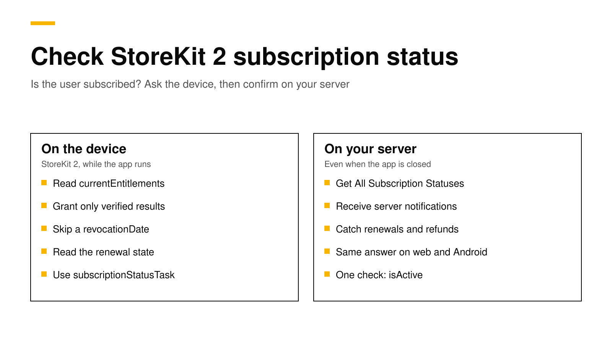

# How to check subscription status in StoreKit 2

To check whether a user is subscribed in StoreKit 2, read `Transaction.currentEntitlements`, keep only results that are verified, and skip any transaction with a `revocationDate`. Apple says this sequence holds the latest transaction for each auto-renewable subscription in the `subscribed` or `inGracePeriod` state, and leaves out refunded and revoked products ([Apple](https://developer.apple.com/documentation/storekit/transaction/currententitlements)). When you also need to know why access ended, or whether the plan will renew, read `Product.SubscriptionInfo.Status` for the subscription group.

This post shows both checks in Swift, the SwiftUI modifier that does it for you on iOS 17, what the device cannot tell you, and the problems developers report on Apple's forums. Every Apple fact links Apple's documentation and was checked on November 16, 2026.



## The short answer

- **For "does this user have access right now", use `Transaction.currentEntitlements`.** Grant access only for `.verified` results whose `revocationDate` is nil.
- **For "what state is the plan in", use `Product.SubscriptionInfo.Status`.** Its `state` is one of `subscribed`, `expired`, `inBillingRetryPeriod`, `inGracePeriod` or `revoked` ([Apple](https://developer.apple.com/documentation/storekit/product/subscriptioninfo/renewalstate)).
- **Only two states give access.** Apple says `subscribed` and `inGracePeriod` are entitled to service, and the other three are not.
- **In SwiftUI on iOS 17 and later, use `subscriptionStatusTask(for:)`.** It loads the status before the view appears and calls you again when it changes ([Apple](https://developer.apple.com/documentation/swiftui/view/subscriptionstatustask(for:priority:action:))).
- **The device only knows about this Apple account on this device.** For web, Android or a closed app, your server asks Apple with the App Store Server API and listens for App Store Server Notifications.

## What currentEntitlements includes and leaves out

Apple lists what the sequence emits ([Apple](https://developer.apple.com/documentation/storekit/transaction/currententitlements)):

- One transaction for each non-consumable purchase.
- The latest transaction for each auto-renewable subscription whose state is `subscribed` or `inGracePeriod`.
- The latest transaction for each non-renewing subscription, including finished ones.

It leaves out products the App Store refunded or revoked, and it never includes consumables. Since it keeps non-renewing subscriptions after they end, your app decides when their time is up.

Each element is a `VerificationResult<Transaction>`, which tells you whether StoreKit's signature check passed. Apple's sample handles `.unverified` "based on your business model", but for a paid feature the safe rule is to grant nothing.

Here is a check for one subscription group:

```swift
import StoreKit

/// True when the user has a verified, unrevoked subscription in the group.
func hasActiveSubscription(groupID: String) async -> Bool {
    for await result in Transaction.currentEntitlements {
        guard case .verified(let transaction) = result else { continue }
        guard transaction.productType == .autoRenewable,
              transaction.subscriptionGroupID == groupID,
              transaction.revocationDate == nil else { continue }
        return true
    }
    return false
}
```

Two fields deserve a closer look.

1. **`revocationDate`** is the date the App Store refunded or revoked the transaction. Apple says this happens after a refund, after a Family Sharing revocation, or when the customer loses access through an organization or group ([Apple](https://developer.apple.com/documentation/storekit/transaction/revocationdate)). Revoked products should already be missing from the sequence, so this check is a second guard, not the main one.
2. **`expirationDate`** is "the date the subscription expires or renews" ([Apple](https://developer.apple.com/documentation/storekit/transaction/expirationdate)). Be careful with it. A grace period starts when a renewal payment fails, so the latest transaction is still in `currentEntitlements` while its `expirationDate` is already in the past. If you add `expirationDate > .now` to the check above, you cut off customers Apple wants you to keep serving. Use `expirationDate` to show "renews on" text, not to decide access for an auto-renewable subscription.

## Read the renewal state for the full picture

`currentEntitlements` tells you yes or no. `Product.SubscriptionInfo.Status` tells you why. You get an array of statuses for a subscription group with the static `Product.SubscriptionInfo.status(for:)`, or from a loaded product with `product.subscription?.status`, which is `async throws` ([Apple](https://developer.apple.com/documentation/storekit/product/subscriptioninfo)).

Each status has three parts ([Apple](https://developer.apple.com/documentation/storekit/product/subscriptioninfo/status-swift.struct)):

- `state`, the renewal state.
- `transaction`, the latest transaction for the group, as a `VerificationResult<Transaction>`.
- `renewalInfo`, the signed renewal info, as a `VerificationResult<RenewalInfo>`.

The five renewal states, with what your app should do in each:

| State | Apple's meaning | Give access? | What to show |
|---|---|---|---|
| `subscribed` | The customer is currently subscribed | Yes | Nothing special |
| `inGracePeriod` | The subscription is in a billing grace period | Yes | Ask the user to update their payment method |
| `inBillingRetryPeriod` | The subscription is in a billing retry period | No | Explain the payment failed and link to settings |
| `expired` | The subscription expired | No | A paywall, maybe a win-back offer |
| `revoked` | The App Store revoked access to the group | No | A paywall |

The meanings and the access rule come from Apple's `RenewalState` page ([Apple](https://developer.apple.com/documentation/storekit/product/subscriptioninfo/renewalstate)). Grace period and billing retry are easy to mix up. Our post on [billing grace period and retry](billing-grace-period-and-retry.md) shows both timelines.

The array is empty when the customer was never subscribed to the group, and it can hold several entries when the subscription supports Family Sharing. A customer can be `expired` on their own purchase and `subscribed` through a family member, and then they are entitled to service. Apple says to give the highest level of service where the state is `subscribed` ([Apple](https://developer.apple.com/documentation/storekit/product/subscriptioninfo/status-swift.property)), so never read only the first status.

### What renewalInfo adds

`RenewalInfo` describes the next renewal period ([Apple](https://developer.apple.com/documentation/storekit/product/subscriptioninfo/renewalinfo)). The fields most apps use:

- `willAutoRenew` tells you whether the plan renews at the end of this period. When it is false, the user has turned off auto-renew, and a "your plan ends on" message makes sense.
- `expirationReason` tells you why it ended. Apple lists `autoRenewDisabled`, `billingError`, `didNotConsentToPriceIncrease`, `productUnavailable`, `unbundled` and `unknown` ([Apple](https://developer.apple.com/documentation/storekit/product/subscriptioninfo/renewalinfo/expirationreason-swift.struct)).
- `isInBillingRetry` and `gracePeriodExpirationDate` give the details of a billing problem.
- `autoRenewPreference` is the product ID that will renew, which differs from the current one after a downgrade.

## A complete status check in Swift

This function reads every status in the group, verifies both signed parts, and returns one summary your UI can use.

```swift
import StoreKit

struct ProStatus {
    var hasAccess = false
    var willRenew = false
    var billingProblem = false
    var expirationReason: Product.SubscriptionInfo.RenewalInfo.ExpirationReason?
}

func loadProStatus(groupID: String) async -> ProStatus {
    var summary = ProStatus()
    guard let statuses = try? await Product.SubscriptionInfo.status(for: groupID) else {
        return summary // Network or App Store error: keep your last known answer instead.
    }
    for status in statuses {
        // Trust nothing that failed verification.
        guard case .verified = status.transaction,
              case .verified(let renewal) = status.renewalInfo else { continue }

        switch status.state {
        case .subscribed:
            summary.hasAccess = true
            summary.willRenew = summary.willRenew || renewal.willAutoRenew
        case .inGracePeriod:
            summary.hasAccess = true
            summary.billingProblem = true
        case .inBillingRetryPeriod:
            summary.billingProblem = true
        case .expired, .revoked:
            summary.expirationReason = renewal.expirationReason
        default:
            break
        }
    }
    return summary
}
```

Because the loop looks at every status, a family member's active plan still grants access when the user's own plan has expired. If the call throws, do not lock the user out on the spot. Keep the last answer you had and try again later.

To react to changes while the app runs, iterate `Product.SubscriptionInfo.Status.updates`, which Apple describes as the sequence that emits status information when a subscription's status changes ([Apple](https://developer.apple.com/documentation/storekit/product/subscriptioninfo/status-swift.struct)). Keep your `Transaction.updates` listener too, because that is where you call `finish()`. Our post on [Transaction.updates](storekit-2-transaction-updates.md) covers that listener in full.

## Let SwiftUI do it with subscriptionStatusTask

On iOS 17, macOS 14 and later, SwiftUI has a view modifier for this. `subscriptionStatusTask(for:priority:action:)` starts a task before the view appears, gets the status for the group, and calls your action whenever the status or the task's state changes ([Apple](https://developer.apple.com/documentation/swiftui/view/subscriptionstatustask(for:priority:action:))). The action receives an `EntitlementTaskState`, which is `.loading`, `.success` or `.failure` ([Apple](https://developer.apple.com/documentation/storekit/entitlementtaskstate)).

```swift
import StoreKit
import SwiftUI

struct RootView: View {
    @State private var isPro = false
    let groupID = "21482939" // Your subscription group ID from App Store Connect.

    var body: some View {
        HomeScreen(isPro: isPro)
            .subscriptionStatusTask(for: groupID) { taskState in
                guard let statuses = taskState.value else { return } // Loading or failed.
                isPro = statuses.contains { status in
                    guard case .verified = status.transaction else { return false }
                    return status.state == .subscribed || status.state == .inGracePeriod
                }
            }
    }
}
```

Put the modifier high in the view tree, so it stays alive while the user moves between screens. It only runs while the view is shown, so it does not replace the `Transaction.updates` listener. Our [SwiftUI subscriptions tutorial](swiftui-subscriptions-tutorial.md) builds a full paywall around a check like this.

## What the device cannot tell you

Everything above runs on one device, for the Apple account signed in to it. That leaves gaps:

- **The same user on the web or Android.** Your other apps cannot read StoreKit.
- **Changes while the app is closed.** A renewal, a refund or a failed payment overnight is invisible until the next launch.
- **Your backend's own checks.** If your server serves paid content or an API, it cannot trust a boolean your app sends.

Apple gives servers two tools for this. The App Store Server API's [Get All Subscription Statuses](https://developer.apple.com/documentation/appstoreserverapi/get-all-subscription-statuses) endpoint, `GET /inApps/v1/subscriptions/{transactionId}`, returns the status of every subscription the customer has in your app, grouped by subscription group. It takes any original transaction ID, transaction ID or app transaction ID that belongs to the customer. Its `status` field uses numbers: 1 is active, 2 expired, 3 billing retry, 4 grace period and 5 revoked ([Apple](https://developer.apple.com/documentation/appstoreserverapi/status)). Those map one to one to the five states on the device.

[App Store Server Notifications](https://developer.apple.com/documentation/appstoreservernotifications) is the other half. Apple calls it a server-to-server service that sends real-time notifications for purchases, renewals, offer redemptions, refunds and more, so your database stays current even when the app never opens. Our guide to [App Store Server Notifications V2](app-store-server-notifications-v2.md) lists each type, and the post on [server-side receipt validation](server-side-receipt-validation.md) shows how to verify what Apple sends.

## Problems developers report on Apple's forums

These are reports from developers, not confirmed Apple bugs, but they are worth planning for.

1. **An empty `currentEntitlements` for a paying user.** Developers report production cases where both `Transaction.currentEntitlements` and `subscription.status` return nothing for an active annual subscription, even after `AppStore.sync()`, with the user stuck on the paywall ([thread 841930](https://developer.apple.com/forums/thread/841930)). No reply had been posted when we checked. A server that knows the user paid gives you a way to let them in while you investigate.
2. **Offer code redemptions that do not show up.** Developers report that a subscription from a redeemed offer code is active in the user's account settings but missing from `currentEntitlements`, even after a sync ([thread 836181](https://developer.apple.com/forums/thread/836181)). An Apple engineer asked whether the app listens to `Transaction.updates`, since redemptions arrive there, and asked for a Feedback Assistant report. Apple's server notifications also cover offer redemptions, so a server can catch them. Our post on [looking up a purchase by order ID](look-up-purchase-by-order-id.md) helps when support has a receipt from the customer.
3. **Expired subscriptions still listed during tests.** Developers testing with a StoreKit configuration file and shortened subscription periods report `currentEntitlements` returning expired subscriptions ([thread 729770](https://developer.apple.com/forums/thread/729770)). One developer traced their case to the device's wrong time zone. Apple notes that the sandbox renews subscriptions at an accelerated rate, up to 12 times, and that a subscription can lapse briefly before it renews ([Apple](https://developer.apple.com/documentation/storekit/testing-an-auto-renewable-subscription)). Check your device clock, and test lapses on purpose.

## Check status with RevenueDot

RevenueDot is an open-source backend for in-app purchases. It receives Apple's server notifications and verifies each signed transaction with Apple, then gives your app and your server one answer per entitlement. New apps install the [RevenueDot SDK](../docs/sdks/ios.md). Its code says `import RevenueCat` because it is built from RevenueCat's MIT-licensed SDK, and it needs no RevenueCat account.

In the app, the whole status check becomes one property:

```swift
import RevenueCat

let customerInfo = try await Purchases.shared.customerInfo()
let pro = customerInfo.entitlements["pro"]

let isPro = pro?.isActive == true              // Includes a billing grace period.
let willRenew = pro?.willRenew == true          // False after the user turns off auto-renew.
let billingProblem = pro?.billingIssueDetectedAt != nil
```

`isActive` compares the entitlement's expiration date with the time of the server's answer ([source](https://github.com/revenuedot/purchases-ios/blob/revenuedot/main-patches/Sources/Purchasing/EntitlementInfo.swift)). The server sets that date for you: a grace period extends access to its end, and a refund ends access at the refund time ([source](https://github.com/revenuedot/revenuedot/blob/main/packages/core/src/entitlements.ts)). So the grace period rule and the revocation rule from earlier are already applied.

On your server, ask RevenueDot with your secret key. `GET /v1/subscribers/{app_user_id}` returns the same customer info the SDK reads, and an entitlement is active while its `expires_date` is null or in the future ([SDK endpoints](../api/sdk-endpoints.md)).

```js
// Node.js 18 or later. Never ship the secret key in an app.
export async function isPro(appUserId) {
  const res = await fetch(
    `https://api.revenuedot.app/v1/subscribers/${encodeURIComponent(appUserId)}`,
    { headers: { Authorization: `Bearer ${process.env.REVENUEDOT_SECRET_KEY}` } },
  );
  if (!res.ok) throw new Error(`RevenueDot answered ${res.status}`);
  const { subscriber } = await res.json();
  const pro = subscriber.entitlements.pro;
  return Boolean(pro) && (pro.expires_date === null || new Date(pro.expires_date) > new Date());
}
```

For events instead of polling, add a [webhook](../docs/guides/webhooks.md). The [App Store setup guide](../docs/guides/app-store.md) shows how to add the in-app purchase key and point Apple's notifications at RevenueDot. If an entitlement looks wrong, [Why is my entitlement not active?](../docs/help/entitlement-not-active.md) walks through the causes. A real App Store sandbox purchase has run end to end against RevenueDot Cloud on a physical iPhone.

**Switching from RevenueCat? Keep your SDK and change one line.** An app that ships the RevenueCat SDK points its proxy URL at RevenueDot, and `customerInfo.entitlements["pro"]?.isActive` keeps working as it is. See the [migration guide](https://revenuedot.app/migrate-from-revenuecat), the [comparison](https://revenuedot.app/compare/revenuedot-vs-revenuecat) and the [RevenueCat fee calculator](https://revenuedot.app/tools/revenuecat-fee-calculator). RevenueCat is free under $2,500 of monthly tracked revenue, then charges 1% of all tracked revenue ([RevenueCat](https://www.revenuecat.com/pricing)). If you are still deciding whether you need a backend at all, read [StoreKit 2 vs RevenueCat](storekit-2-vs-revenuecat.md).

[Start for free on RevenueDot Cloud](https://app.revenuedot.app/signup). Building and testing are free, no card needed. Add a card when you go live; Pro costs $0 until your apps make $10,000 a month. See [pricing](https://revenuedot.app/pricing).

## FAQ

### How do I check if a user is subscribed in StoreKit 2?

Loop over `Transaction.currentEntitlements`, keep `.verified` results for your subscription group, and skip any with a `revocationDate`. Apple includes auto-renewable subscriptions in the `subscribed` or `inGracePeriod` state and leaves out refunded ones ([Apple](https://developer.apple.com/documentation/storekit/transaction/currententitlements)).

### Should I check expirationDate to decide access?

Not for auto-renewable subscriptions. During a billing grace period the user keeps access while the transaction's `expirationDate` is already in the past. Use `currentEntitlements` or the renewal state for access, and use `expirationDate` for display.

### What is the difference between inGracePeriod and inBillingRetryPeriod?

Both mean a renewal payment failed. In `inGracePeriod` the user keeps access while Apple retries, and in `inBillingRetryPeriod` they do not. Apple says only `subscribed` and `inGracePeriod` are entitled to service ([Apple](https://developer.apple.com/documentation/storekit/product/subscriptioninfo/renewalstate)).

### Why does Product.SubscriptionInfo.status return more than one status?

Family Sharing. A user can have their own expired plan and a shared active one. Apple says to give the highest level of service where the state is `subscribed` ([Apple](https://developer.apple.com/documentation/storekit/product/subscriptioninfo/status-swift.property)).

### Can I check subscription status without the app?

Yes, on a server. Call the App Store Server API's Get All Subscription Statuses endpoint with any of the customer's transaction IDs, and listen for App Store Server Notifications ([Apple](https://developer.apple.com/documentation/appstoreserverapi/get-all-subscription-statuses)).

**About RevenueDot.** RevenueDot is an open-source (AGPL-3.0) backend for in-app purchases and subscriptions on the App Store, Google Play and the web. Start for free on [RevenueDot Cloud](https://app.revenuedot.app/signup): Pro costs $0 until your apps make $10,000 a month, then 0.5% of revenue above $10,000, never more than $999 a month. New apps install the [RevenueDot SDK](../docs/sdks/README.md) and pass their key. Apps that ship the RevenueCat SDK point its proxy URL at RevenueDot and keep their code, offerings and customers. Read the [quickstart](../docs/getting-started/quickstart.md) or the code on [GitHub](https://github.com/revenuedot/revenuedot).
