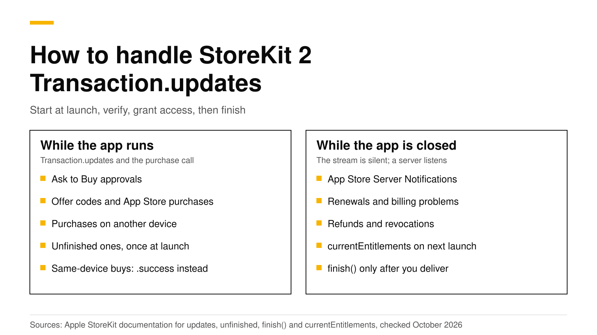

# How to handle StoreKit 2 Transaction.updates

`Transaction.updates` is the StoreKit 2 stream that tells your app about purchases it did not start itself: renewals, Ask to Buy approvals, offer code redemptions, purchases made in the App Store and purchases made on another device. Apple says to start listening in a `Task` as soon as the app launches, because unfinished transactions arrive on this stream once, right after launch, and an app that is not listening misses them. For each transaction, check that it is verified, grant access, and then call `finish()`. When the app is closed the stream is silent, so a server that receives App Store Server Notifications covers the rest.

This post shows a complete listener in Swift, explains each case it receives, lists the mistakes that cause missed or repeated purchases, and shows what changes when you use the RevenueCat SDK or RevenueDot. Every Apple fact links Apple's documentation and was checked on October 19, 2026.



## The short answer

- **Start the listener at launch.** Apple says to create a `Task` that iterates `Transaction.updates` "as soon as your app launches" ([Apple](https://developer.apple.com/documentation/storekit/transaction/updates)).
- **It carries purchases from outside your purchase call.** Apple lists Ask to Buy, offer code redemptions, App Store purchases and purchases on another device ([Apple](https://developer.apple.com/documentation/storekit/transaction/updates)).
- **A purchase on the same device does not arrive there.** Apple returns it through `Product.PurchaseResult.success` instead ([Apple](https://developer.apple.com/documentation/storekit/transaction/updates)).
- **Unfinished transactions arrive once, at launch.** Use `Transaction.unfinished` to read them again at any time ([Apple](https://developer.apple.com/documentation/storekit/transaction/unfinished)).
- **Call `finish()` only after you deliver.** Apple says to finish a transaction after you deliver the content or turn on the service ([Apple](https://developer.apple.com/documentation/storekit/transaction/finish%28%29)).
- **The stream only runs while the app runs.** Renewals and refunds that happen while the app is closed reach your server through App Store Server Notifications.

## What does Transaction.updates deliver?

Apple describes `Transaction.updates` as the sequence that emits a transaction when the system creates or updates one outside the app or on other devices ([Apple](https://developer.apple.com/documentation/storekit/transaction/updates)). In practice, these are the cases you will see:

| Case | Where it comes from | What your app should do |
|---|---|---|
| Ask to Buy approved | A parent approves a child's request later | Grant access, finish |
| Offer code redeemed | The customer redeems a code in the App Store | Grant access, finish |
| Purchase in the App Store | A promoted in-app purchase bought on the App Store page | Grant access, finish |
| Purchase on another device | The same Apple account buys on an iPad or Mac | Grant access, finish |
| Renewal | The subscription renews while the app is running | Extend access, finish |
| Refund or revocation | Apple refunds it, or Family Sharing access is removed | Remove access, finish |
| Unfinished from last session | The app crashed or closed before calling `finish()` | Grant access, finish |

A purchase that the customer makes inside your app on the same device is the one case that does not come through this stream. Apple returns it from your `purchase()` call as `.success` ([Apple](https://developer.apple.com/documentation/storekit/transaction/updates)). If the call returns `.pending`, for example because Ask to Buy needs a parent's approval, Apple says the resulting transaction arrives later in `Transaction.updates` ([Apple](https://developer.apple.com/documentation/storekit/product/purchaseresult/pending)). So your purchase code and your listener must share the same "grant access" function.

## A complete listener in Swift

Here is a small store class that starts the listener when it is created, handles every transaction the same way, and refreshes entitlements after each one. Create it once, early, for example as a property of your `App` struct.

```swift
import StoreKit

@MainActor
final class Store: ObservableObject {
    @Published private(set) var ownedProductIDs = Set<String>()
    private var updates: Task<Void, Never>?

    init() {
        // Start listening before anything else, so no transaction is missed.
        updates = Task(priority: .background) { [weak self] in
            for await result in Transaction.updates {
                await self?.handle(result)
            }
        }
        Task { await refreshEntitlements() }
    }

    deinit { updates?.cancel() }

    func purchase(_ product: Product) async throws {
        switch try await product.purchase() {
        case .success(let result):
            await handle(result)
        case .pending:
            break // For example Ask to Buy. The result arrives in Transaction.updates.
        case .userCancelled:
            break
        @unknown default:
            break
        }
    }

    private func handle(_ result: VerificationResult<Transaction>) async {
        guard case .verified(let transaction) = result else {
            return // Do not grant access for a transaction that failed verification.
        }
        // Send transaction.jwsRepresentation to your server here if you have one.
        await refreshEntitlements()
        await transaction.finish()
    }

    func refreshEntitlements() async {
        var owned = Set<String>()
        for await result in Transaction.currentEntitlements {
            if case .verified(let transaction) = result {
                owned.insert(transaction.productID)
            }
        }
        ownedProductIDs = owned
    }
}
```

Three choices in this code matter.

1. **The listener starts in `init()`.** If you start it from a view's `onAppear`, a transaction that arrives before the view appears is lost.
2. **Access comes from `currentEntitlements`, not from the transaction alone.** Apple's `currentEntitlements` returns the latest transaction for each non-consumable and each subscription that is active or in a billing grace period, and leaves out refunded and revoked products ([Apple](https://developer.apple.com/documentation/storekit/transaction/currententitlements)). Recomputing from it after every update handles renewals, upgrades and refunds with one code path.
3. **`finish()` comes last.** Apple says to finish after you deliver the content or turn on the service ([Apple](https://developer.apple.com/documentation/storekit/transaction/finish%28%29)). If you send the transaction to a server, finish only after the server accepts it.

## How do refunds arrive?

A refund or a Family Sharing revocation also comes through `Transaction.updates`. The transaction has a `revocationDate`, which Apple defines as the date the App Store refunded the transaction or revoked it from Family Sharing ([Apple](https://developer.apple.com/documentation/storekit/transaction/revocationdate)). The listener above handles it without a special case, because `currentEntitlements` no longer includes the product. If your app stores access anywhere else, check `revocationDate` and remove access there too.

Consumables are different. They never appear in `currentEntitlements`, so keep their balance yourself. Apple says unfinished consumables are available from `Transaction.unfinished` and `Transaction.all` ([Apple](https://developer.apple.com/documentation/storekit/transaction/currententitlements)), and `Transaction.all` includes finished consumables only when they are refunded or revoked, unless you set the `SKIncludeConsumableInAppPurchaseHistory` key to true ([Apple](https://developer.apple.com/documentation/storekit/transaction/all)).

## Five mistakes that cause missed or repeated purchases

These are the problems developers report most often on Apple's developer forums about this stream, such as a listener that never fires in an [Ask to Buy test](https://developer.apple.com/forums/thread/695394) or a [listener that stops working](https://developer.apple.com/forums/thread/732096).

1. **Starting the listener late.** Unfinished transactions arrive once, right after launch ([Apple](https://developer.apple.com/documentation/storekit/transaction/updates)). Start the task in your app's entry point, not in a screen.
2. **Never calling `finish()`.** An unfinished transaction is delivered again on the next launch. Apple says a transaction stays unfinished until you call `finish()` ([Apple](https://developer.apple.com/documentation/storekit/transaction/unfinished)), and for consumables that can block the next purchase.
3. **Calling `finish()` too early.** If you finish before your server records the purchase and the request fails, StoreKit will not send the transaction again. Finish after the server says yes.
4. **Two listeners.** If your own code and an SDK both iterate `Transaction.updates` and both call `finish()`, they race. Pick one owner, as the next section explains.
5. **Expecting updates while the app is closed.** The stream only runs while your app runs. A subscription that renews or is refunded overnight shows up on the next launch, or at your server right away if you have one.

## Do you need a server too?

For one app on one platform with one subscription, the listener plus `currentEntitlements` is enough to ship. A server earns its place when you need any of these:

- **Access on the web or Android** for a customer who bought on iOS. The device cannot tell your other platforms.
- **Events while the app is closed.** Apple sends App Store Server Notifications to your server for renewals, billing problems, refunds and more, in real time. Our [App Store Server Notifications V2 guide](app-store-server-notifications-v2.md) lists every type.
- **Revenue charts and webhooks** to your own backend, CRM or analytics.
- **Checks you trust.** Apple's documentation suggests verifying the signed transaction on your server "for the most control and security" ([Apple](https://developer.apple.com/documentation/storekit/verificationresult)).

Our post on [server-side receipt validation](server-side-receipt-validation.md) shows what a server does with each signed transaction, and [StoreKit 2 vs RevenueCat](storekit-2-vs-revenuecat.md) compares building it yourself with using a backend.

## What changes with the RevenueCat SDK or RevenueDot

If your app uses the RevenueCat SDK, or the RevenueDot SDK built from it, you do not write this listener. The SDK observes `Transaction.updates` itself; the source comment says it receives renewals, purchases made on other devices and purchases from SwiftUI's paywalls ([source](https://github.com/revenuedot/purchases-ios/blob/revenuedot/main-patches/Sources/Purchasing/StoreKit2/StoreKit2TransactionListener.swift)). It posts each transaction to the backend and, by default, finishes it after the backend accepts it. Your code reads the result:

```swift
import RevenueCat

// Once, at launch.
Purchases.configure(withAPIKey: "appl_...")

// Anywhere you need to know about changes, including ones from Transaction.updates.
for await customerInfo in Purchases.shared.customerInfoStream {
    let isPro = customerInfo.entitlements["pro"]?.isActive == true
    // Update your UI.
}
```

Do not add your own `finish()` calls next to the SDK. If you must keep your own StoreKit code, configure the SDK with `purchasesAreCompletedBy: .myApp` so your code owns `finish()` and the SDK only records the purchase.

The RevenueDot SDK's code imports `RevenueCat` because it is built from RevenueCat's MIT-licensed SDK, and it needs no RevenueCat account. It sends everything to RevenueDot, an open-source backend that verifies each signed transaction with Apple, receives App Store Server Notifications while the app is closed, and turns both into one entitlement your app, your web app and your Android app can read. A real App Store sandbox purchase has run end to end against RevenueDot Cloud on a physical iPhone. See the [iOS SDK guide](../docs/sdks/ios.md) and the [App Store setup](../docs/guides/app-store.md).

**Switching from RevenueCat?** Keep your SDK and change one line: point its proxy URL at RevenueDot. The [migration guide](../docs/migrate/README.md) covers importing your customers, and the [RevenueCat comparison](https://revenuedot.app/compare/revenuedot-vs-revenuecat) and [fee calculator](https://revenuedot.app/tools/revenuecat-fee-calculator) cover cost. See [pricing](https://revenuedot.app/pricing) for RevenueDot's plans.

[Start for free on RevenueDot Cloud](https://app.revenuedot.app/signup). Building and testing are free, no card needed. Add a card when you go live; Pro costs $0 until your apps make $10,000 a month.

## FAQ

### Where should I start the Transaction.updates listener?

In your app's entry point, before any screen appears: in your `App` struct's `init()` or in `application(_:didFinishLaunchingWithOptions:)`. Apple says to start it as soon as the app launches, because unfinished transactions arrive once right after launch ([Apple](https://developer.apple.com/documentation/storekit/transaction/updates)).

### Why doesn't Transaction.updates fire after a purchase?

A purchase made inside your app on the same device returns from `purchase()` as `.success` and does not also arrive on the stream ([Apple](https://developer.apple.com/documentation/storekit/transaction/updates)). Handle it in your purchase code, with the same function your listener uses.

### What is the difference between Transaction.updates and Transaction.unfinished?

`Transaction.updates` delivers new and changed transactions while the app runs, plus unfinished ones once at launch. `Transaction.unfinished` lets you read the unfinished ones again at any time ([Apple](https://developer.apple.com/documentation/storekit/transaction/unfinished)).

### Do I need to call finish() for subscriptions?

Yes. Every transaction stays unfinished until you call `finish()`, whatever the product type ([Apple](https://developer.apple.com/documentation/storekit/transaction/unfinished)). Call it after you grant access. If you use the RevenueCat SDK, it finishes for you unless you set `purchasesAreCompletedBy` to `.myApp`.

### How do I test Transaction.updates?

In Xcode, use a StoreKit configuration file and the transaction manager to approve Ask to Buy requests, refund purchases and speed up renewals while the app runs. On a device, use a sandbox account. Our [sandbox testing guide](sandbox-testing-in-app-purchases.md) shows each step.

**About RevenueDot.** RevenueDot is an open-source (AGPL-3.0) backend for in-app purchases and subscriptions on the App Store, Google Play and the web. Start for free on [RevenueDot Cloud](https://app.revenuedot.app/signup): Pro costs $0 until your apps make $10,000 a month, then 0.5% of revenue above $10,000, never more than $999 a month. New apps install the [RevenueDot SDK](../docs/sdks/README.md) and pass their key. Apps that ship the RevenueCat SDK point its proxy URL at RevenueDot and keep their code, offerings and customers. Read the [quickstart](../docs/getting-started/quickstart.md) or the code on [GitHub](https://github.com/revenuedot/revenuedot).
