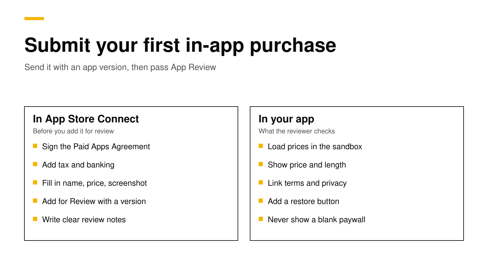

# How to submit your first in-app purchase for App Review

Your first in-app purchase does not go to App Review on its own. Apple says the first consumable, non-consumable, auto-renewable subscription and non-renewing subscription of each type "must be submitted with a new app version" ([Apple](https://developer.apple.com/help/app-store-connect/manage-submissions-to-app-review/submit-an-in-app-purchase)). If the app goes without its subscription, the reviewer sees a paywall with no prices and rejects it. The fix is to finish the product's metadata, sign the Paid Apps Agreement, and put the app version and the product in one submission.

This post is for builders shipping their first paid app, often with Flutter, React Native, Expo or an AI coding tool. It covers the product states, where the product goes in the submission, the common rejections, how the reviewer buys, and a checklist. Every fact about Apple and Google links its source and was checked on November 16, 2026.



## The short answer

- **Send the first one with an app version.** This covers the first item of each type and your first subscription group. Later items of an approved type can go alone ([Apple](https://developer.apple.com/help/app-store-connect/manage-submissions-to-app-review/submit-an-in-app-purchase)).
- **Finish the metadata first.** Add a display name, description, price, availability and review screenshot ([Apple](https://developer.apple.com/help/app-store-connect/reference/in-app-purchases-and-subscriptions/in-app-purchase-information)).
- **Sign the Paid Apps Agreement.** Apple says it must be active "in order for you to submit or update paid apps and In-App Purchases" ([Apple](https://developer.apple.com/help/app-store-connect/manage-agreements/sign-and-update-agreements)).
- **The reviewer buys in the sandbox.** Your release build and your server must accept sandbox purchases ([Apple](https://developer.apple.com/documentation/storekit/validating-receipts-with-the-app-store)).
- **Show price, length, terms and a restore button.** The common rejections cite guideline 2.1(b), 3.1.1 or 3.1.2 ([Apple](https://developer.apple.com/app-store/review/guidelines/)).

## Why the first purchase needs an app version

The first item of each type goes to review with a build, so the reviewer can see it inside the app. Your first subscription group must also go with a new app version, together with at least one of its subscriptions ([Apple](https://developer.apple.com/help/app-store-connect/manage-subscriptions/offer-auto-renewable-subscriptions)).

The rule is per type. After a monthly subscription is approved, a yearly plan can later go without a build. A first lifetime purchase, which is a non-consumable, needs a new app version again.

Our post on [products that fail to load](in-app-products-not-loading.md) covers why StoreKit returns an empty list while you test. This post covers getting the product approved with the build.

## The states your product moves through

The App Store Connect API lists the product states, including `MISSING_METADATA`, `READY_TO_SUBMIT`, `WAITING_FOR_REVIEW`, `DEVELOPER_ACTION_NEEDED` and `APPROVED` ([Apple](https://developer.apple.com/documentation/appstoreconnectapi/inapppurchasestate)). Apple's help page uses other labels for some, such as Prepare for Submission ([Apple](https://developer.apple.com/help/app-store-connect/reference/in-app-purchases-and-subscriptions/in-app-purchase-statuses)).

| State | What it means | What to do |
|---|---|---|
| Missing Metadata | Something required is empty | Add the display name, description, price, availability and review screenshot |
| Ready to Submit (Prepare for Submission) | The product is complete but not in a submission | Add it for review with the app version |
| Ready for Review | It is in a draft submission that has not been sent | Send the submission |
| Waiting for Review, In Review | Apple has it | Wait. You can edit only the reference name, price and availability ([Apple](https://developer.apple.com/help/app-store-connect/reference/in-app-purchases-and-subscriptions/in-app-purchase-statuses)) |
| Developer Action Needed, Rejected | Apple sent it back | Read the message, fix the item, and resubmit |
| Approved | It is live | Later items of this type can go without a build |

If the app version is rejected, a product in the same submission can show Accepted, and it "won't be approved until all items in the submission are accepted" ([Apple](https://developer.apple.com/help/app-store-connect/reference/in-app-purchases-and-subscriptions/in-app-purchase-statuses)).

## What Missing Metadata usually means

These are the fields first-timers skip ([Apple](https://developer.apple.com/help/app-store-connect/reference/in-app-purchases-and-subscriptions/in-app-purchase-information)):

1. **Display name and description.** You need them in at least one language. The display name is 2 to 30 characters, and the description is at most 45.
2. **Review screenshot.** It must clearly show what you sell, in one of the screenshot sizes your app supports. Only App Review sees it.
3. **Review notes.** Apple suggests test accounts and passwords, up to 4,000 characters.
4. **Price and availability.** Pick a price and at least one country or region. A subscription also needs a duration ([Apple](https://developer.apple.com/help/app-store-connect/manage-subscriptions/offer-auto-renewable-subscriptions)).

Then check the account. The Account Holder signs the Paid Apps Agreement under Business, Agreements ([Apple](https://developer.apple.com/help/app-store-connect/manage-agreements/sign-and-update-agreements)). To get paid, you also need banking information and tax forms, and every developer completes a US tax form ([Apple](https://developer.apple.com/help/app-store-connect/manage-tax-information/provide-tax-information)).

## Where the product goes in the submission

Older guides tell you to select the product in the In-App Purchases and Subscriptions section of the app version page. Apple's current help starts from the product instead ([Apple](https://developer.apple.com/help/app-store-connect/manage-submissions-to-app-review/submit-an-in-app-purchase)):

1. In Apps, open your app, and under Monetization open In-App Purchases or Subscriptions.
2. Open the product and click **Add for Review**.
3. Pick an existing draft submission or click **Create New Submission**.
4. If the product needs an app version, choose the platform and version. Add the subscription group too if it is not approved yet.
5. Check the list of items and click **Submit for Review**.

Developers report that the version page section is often missing. In one thread, an Expo developer could not find it and was rejected twice under guideline 2.1(b) ([Apple Developer Forums](https://developer.apple.com/forums/thread/829091)). In another, a developer removed the version from a rejected submission, and App Store Connect moved it into the draft that held the subscription ([Apple Developer Forums](https://developer.apple.com/forums/thread/841193)). That developer believes Apple changed this flow in July 2026, which Apple's pages do not confirm.

Developers also report that the section lists only products that are ready to submit, and that a rejected product moves to Developer Action Needed and drops off the list. If you cannot find your product, check its state, then use **Add for Review** on the product page.

## The rejections that catch first submissions

| Guideline | What it says, in short | The usual cause |
|---|---|---|
| 2.1(b) | In-app purchases must be "complete, up-to-date, visible to the reviewer and functional" | The product was not in the submission, or prices did not load in review |
| 3.1.1 | Paid features must use in-app purchase, and restorable purchases need a restore mechanism | A license key or code that opens paid content, or no Restore button |
| 3.1.2(a) | A subscription must give ongoing value and last at least seven days | A short or one-off item sold as a subscription |
| 3.1.2(c) | Before asking a customer to subscribe, say what they get for the price | Missing price, length or terms on the paywall |

Source for all rows: [Apple App Review Guidelines](https://developer.apple.com/app-store/review/guidelines/). Guideline 2.1(b) also says that if a configured item cannot be found or reviewed in your app, you should explain why in your review notes.

### Guideline 2.1(b): the reviewer found no products

Either the product was not in the submission, or the paywall loaded nothing during review. A blank paywall looks broken, so show an error with a retry button. This StoreKit 2 view also has the restore button that guideline 3.1.1 asks for.

```swift
import StoreKit
import SwiftUI

struct PaywallView: View {
    @State private var products: [Product] = []
    @State private var failed = false

    var body: some View {
        VStack(spacing: 12) {
            ForEach(products) { product in
                Button("\(product.displayName), \(product.displayPrice)") {
                    Task { _ = try? await product.purchase() }
                }
            }
            if failed {
                Text("Prices could not load. Check your connection and try again.")
                Button("Try again") { Task { await load() } }
            }
            Button("Restore purchases") { Task { try? await AppStore.sync() } }
        }
        .task { await load() }
    }

    func load() async {
        products = (try? await Product.products(for: ["pro_monthly", "pro_annual"])) ?? []
        failed = products.isEmpty
    }
}
```

`Product.products(for:)` leaves out IDs it cannot find and returns an empty list instead of an error ([Apple](https://developer.apple.com/documentation/storekit/product/products(for:))), which is why the empty case needs its own message.

### Guideline 3.1.2: what the paywall must show

Apple's subscription page says the sign-up screen needs the subscription's name and length, what the customer gets, the full renewal price, and a way to restore ([Apple](https://developer.apple.com/app-store/subscriptions/)). The billed amount must be the most prominent price, so a yearly plan shows the yearly total first. For a free trial, say how long it lasts and what is billed after. Your app and App Store metadata must also link to your Terms of Use and Privacy Policy.

See our posts on the [free trial toggle rejection](apple-free-trial-toggle-rejection.md) and on [restore purchases](restore-purchases-ios-android.md).

## How products load during review

The reviewer runs your release build, but purchases happen in Apple's sandbox. Apple's receipt guide says to use the sandbox "while your app is in review" and to retry against the sandbox when production answers with status `21007` ([Apple](https://developer.apple.com/documentation/storekit/validating-receipts-with-the-app-store)). That guide covers the older receipt API, but the lesson holds for any server:

- **Your server must accept sandbox purchases.** Otherwise the reviewer pays and gets nothing.
- **Your products must reach the sandbox.** Apple says metadata changes can take up to one hour to appear there ([Apple](https://developer.apple.com/help/app-store-connect/manage-in-app-purchases/create-consumable-or-non-consumable-in-app-purchases)).
- **TestFlight is the closest rehearsal.** Apps from TestFlight always run in the sandbox ([Apple](https://developer.apple.com/documentation/storekit/testing-in-app-purchases-with-sandbox)).

Our [testing guide](sandbox-testing-in-app-purchases.md) covers each test setup.

## Checklist before you press Submit

1. The Paid Apps Agreement is active, and tax and banking are complete.
2. Each product has a display name, description, price, availability and review screenshot.
3. Review notes say where the paywall is and give a demo account if the app needs a login.
4. The build asks for the exact product IDs in App Store Connect.
5. A TestFlight build loads prices, and a sandbox purchase grants access.
6. The paywall shows the name, length and full price, with the billed amount most prominent.
7. The paywall and settings have a Restore purchases button.
8. The paywall links to your Terms of Use and Privacy Policy.
9. The app version and the first product of each type, plus a new subscription group, are in one submission.

## Google Play works differently

Google's setup guide has no separate review step for products. It says you first publish a version of your app that includes the Play Billing Library, to any track, including the internal test track. Only then can you create and sell products ([Google](https://developer.android.com/google/play/billing/getting-ready)). You also need a linked payments profile, and a new testing track can take a few hours to reach testers ([Google](https://developer.android.com/google/play/billing/test)). For a cross-platform app, upload an internal test build early.

## Do it with RevenueDot

RevenueDot is an open-source backend for in-app purchases and subscriptions. It helps with the parts of review outside App Store Connect.

- **Build the paywall before Apple is ready.** The [Test Store](../docs/guides/test-store.md) loads products with a `test_` key before the agreement and products are done. Ship your `appl_` and `goog_` keys in the release build.
- **Use the store's own product IDs.** [Import products](../docs/guides/import-products.md) reads your products from App Store Connect and Google Play, so your offerings use the same IDs. The [App Store guide](../docs/guides/app-store.md) shows how to create a product from your catalog; you still add its price, screenshot and localizations in App Store Connect.
- **Sandbox purchases work in release builds.** RevenueDot takes the environment from Apple's signed transaction, so the reviewer's sandbox purchase grants access like a real one, while charts count only production by default ([Sandbox](../docs/concepts/sandbox.md)).
- **Paywalls with the required parts.** [Paywall](../docs/guides/paywalls.md) templates ask for your Terms and Privacy links, and the editor has a Restore purchases button.

New apps install the [RevenueDot SDK](../docs/sdks/README.md). Its code says `import RevenueCat` because it is built from RevenueCat's MIT-licensed SDK, and it needs no RevenueCat account. In React Native or Expo, the same empty check looks like this:

```ts
import Purchases from "react-native-purchases";

export async function loadPaywall() {
  const offerings = await Purchases.getOfferings();
  const packages = offerings.current?.availablePackages ?? [];
  if (packages.length === 0) return { error: "Prices could not load. Please try again." };
  return { packages: packages.map((p) => ({ id: p.identifier, price: p.product.priceString })) };
}

export async function restore() {
  const info = await Purchases.restorePurchases();
  return Object.keys(info.entitlements.active).length > 0;
}
```

Before launch, read the [going to production checklist](../docs/guides/going-to-production.md) and our [SwiftUI subscriptions tutorial](swiftui-subscriptions-tutorial.md).

**Switching from RevenueCat? Keep your SDK and change one line.** An app that ships the RevenueCat SDK can point its proxy URL at RevenueDot and keep its code, offerings and customers. See the [migration guide](https://revenuedot.app/migrate-from-revenuecat), the [comparison](https://revenuedot.app/compare) and the [tools](https://revenuedot.app/tools).

[Start for free on RevenueDot Cloud](https://app.revenuedot.app/signup). Building and testing are free, no card needed. Add a card when you go live; Pro costs $0 until your apps make $10,000 a month. See [pricing](https://revenuedot.app/pricing).

## FAQ

### Why does my first in-app purchase need a new app version?

Apple wants to review the first item of each type, and your first subscription group, inside a build. Later items of an approved type can go alone ([Apple](https://developer.apple.com/help/app-store-connect/manage-submissions-to-app-review/submit-an-in-app-purchase)).

### Why can't I find In-App Purchases and Subscriptions on the version page?

Developers report that it lists only products ready to submit, and some find it missing entirely ([Apple Developer Forums](https://developer.apple.com/forums/thread/829091)). Use **Add for Review** on the product page and pick the app version there ([Apple](https://developer.apple.com/help/app-store-connect/manage-submissions-to-app-review/submit-an-in-app-purchase)).

### What does guideline 2.1(b) mean for in-app purchases?

The reviewer could not find or use a product you configured. Apple asks that in-app purchases be complete, visible and functional, and that review notes explain any item the reviewer cannot find ([Apple](https://developer.apple.com/app-store/review/guidelines/)).

### Does App Review make real purchases?

No. Reviewers buy in the sandbox while the app is in review, so your build and server must accept sandbox purchases ([Apple](https://developer.apple.com/documentation/storekit/validating-receipts-with-the-app-store)).

### Do Google Play products need review?

Google's setup guide has no separate product review. You publish an app with the Play Billing Library to any track, then create products in Play Console ([Google](https://developer.android.com/google/play/billing/getting-ready)).

**About RevenueDot.** RevenueDot is an open-source (AGPL-3.0) backend for in-app purchases and subscriptions on the App Store, Google Play and the web. Start for free on [RevenueDot Cloud](https://app.revenuedot.app/signup): Pro costs $0 until your apps make $10,000 a month, then 0.5% of revenue above $10,000, never more than $999 a month. New apps install the [RevenueDot SDK](../docs/sdks/README.md) and pass their key. Apps that ship the RevenueCat SDK point its proxy URL at RevenueDot and keep their code, offerings and customers. Read the [quickstart](../docs/getting-started/quickstart.md) or the code on [GitHub](https://github.com/revenuedot/revenuedot).
