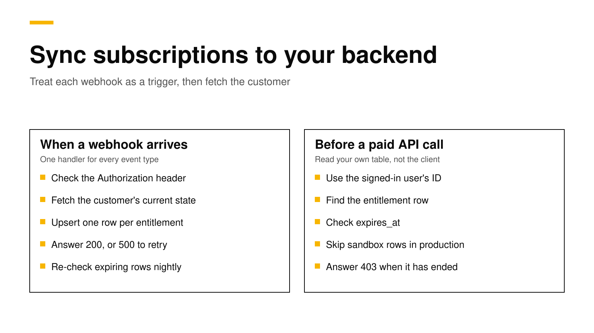

# How to sync subscription status to your own backend

To sync subscription status to your own backend, use the same user ID in the app and on the server, and let a webhook tell your server when something changed. Do not write separate logic for each event type. When any webhook arrives, check its authorization header, fetch that customer's current state with one REST call, and save it in a table that your API reads before every paid call. A nightly job then re-checks the rows that are about to expire, in case a webhook never arrived.

This post is for Flutter, React Native and Expo apps that sell on the App Store and Google Play and have their own backend on Firebase, Supabase or Node.js. It covers the three signals, a Node.js webhook receiver and a SQL table. Every fact about RevenueCat links its source and was checked on November 16, 2026.



## The short answer

- **Do not trust the app for server features.** Your API should check its own database before it spends money on an AI call.
- **Use one user ID everywhere.** Call `logIn` with your Firebase `uid` or Supabase user `id`, so webhooks name the same person your API sees.
- **Treat every webhook as a trigger.** Check the `Authorization` header, then fetch the customer with `GET /v1/subscribers/{app_user_id}` and save what it says.
- **Answer 200 only when you saved it.** Any other answer makes the sender try again later.
- **Run a reconciliation job.** Once a day, re-fetch customers whose access ends soon or just ended.
- **Store sandbox and production apart.** Only production rows should grant access in your live API.

## Why the app alone is not enough

The purchases SDK tells your app whether the customer has an active entitlement. That is the right place to decide whether to show a paywall, but not whether your server should run an expensive request. Anything the app sends can be changed by the person holding the phone, so a flag like `isPro: true` in a request body proves nothing. Many changes also happen while the app is closed, such as a renewal at night, a refund or a failed card. And some backend work runs with no app in the loop, such as a weekly report for paying users. So the server needs its own copy of the truth. The app is still useful as a fast path: after a purchase, it can ask your API to "check me now", and the server fetches the state itself.

## The three signals your server can use

| Signal | What it tells you | When it fires | Weakness |
|---|---|---|---|
| Webhook | Something changed for this customer | Seconds after the change, usually | Can repeat, arrive late or arrive out of order |
| REST lookup per customer | The customer's full current state | Whenever you call it | You have to know when to call it |
| Reconciliation job | Rows that drifted from the truth | On your schedule, for example nightly | Slow, so it is a safety net and not the main path |

The webhook answers "when", the lookup answers "what", and the job catches what the other two missed.

## Treat the webhook as a trigger, not as the data

The tempting design is a big `switch` on the event type: add access on `INITIAL_PURCHASE`, extend it on `RENEWAL`, remove it on `EXPIRATION`. It breaks in quiet ways. You must get upgrades, refunds, pauses and transfers right, a late event can undo a newer one, and a missed event leaves the row wrong forever.

The better design uses the event only as a signal. When any webhook arrives, read the user ID from it, fetch that customer's current state, and overwrite your row. A repeated event writes the same row again, a late event still writes today's state, and a new event type still works.

This is not our idea. RevenueCat's webhook docs suggest calling `GET /subscribers` after every webhook instead of writing logic per event type ([RevenueCat](https://www.revenuecat.com/docs/integrations/webhooks)), and a RevenueCat staff member gave a Flutter developer the same advice in their community forum ([RevenueCat community](https://community.revenuecat.com/general-questions-7/syncing-backend-with-user-s-iap-subscription-status-in-flutter-projec-3507)). The same docs set the other rules a receiver must follow: check the authorization header on every request, answer with a 200 because any other status counts as a failure, answer within 60 seconds, and expect up to five retries spread over about 80 minutes.

## Use the same user ID in the app and on the server

Webhooks and lookups use the app user ID. Your server cannot match the SDK's anonymous ID, which starts with `$RCAnonymousID:`, to a user, so call `logIn` with your own ID as soon as the customer signs in.

```dart
// Flutter (purchases_flutter), after Firebase sign-in
final user = FirebaseAuth.instance.currentUser!;
final result = await Purchases.logIn(user.uid);
```

```ts
// React Native or Expo (react-native-purchases), after Supabase sign-in
const { data: { user } } = await supabase.auth.getUser();
const { customerInfo } = await Purchases.logIn(user!.id);
```

When an anonymous customer who already bought something calls `logIn`, the purchase follows them to the new ID; the rules are in [customers and app user IDs](../docs/concepts/customers-and-app-user-ids.md). Use an ID that cannot be guessed, such as a database ID, rather than an email address. The same ID on every platform also lets one subscription work on iOS, Android and the web, as our post on [sharing a subscription across platforms](share-subscription-across-ios-android-web.md) shows.

## What to store

Store one row per user and entitlement, not one row per event, because your API only asks whether this user has this entitlement right now.

```sql
create table entitlements (
  app_user_id  text        not null,
  entitlement  text        not null,             -- for example 'pro'
  product_id   text        not null,             -- the store product that gives it
  store        text,                             -- app_store, play_store, stripe ...
  environment  text        not null check (environment in ('sandbox', 'production')),
  expires_at   timestamptz,                      -- null means lifetime access
  synced_at    timestamptz not null,             -- server time of the lookup
  primary key (app_user_id, entitlement)
);
```

Your code checks `entitlement`, so you can change products without touching your API. `expires_at` lets the API decide without a network call. `store` and `product_id` tell support where the customer bought. `environment` keeps a tester's sandbox purchase from granting access to a live account, and `synced_at` stops a slow lookup from overwriting a newer one.

The check in your API is then one query:

```sql
select 1 from entitlements
where app_user_id = $1 and entitlement = 'pro' and environment = 'production'
  and (expires_at is null or expires_at > now());
```

An app that sells credits needs a ledger instead, as our post on [selling credits](sell-credits-in-app-purchases.md) shows.

## A Node.js webhook receiver

This receiver uses Express and `pg`. It checks the `Authorization` header, fetches each changed customer with a secret key that stays on your server, and upserts their rows.

```js
import express from "express";
import { timingSafeEqual } from "node:crypto";
import pg from "pg";

const db = new pg.Pool({ connectionString: process.env.DATABASE_URL });
const API = process.env.PURCHASES_API_URL; // https://api.revenuedot.app on RevenueDot Cloud
const app = express();

function authorized(req) {
  const got = Buffer.from(req.get("Authorization") ?? "");
  const want = Buffer.from(process.env.WEBHOOK_AUTHORIZATION);
  return got.length === want.length && timingSafeEqual(got, want);
}

app.post("/webhooks/purchases", express.json(), async (req, res) => {
  if (!authorized(req)) return res.sendStatus(401);
  const { event } = req.body;
  // A TRANSFER names two customers; every other type names one.
  const ids = event.type === "TRANSFER"
    ? [...event.transferred_from, ...event.transferred_to]
    : [event.app_user_id];
  try {
    for (const id of ids) await syncCustomer(id);
    res.sendStatus(200); // only 200 counts as delivered
  } catch (err) {
    console.error(err);
    res.sendStatus(500); // the sender retries later
  }
});

export async function syncCustomer(appUserId) {
  const r = await fetch(`${API}/v1/subscribers/${encodeURIComponent(appUserId)}`, {
    headers: { Authorization: `Bearer ${process.env.SECRET_KEY}` },
  });
  if (!r.ok) throw new Error(`lookup failed with ${r.status}`);
  const { request_date_ms, subscriber } = await r.json();
  const names = Object.keys(subscriber.entitlements);
  for (const name of names) {
    const e = subscriber.entitlements[name];
    const sub = subscriber.subscriptions[e.product_identifier]
      ?? subscriber.non_subscriptions[e.product_identifier]?.at(-1);
    await db.query(
      `insert into entitlements as t
         (app_user_id, entitlement, product_id, store, environment, expires_at, synced_at)
       values ($1, $2, $3, $4, $5, $6, to_timestamp($7 / 1000.0))
       on conflict (app_user_id, entitlement) do update set
         product_id = excluded.product_id, store = excluded.store,
         environment = excluded.environment, expires_at = excluded.expires_at,
         synced_at = excluded.synced_at
       where t.synced_at <= excluded.synced_at`,
      [appUserId, name, e.product_identifier, sub?.store ?? null,
       sub?.is_sandbox ? "sandbox" : "production", e.expires_date, request_date_ms],
    );
  }
  // An entitlement that is gone from the answer, for example after a transfer, is gone here too.
  await db.query(
    "delete from entitlements where app_user_id = $1 and not (entitlement = any($2))",
    [appUserId, names],
  );
}

app.listen(3000);
```

The answer lists entitlements even after they expire, so an expired subscription writes an old `expires_at` and the check above denies it. The fetch runs before the 200, so if your database is down, the 500 makes the sender retry. Keep the handler well under the 60-second timeout; if your work is slow, save the event, answer 200, and process it in a queue. On Firebase the same code fits an HTTPS Cloud Function, and on Supabase an Edge Function.

## Idempotency and ordering

Webhooks are delivered at least once, so the same event can arrive twice, and delivery order is not guaranteed ([webhooks](../docs/guides/webhooks.md#4-retries-and-delivery-guarantees)). The fetch-and-overwrite design is safe against repeats, because writing the same state twice changes nothing; saving each `event.id` and skipping repeats only saves a lookup. Order is the bigger risk. If your code acts on what each event says, an old `EXPIRATION` that arrives after a newer `RENEWAL` locks out a paying customer. With the handler above, the late event only triggers one more lookup, and the lookup returns the truth.

## The reconciliation job

A webhook can still be lost, for example when your server is down for longer than the retries last. A small daily job closes that gap by re-fetching every row whose `expires_at` falls near now, because those rows are the most likely to change.

```js
// Run once a day, for example with a cron trigger or a scheduled function.
const { rows } = await db.query(
  `select distinct app_user_id from entitlements
   where expires_at between now() - interval '3 days' and now() + interval '1 day'`,
);
for (const { app_user_id } of rows) await syncCustomer(app_user_id);
```

A customer who bought while every webhook failed is not in your table yet, so also run `syncCustomer` when the app calls your API after a purchase or restore. For a full rebuild, REST API v2 can [list every customer](../api/rest-v2.md#list-or-search-customers) in pages.

## Do it with RevenueDot

RevenueDot is an open-source backend for in-app purchases and subscriptions on the App Store, Google Play and the web. It sends webhooks in RevenueCat's format, so the receiver above works as written. Here is what its docs describe:

- **Two kinds of proof.** Add a webhook in **Integrations → Webhooks** or with the API. It can send an `authorization_header` exactly as you typed it, and every delivery also carries an `X-RevenueCat-Webhook-Signature` header: an HMAC-SHA256 of the raw body, signed with a `whsec_...` secret that is shown once. The HMAC is the stronger check because it proves the body was not changed; read the body with `express.raw()` to verify it. The [webhooks guide](../docs/guides/webhooks.md#3-verify-the-signature) has the code, and there is a [runnable receiver](https://github.com/revenuedot/examples/tree/main/backend/node-express-webhook).
- **Clear retry rules.** Only HTTP 200 counts. Each attempt waits up to 60 seconds, and a failure is retried after 5, 10, 20, 40 and 80 minutes. The dashboard shows every attempt and your server's answer, with a Retry button.
- **Filters.** Set `environment` to `production` or `sandbox`, or leave it empty for both, and use `app_id` for one app's events.
- **A documented event list.** RevenueDot sends 19 of RevenueCat's 21 event types, each with its own page under [webhook events](../docs/webhooks/README.md); every field is in [which webhook events RevenueDot sends](../api/webhook-events.md).
- **The customer lookup.** `GET /v1/subscribers/{app_user_id}` with a secret key returns entitlements, subscriptions and one-time purchases ([SDK endpoints](../api/sdk-endpoints.md)). It creates the customer when the ID is new, so do not call it with made-up IDs. REST API v2 also lists [a customer's active entitlements](../api/rest-v2.md#list-a-customers-active-entitlements); [authentication](../api/authentication.md) explains secret keys.
- **Test events.** **Send test event** delivers a signed `TEST` event, and the [Test Store](../docs/guides/test-store.md) creates renewals, cancellations and refunds that fire real webhooks.

To be clear about where this stands: a real App Store sandbox purchase has run end to end against RevenueDot Cloud on a physical iPhone, but no real Google Play purchase has yet; Google Play handling is tested against a copy of Google's API. If [webhooks are not arriving](../docs/help/webhooks-not-arriving.md), that page lists common causes.

New apps install the [RevenueDot SDK](../docs/sdks/README.md). Its code says `import RevenueCat` because it is built from RevenueCat's MIT-licensed SDK, and it needs no RevenueCat account. Our [Flutter](flutter-in-app-purchases-tutorial.md) and [React Native and Expo](react-native-expo-subscriptions-tutorial.md) tutorials set up the app side, and [server-side receipt validation](server-side-receipt-validation.md) explains what the backend does with the stores.

**Switching from RevenueCat? Keep your SDK and change one line.** An app that ships the RevenueCat SDK points its proxy URL at RevenueDot and keeps its code, offerings and customers. Your webhook handler stays too, because RevenueDot uses RevenueCat's payload shape and the same `GET /v1/subscribers` path. Webhooks are not imported. During the [dual run](../docs/migrate/dual-run.md), keep acting on RevenueCat's webhooks and point any RevenueDot webhook at an endpoint that only logs. At cutover, create your webhooks in RevenueDot, save each signing secret, and turn off RevenueCat's in the same hour ([cutover checklist](../docs/migrate/cutover-checklist.md)). See [migrating without data loss](migrating-from-revenuecat-without-data-loss.md), the [comparison](https://revenuedot.app/compare/revenuedot-vs-revenuecat) and the [fee calculator](https://revenuedot.app/tools/revenuecat-fee-calculator). RevenueCat is free under $2,500 of monthly tracked revenue and then charges 1% of all of it ([RevenueCat](https://www.revenuecat.com/pricing)).

[Start for free on RevenueDot Cloud](https://app.revenuedot.app/signup). Building and testing are free, no card needed. Add a card when you go live; Pro costs $0 until your apps make $10,000 a month. See [pricing](https://revenuedot.app/pricing).

## FAQ

### Can I just send the subscription status from my Flutter app to my backend?

Send it as a hint, but do not trust it. Anyone can change a request from their own phone, and renewals and refunds happen while the app is closed. Let the app ask your server to re-check, and have the server fetch the state itself.

### Should I write a handler for each webhook event type?

No. Treat every event as a sign that the customer changed, fetch the customer's current state, and save it. RevenueCat's docs suggest the same approach ([RevenueCat](https://www.revenuecat.com/docs/integrations/webhooks)). It handles repeats, late events and new event types with no extra code.

### How do I keep sandbox purchases out of my production database?

Store the environment on every row, and let only production rows grant access in your live API. On RevenueDot you can also give a webhook `environment: "production"`, and send sandbox events to a staging server with a second webhook.

### Do I still need a cron job if I have webhooks?

Yes, a small one. Retries stop after about 80 minutes, so a long outage on your side can lose a webhook. A daily job that re-fetches customers whose access ends soon or just ended fixes rows that drifted.

**About RevenueDot.** RevenueDot is an open-source (AGPL-3.0) backend for in-app purchases and subscriptions on the App Store, Google Play and the web. Start for free on [RevenueDot Cloud](https://app.revenuedot.app/signup): Pro costs $0 until your apps make $10,000 a month, then 0.5% of revenue above $10,000, never more than $999 a month. New apps install the [RevenueDot SDK](../docs/sdks/README.md) and pass their key. Apps that ship the RevenueCat SDK point its proxy URL at RevenueDot and keep their code, offerings and customers. Read the [quickstart](../docs/getting-started/quickstart.md) or the code on [GitHub](https://github.com/revenuedot/revenuedot).
